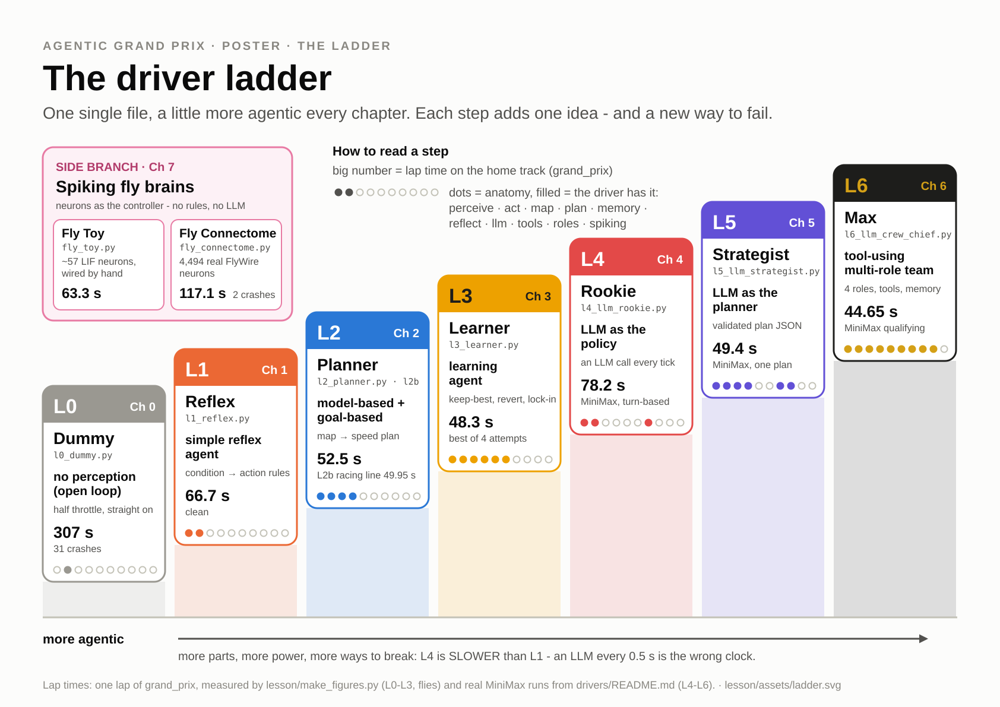
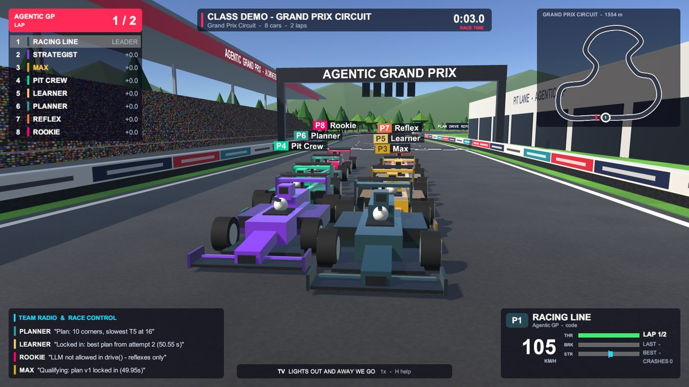

# Agentic Grand Prix 2.0

[](https://github.com/GenomZ/race-mini-comp/actions/workflows/tests.yml)

**A 2-day bootcamp lesson on AI agents, run as a racing championship.** Each student writes **one Python
file**: an AI driver for a deterministic 2D racing simulator. Chapter by chapter that file becomes more
"agentic": reflexes, then a map and a plan, then learning from practice laps, then a MiniMax LLM as
strategist and race engineer. On the last afternoon every student's car races in a **Grand Prix** against
**Max**, the house LLM racer, shown live in Streamlit and in a 3D broadcast viewer.

- **You write:** `drive(obs) -> (throttle, steering)`, later `plan(track)` and `reflect(report)`.
- **The runner does the rest:** physics, clocks, rules, crashes, replays and standings. Your file never
  touches the simulator, so every car is judged the same way.
- **What you learn:** agent types (Russell & Norvig), the **Three Clocks** (where an LLM belongs),
  calling an LLM robustly (JSON, validation, fallback, budgets), Streamlit, and evaluating an agent like a
  data scientist (validation tracks, overfitting, a sealed mystery track).

[](lesson/assets/ladder.svg)

*The ladder: one file, a little more agentic every chapter. Lap times are measured on the home track
(`grand_prix`). Max's 44.65 s is one real-MiniMax run ([drivers/README.md](drivers/README.md); LLM runs
vary, 44.65-45.75 s there and 44.90 s in CALIBRATION.md). Click the poster for the full-size SVG.*



*The finale as the class sees it: `races/demo/class_demo.json` in the Unity 3D viewer, with the timing
tower, team radio and mini-map.*

---

## Quickstart

You need **Python 3.11 or newer** (the course pins 3.12) and git. Clone to a **short local path** such as
`C:\code` or `~/code`. Do not use a OneDrive or iCloud folder.

### Option A: uv (recommended)

[uv](https://docs.astral.sh/uv/) installs the right Python and the exact package versions from `uv.lock`.
These commands are the same in PowerShell and in the macOS Terminal:

```bash
git clone https://github.com/GenomZ/race-mini-comp.git
cd race-mini-comp
uv sync
uv run race.py doctor
uv run race.py drive drivers/examples/l2_planner.py --replay races/l2.json
uv run race.py watch races/l2.json --html
uv run streamlit run app/race_control.py
```

- **`doctor`:** you should see a list of `[OK  ]` lines and a last line that starts with `ALL GREEN` or
  `OK with N warning(s)` and says `report written to doctor_report.txt`. A `[WARN]` "key not set" is
  expected: you get the key on Day 2. A `[WARN]` "spaces in the path" (a user folder like
  `C:\Users\Ada Lovelace`) is harmless too.
- **`drive`:** you should see `Attempt 1: FINISHED 52.50 s | laps [52.50] | crashes 0`. The simulator is
  deterministic, so you get exactly this number.
- **`watch --html`:** your browser opens a replay player for that lap.
- **`streamlit run`:** **Race Control** opens at http://localhost:8501. Stop it with **Ctrl+C**.

### Option B: pip and a virtual environment

**Windows (PowerShell):**

```powershell
git clone https://github.com/GenomZ/race-mini-comp.git
cd race-mini-comp
py -3.12 -m venv .venv            # any Python 3.11+ works; `py -0` lists yours
.venv\Scripts\activate
python -m pip install -r requirements.txt
python race.py doctor
```

**macOS (Terminal):**

```bash
git clone https://github.com/GenomZ/race-mini-comp.git
cd race-mini-comp
python3.12 -m venv .venv
source .venv/bin/activate
python -m pip install -r requirements.txt
python race.py doctor
```

Once the venv is active, every command in the lesson is written as `python race.py ...` and
`python -m streamlit run ...`. With uv you can write `uv run race.py ...` and `uv run streamlit run ...`
instead.

> **PowerShell says "running scripts is disabled"?** Run
> `Set-ExecutionPolicy -Scope CurrentUser RemoteSigned` once, or skip activation and call
> `.venv\Scripts\python race.py doctor` directly.

**Day 2 (LLM chapters):** copy `.env.example` to `.env` (PowerShell: `Copy-Item .env.example .env`, macOS:
`cp .env.example .env`). Paste the key your instructor gives you, then run `python race.py doctor --llm`.
`.env` is git-ignored: never commit it and never paste the key into a driver file. No key? Every LLM
driver still runs offline with the mock provider (`LLM_PROVIDER=mock`).

---

## Four ways to watch a race

Every race command can write a **replay JSON**. All viewers read that same file.

| # | Viewer | Command | What you get |
|---|---|---|---|
| 1 | **Plot** (PNG) | `python race.py drive drivers/examples/l2_planner.py --plot races/l2.png` | A matplotlib picture of the best attempt: the line, speed and crashes. |
| 2 | **Standalone HTML player** | `python race.py watch races/demo/class_demo.json --html` | One `.html` file that plays in any browser (works offline, easy to share). `drive` and `grand-prix` also take `--html FILE`. |
| 3 | **Streamlit Race Control** | `python -m streamlit run app/race_control.py`, then the **Replay** page | A multi-car player with timing tower, radio feed and the official classification. Other pages show live driving, Sensor X-ray, Physics Lab, Telemetry, Learning Curves, Latency Lab, Pit Wall (LLM trace) and Fly Lab. |
| 4 | **Unity 3D broadcast** (Windows) | `python race.py watch races/demo/class_demo.json --unity` | A TV-style 3D race with start lights, chase cameras and a podium. The instructor builds it once; see [unity/README.md](unity/README.md). |

`python race.py watch <replay.json>` with no option prints the classification in the terminal. A
precomputed demo race is already in the repo: [`races/demo/html/class_demo.html`](races/demo/html/class_demo.html).

---

## Lesson map

Your file is `drivers/submissions/<handle>.py` (`<handle>` = your handle, lower case, no spaces; the
Day-1 chapters use the example handle `ada`). Start with **[lesson/README.md](lesson/README.md)** (agenda,
rules and how to get unstuck) and keep the
**[cheat sheet](lesson/cheatsheet.md)** open. Bands are measured on `grand_prix` (see
[CALIBRATION.md](lesson/instructor/CALIBRATION.md)).

| Day | Chapter | Agent type | Reference driver | Handrail (catch-up file) | Checkpoint |
|---|---|---|---|---|---|
| 1 | [Ch0 Pit Lane](lesson/00_pit_lane.md) | environment vs agent | `examples/l0_dummy.py` | `ch0_pit_lane.py` | CP0: `check` PASSED, your car in the viewer (template: 85.85 s) |
| 1 | [Ch1 Reflexes](lesson/01_reflexes.md) | simple reflex | `examples/l1_reflex.py` | `ch1_reflex.py` | CP1: 60-80 s, clean |
| 1 | [Ch2 The Map](lesson/02_the_map.md) | model-based, goal-based | `examples/l2_planner.py`, `l2b_racing_line.py` | `ch2_planner.py` | CP2: 48-55 s, clean on every public **and** random track |
| 1 | [Streamlit block](lesson/streamlit_block.md) (S01-S10) | - | [streamlit_lessons/](streamlit_lessons/README.md) | `streamlit_lessons/solutions/` | your own replay viewer + learning-curve page |
| 1 | [Ch3 Practice Makes Perfect](lesson/03_practice.md) | learning agent | `examples/l3_learner.py` | `ch3_learner.py` | CP3: at least 3 % faster over 6 attempts on `sprint` |
| 2 | [Ch4 Talking to MiniMax](lesson/04_minimax.md) | LLM as the policy | `examples/l4_llm_rookie.py` | `ch4_pilot.py` | CP4: exam table + latency p50/p95 (never raced) |
| 2 | [Ch5 The Strategist](lesson/05_strategist.md) | LLM planner | `examples/l5_llm_strategist.py` | `ch5_strategist.py` | CP5: within 5 % of your Ch3, 0 zone violations |
| 2 | [Ch6 The Crew Chief](lesson/06_crew_chief.md) | tool-using, multi-role | `examples/l6_llm_crew_chief.py` (Max) | `ch6_crew_chief.py` | CP6: 4 clean attempts on a `random:<seed>` track, best about level with your Ch3 car or better |
| 2 | [Ch7 Fly Brains](lesson/07_fly_brains.md) | spiking neurons | `examples/fly_toy.py`, `fly_connectome.py` | `ch7_fly_fixed.py` | CP7: the fixed fly finishes; scrambled wiring fails |
| 2 | [Ch8 Garage and Grand Prix](lesson/08_garage_gp.md) | your final file | - | `ch6_crew_chief.py` | `check` green, clean on public tracks, finishes with the mock LLM |

Reference drivers are in [`drivers/examples/`](drivers/README.md). Handrails are in
[`lesson/checkpoints/`](lesson/checkpoints/).

---

## Repo layout

```text
race.py                 the command line: drive | check | validate | exam | grand-prix | final | watch |
                        tracks | leaderboard | doctor | llm-check     (python race.py <command> --help)
agentic_gp/
  sim/                  the simulator: physics, tracks (+ random:<seed>), crash rules, zones
  driver.py             the driver protocol + OBS_FIELDS / TRACK_FIELDS / REPORT_FIELDS
  driverkit.py          optional helpers for drivers: steer_towards, speed_profile, PathFollower, ...
  llm.py                MiniMax-first LLM helper: chat, chat_json, ask_with_tools; mock and replay providers
  race/                 the runner: loader + scrutineering, sessions, replays, grand prix, leaderboard
  viz/                  matplotlib figures, the HTML player, plotly figures, the Unity bridge
  fly/                  fruit-fly brains: LIF simulator, FlyWire connectome circuit
drivers/
  template.py           where your driver starts
  examples/             the ladder: l0_dummy ... l6_llm_crew_chief (Max), l6b_pit_crew_langgraph, fly_*
  submissions/          your one file goes here
lesson/                 the course: chapters, cheat sheet, checkpoints/ (handrails), assets/ (posters and
                        figures, rebuilt by make_figures.py), instructor/
streamlit_lessons/      the 2-hour Streamlit block: s01 ... s10 + solutions/
app/                    Race Control, the Streamlit app used all course long (views/ = its pages)
unity/                  Unity 6 3D broadcast viewer (RaceViewer/) + build script + replay tools
races/demo/             precomputed demo races, replays, exam states and LLM logs
results/                one JSON per driver and track -> LEADERBOARD.md
docs/                   architecture and the documentation index
tests/                  pytest (the LLM is mocked; live tests are opt-in)
```

`data/` (the fly circuit) is not in git because of its licence; the instructor builds it (see below).

---

## For instructors

- [lesson/instructor/HOWTO.md](lesson/instructor/HOWTO.md): the one-page quick reference (setup, Race
  Control + the 2-hour Streamlit tutorial, the Unity finale, the final Grand Prix with Max).
- [lesson/instructor/instructor_guide.md](lesson/instructor/instructor_guide.md): prep checklist, key
  hygiene for the shared MiniMax key, fly data, Unity build, troubleshooting.
- [lesson/instructor/RUN_OF_SHOW.md](lesson/instructor/RUN_OF_SHOW.md): minute by minute for both days,
  with the exact commands for snapshots, the Club Race and the finale.
- [lesson/instructor/CALIBRATION.md](lesson/instructor/CALIBRATION.md): every measured lap time and
  checkpoint band. Re-measure with `python lesson/instructor/calibrate.py`.
- [lesson/instructor/awards.md](lesson/instructor/awards.md) and `lesson/instructor/grade.py`: awards and
  the optional autograder.
- [lesson/cassettes/README.md](lesson/cassettes/README.md): record LLM answers before class, replay them
  offline.
- [streamlit_lessons/README.md](streamlit_lessons/README.md) (Part A): the Streamlit block run sheet.
- [unity/README.md](unity/README.md): build the 3D viewer and drive the broadcast from the keyboard.
- [docs/README.md](docs/README.md): index of all documentation, including
  [docs/ARCHITECTURE.md](docs/ARCHITECTURE.md).

Run the tests with `python -m pytest -q` (the LLM is mocked). `python race.py doctor --llm` makes one real
LLM call; `python race.py llm-check --load 10` load-tests the shared key.

---

## Credits and licences

- **Code:** MIT licence (see `pyproject.toml`), written for this course.
- **Fly connectome data (Ch7 part B):** `data/fly/steering_circuit_783.*` is **derived from FlyWire**
  (FAFB public release v783) by the FlyWire Consortium and is licensed
  **[CC BY-NC 4.0](https://creativecommons.org/licenses/by-nc/4.0/): non-commercial use only**. The MIT
  licence covers the code, not this data. It is not in git: the instructor builds it with
  `python -m agentic_gp.fly.extract`. The spiking model re-implements Shiu et al. 2024. Please cite
  Dorkenwald et al. 2024 and Schlegel et al. 2024 (*Nature* 634). Read
  [agentic_gp/fly/ATTRIBUTION.md](agentic_gp/fly/ATTRIBUTION.md) for the full citations, the honesty
  statement and the rules for paid events before you show it.
- **LLM:** [MiniMax](https://www.minimax.io/) M3 through its OpenAI-compatible API (a paid key, not
  included). Any OpenAI-compatible provider works as a backup (`.env.example`).
- **Libraries:** NumPy, SciPy, pandas, Matplotlib, Plotly, Streamlit, the OpenAI Python SDK, LangGraph and
  LangChain. The 3D viewer is built with Unity 6, under Unity's own licence terms.
- **Ideas:** the agent types follow Russell & Norvig, *Artificial Intelligence: A Modern Approach*. The toy
  fly borrows from Braitenberg's *Vehicles*. Max's lessons notebook is inspired by Reflexion (Shinn et
  al. 2023).
