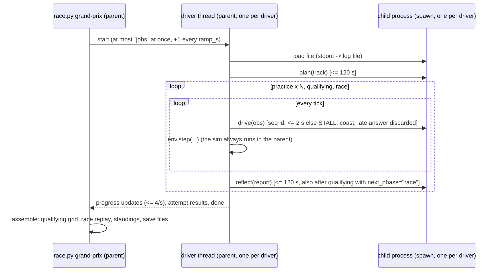

# Agentic Grand Prix - Architecture

A deterministic 2D racing gym for **single-file AI drivers**. Students write one `.py` file that answers
"what do I do now?"; the runner owns the simulation, the clocks, the rules and the replays.
One JSON replay format feeds every viewer (Streamlit, the standalone HTML player, Unity 3D).

Principles:

1. **One file = one driver.** A driver gets plain dicts and returns plain tuples or dicts. It never
   imports `agentic_gp.sim`, `agentic_gp.race`, `agentic_gp.cli` or `agentic_gp.viz`.
2. **The sim is deterministic.** The same decisions always produce the same lap. Only LLM drivers and
   realtime mode add randomness.
3. **The replay JSON is the single contract** between the runner and every viewer.
4. **Teaching-first code.** Small functions, docstrings that explain *why*, dataclasses and type hints.
5. **Cross-platform.** Child processes use `spawn` with importable targets, so everything works on Windows.

## 1. Module map

```
race.py                        3-line wrapper -> agentic_gp.cli.main()   (also: python -m agentic_gp)
agentic_gp/
  __init__.py                  RaceEnv, PhysicsConfig, Track, TRACKS, make_track, load_driver,
                               run_session, SessionConfig, run_grand_prix, GrandPrixConfig, Replay
  cli.py                       drive | check | validate | exam | grand-prix | final | watch | tracks |
                               leaderboard | doctor [--llm] | llm-check [--load]
  sim/                         THE SIMULATION (drivers never import it)
    config.py                  PhysicsConfig: grip, brakes, tick 0.5 s, crash_rule, penalties, max_ticks/lap
    geometry.py                ray casting, segment intersection, polyline helpers (vectorised numpy)
    physics.py                 bicycle-ish car model: integrate(state, throttle, steering)
    track.py                   Track, Zone, TRACKS registry, random:<seed>, track files, to_map(), briefing
    env.py                     RaceEnv: one car, multi-lap, sensors, crash rules, zones, traces
  driver.py                    the driver protocol: Action, normalize_action, Driver base class,
                               OBS_FIELDS / TRACK_FIELDS / REPORT_FIELDS (single source of truth for docs/apps)
  driverkit.py                 OPTIONAL helpers a driver may import: speed_profile, PathFollower,
                               racing_line, track_brief, summarize_report, ... (no sim imports)
  llm.py                       MiniMax-first LLM helper: chat, chat_json, ask_with_tools, policy, mock/replay
  race/                        THE RUNNER
    loader.py                  load_driver (fresh module per load), check_driver_source (AST whitelist),
                               IsolatedDriver (child process proxy with timeouts)
    session.py                 SessionConfig, iter_session/run_session, AttemptReport, SessionResult
    replay.py                  replay schema v1 dataclasses, builders, validation, standings_at, car_state_at
    grand_prix.py              many drivers: plan -> practice -> qualifying -> race, merged replays
    leaderboard.py             results/*.json -> LEADERBOARD.md, GP standings, championship points
  viz/
    mpl.py                     static matplotlib figures (track, attempt, session, replay, telemetry)
    unity.py                   bridge to the Unity viewer: find_viewer, install_replay, launch_viewer
    player.py, plotly_figs.py  HTML/JS replay player and plotly figures (app team)
  fly/                         fruit-fly connectome brain helpers (fly team)
drivers/examples/              the ladder: l0_dummy, l1_reflex, l2_planner, ... l6_llm_crew_chief (Max)
drivers/submissions/           students drop their single file here
app/, streamlit_lessons/       Streamlit "Race Control" app and the 2-hour Streamlit block
unity/RaceViewer/              Unity 6 3D broadcast viewer (reads replay JSON only)
races/                         grand prix output (gitignored except races/demo/)
tests/                         pytest; tests/conftest.py forces LLM_PROVIDER=mock
```

The dependency direction is strict: `sim` imports nothing from the rest of the package. `race`
imports `sim`, `driver` and `llm`. `cli` and `viz` sit on top. A driver file can only reach
`driverkit`, `llm` and `fly`, and `check_driver_source` enforces that.

## 2. Data flow

```mermaid
flowchart LR
    subgraph DRV["Driver file (student)"]
        P[plan&#40;track&#41;] --> D[drive&#40;obs&#41;]
        D --> R[reflect&#40;report&#41;]
        R -. memory .-> D
    end
    T[Track / TRACKS / random:seed / file] -->|to_map + physics + briefing| P
    subgraph RUN["Runner (agentic_gp.race)"]
        S[iter_session] -->|obs dict| D
        D -->|"Action: throttle, steering, say, debug"| S
        S -->|step| E[RaceEnv]
        E -->|frames, crashes, laps| S
        S -->|AttemptReport.to_reflect_dict| R
        S --> SR[SessionResult]
        GP[run_grand_prix] -->|one session per driver| S
    end
    SR -->|to_replay| J[(replay JSON v1)]
    GP -->|race + qualifying replays| J
    SR -->|to_result_dict| RES[(results/*.json)] --> LB[LEADERBOARD.md]
    J --> ST[Streamlit app]
    J --> H[HTML player]
    J --> U[Unity 3D viewer]
    D -. optional .-> L[agentic_gp.llm] -->|policy + budget| M[MiniMax / mock / replay]
```



One session works like this:

1. `track_map = env.track_map()`, then `driver.plan(track_map)` is called once.
2. For each attempt, `env.reset(laps)` runs, then `action = driver.drive(obs)` and
   `obs = env.step(...)` repeat until `attempt_over`.
3. The runner builds an `AttemptReport` and calls `driver.reflect(report)`. The **same** driver
   instance then runs the next attempt, so memory carries over within a session.

Exceptions never stop a session:

- a failing `drive()` coasts for that tick and is recorded;
- a failing `plan()` or `reflect()` is recorded in the result.

## 3. Driver protocol (`agentic_gp/driver.py`)

```python
NAME = "Rocket"; AUTHOR = "ada"; COLOR = "#e63946"; KIND = "code"      # code | llm | fly | human | other
MOTTO = "..."; ANATOMY = ["perceive", "act", "map", "plan"]; PARAMS = {"aggression": 1.0}

def drive(obs: dict):                      # function style: drive() is required
    return 1.0, 0.0                        # (throttle, steering) in [-1, 1]

class Driver:                              # or class style (instantiated once per session)
    def plan(self, track: dict) -> None: ...
    def drive(self, obs: dict): return {"throttle": 1, "steering": 0, "say": "flat out", "debug": {...}}
    def reflect(self, report: dict) -> None: ...
```

- **Return values.** `drive` may return `(t, s)`, `(t, s, say)`, a dict, or `None` (coast).
  `normalize_action` clips values to [-1, 1], turns NaN and inf into 0, caps `say` at
  160 characters, and caps `debug` at 2 KB of JSON (`debug` goes into session frames only, never into
  replays). A value that is not an action at all (a string, one number - also a 0-d numpy value -,
  a dict without `throttle`/`steering`, a non-numeric or non-finite throttle/steering such as NaN
  from a division by zero) is a driver error for that tick
  (`action_problem()` explains it, e.g. "drive() returned str 'full throttle' - return (throttle,
  steering), ..."); the car coasts.
- **Driver errors.** An exception in driver code (also `sys.exit()`) never stops a session. Its
  text names the line in the driver file and, for a misspelled key, the closest documented field:
  `KeyError: 'angle_to_waypoint' (my_driver.py:3) - did you mean 'angle_to_next_waypoint'?`.
  `SessionResult.first_error_traceback` keeps the first full traceback (`race.py check` prints it).
- **Sign convention: "+ = right".** It applies to steering, ray and waypoint angles, and
  `offset_from_center`.
- **What the driver receives.** `obs` (`OBS_FIELDS`) has the 7 wall rays, the next two waypoints,
  position and heading, offset, segment, lap progress, `race_progress`, the clocks, `crashes`, `tick`,
  `ticks_remaining`, `finished`, `attempt_over`, `zone_speed_limit`, `phase` and `dt`, plus `events`.
  `track` (`TRACK_FIELDS`) has the dense `centerline`, the walls, `half_width`, the waypoints (with
  `centerline_index`), the auto-detected `corners`, a natural-language `briefing` (speed-limit zones
  appear only there), `physics` and `laps`. `report` (`REPORT_FIELDS`) has the times, crash log
  (with rays and corner), per-segment stats, telemetry, `stalls`, `driver_errors`, `llm_usage`,
  `next_phase` and `summary_text`.
- **Static check (`check_driver_source`).** The import whitelist allows the stdlib (except network,
  process and ctypes modules), `numpy`, `agentic_gp.driverkit`, `agentic_gp.llm`, `agentic_gp.fly`
  and `langgraph` / `langchain_*`. The file must be 100 KB or less and `NAME` 16 characters or less.
  Errors also: starting processes (`os.system`, `os.spawn*`, `os.exec*`, `os.startfile`, `os.popen`,
  `asyncio.create_subprocess_*`, `ProcessPoolExecutor`, ...), private `llm._*` internals,
  `llm.llm_policy` / `LLMPolicy` and `contextvars` (the runner owns the LLM rules), dynamic code
  (`eval`, `exec`, `compile`, `__import__`), `getattr(module, <computed name>)`, `sys.modules`,
  `module.__dict__`, `vars(module)`, `__builtins__`, and the modules `builtins`, `_winapi`, `nt`,
  `posix`, `_posixsubprocess`, `runpy`, `pty`. Warnings: `open(...)`, threads, a computed `NAME`.
  The check is scrutineering, not a sandbox: isolated drivers are also contained by their process
  (see section 6), and in-process runs are for trusted code only.
  At load time `NAME` is cut to one line of at most 16 characters whatever the file computes.
- **Loading.** Every load runs the file in a fresh, uniquely named module, so two `driver.py` files
  never clash.
- **Overrides.** `--param key=value` replaces `PARAMS` entries before the driver is instantiated.
  A value of the wrong type is a one-line error ("--param aggression expects a number (default 1.0),
  got 'fast'"); a key the driver does not have ends up in `drv.unknown_params` and the CLI warns.
  `meta()["params"]` is JSON-safe (inf/NaN become text), so results always save.

## 4. Simulation rules (`agentic_gp/sim`)

- **Ticks.** One tick is 0.5 s of sim time and is integrated in substeps. The tick limit is
  `max_ticks` (500) **per lap**, so an attempt of L laps is DNF after 500 × L ticks.
- **Crash rule `marshal` (default).** The car respawns on the centerline inside its current gate
  segment, pointing along the track, at speed 0, with +5 s. The `classic` rule (stop and a 2-unit
  nudge) is kept for the Ch1 "crash loop" demo.
- **Zones.** Every tick that ends inside a zone faster than `max_speed + 0.5` costs +1 s. A tick that
  crosses gate 0 is judged in the new lap and booked to it; the tick that crosses the finish line is
  not judged (that lap is never driven).
- **Race clock.** Race clock = `sim_time + penalty_time`, and lap times include the penalties of their
  lap.
- **Classification.** By race time; ties go to fewer crashes; DNFs are ordered by `race_progress`.
- **Tracks.** The public tracks are `grand_prix` (alias `default`), `oval`, `sprint`, `speedway` and
  `briefing_demo`. Procedural tracks use `random:<seed>`: 1300-1700 units long, half-width 9, R ≥ 12,
  16 gates, and the same track for the same seed (any seed: negative numbers and text work too).
  Track files are `file:path.py`, defining either `make_track()` or `CONTROL_POINTS`.

## 5. Replay schema v1 (`agentic_gp/race/replay.py`)

The schema is built for Unity's `JsonUtility`: no nested arrays, no dicts with dynamic keys, and
points stored as parallel float arrays.

```
{format: "agentic-gp-replay", version: 1, title, created_utc, kind: "race"|"session", laps, tick_seconds, max_speed,
 track: {key, name, half_width, length, center_x[], center_y[], left_x[], left_y[], right_x[], right_y[],
         gate_x1[], gate_y1[], gate_x2[], gate_y2[], start_x, start_y, start_heading_deg,
         zones[{from_index, to_index, max_speed, label}]},                       # zones: A15 (additive)
 cars: [{id, name, author, color, kind, model, finished, position, race_time, laps_completed, crashes,
         penalty_time, best_lap, lap_times[], ended_by, qualifying_time, llm_calls, llm_tokens, status,
         motto, anatomy[], house,                                                 # A15 (additive)
         tick[], t[], x[], y[], heading_deg[], speed[], throttle[], steering[], lap[], race_progress[],
         events[{t, tick, kind, lap, x, y, value, text}],   # crash | lap | finish | dnf | driver_error | late
                                                            #   (+ zone | stall, A15)
         messages[{t, tick, text}]}]}
```

Rules:

- **Frame arrays.** All frame arrays of a car have the same length.
- **Time.** `t` is the race clock and never decreases.
- **Crashes.** A crash adds three frames. A *contact frame* at the wall (the crash point, 0.05 s before
  the crash time), the *crash frame* (the respawn pose on the centerline, race clock before the
  penalty), and a *hold frame*: same position, speed 0, `t` + penalty (5 s; the same `t` when
  `crash_penalty_seconds=0`). Viewers that interpolate by `t` show the car hit the wall, jump back
  onto the track and stand still, so the on-screen order always equals the official order.
- **Order.** Cars are sorted by `position`.
- **Strict copies.** `Replay.to_json(path, extended=False)` writes strict v1 without the A15 fields.
  The Unity runtime ignores unknown keys either way. The standalone validator
  `unity/tools/make_sample_replay.py --validate X.json` accepts v1 plus the additive A15 fields
  ("VALID schema v1 (+A15 extras)"); add `--strict-v1` to reject them.

## 6. Grand prix process model (`agentic_gp/race/grand_prix.py`)



- **Isolation.** Each driver runs in its own `spawn` child process, while its thread in the parent
  steps the simulation. A driver that hangs, crashes or calls `sys.exit` only ruins its own race,
  which ends as "DNF (stalled)", "DNF (timeout)" or "DNF (driver crashed: ...)".
- **Clean-up.** The child and every process it starts are killed together (Windows: a Job Object
  with kill-on-close; POSIX: the child leads its own process group). The child also exits by itself
  when the parent dies (crash, taskkill, closed terminal). Its stdout/stderr log is capped at 5 MB
  (the first and last 1 MB are kept), and the parent reads only the last 4 KB of it.
- **Loading.** `load_timeout_s` covers starting the child and importing the driver file. An LLM
  driver then imports the LLM SDK (minutes on a busy machine) in a separate window of the same size,
  so a slow import is not a load error; if it is still importing after that, the first call
  (`begin_session`) waits one more window before its own time limit starts. Past 2 × `load_timeout_s`
  the car is "DNF (timeout: loading)". Each window posts a progress event (`phase` "load" /
  "warm-up"), and the grand-prix watchdog allows 2 × `load_timeout_s` + 30 s of silence, so it never
  stops a driver that is legally loading; if it does fire during loading, the status is
  "DNF (timeout: loading)", not "DNF (stopped)". In official events, LLM calls at import time are
  refused (threads started at import time included).
- **API key.** The child moves the provider API key out of `os.environ` before the driver file loads
  (`llm.seal_api_keys()`); `llm.get_config().api_key` only says whether a key is set
  (`"(set - hidden)"`). `llm.get_langchain_model(native=True)`, which bypasses the rules, raises
  `LLMNotAllowed` while an official session runs.
- **LLM slots.** The child counts the slots of the shared LLM semaphore it holds in shared memory;
  when the parent kills a child in the middle of a request, it releases them, so other drivers never
  wait forever.
- **Stopping.** Setting `stop_event` kills the running drivers at once (also during load, plan and
  reflect); they end as "DNF (stopped)".
- **Names.** Two cars with the same `NAME` keep both sessions (`gp.sessions["Twin"]`,
  `gp.sessions["Twin-2"]`) and write separate LLM logs. A path that does not exist is an error
  (FileNotFoundError), not a DNF car.
- **Budgets.**
  - Ten stalls in a row, or 30 in total, mean DNF.
  - Thinking time is limited to 300 s per driver per track.
  - A watchdog kills a driver that has been silent for too long.
- **Weekend format.** Practice attempts, then a qualifying lap (sets the grid; DNF goes to the back),
  then a race of `race_laps` laps.
- **Ghost cars.** Sessions are independent (no collisions) and are merged by race clock in the replay.
- **Outputs.** `gp.save(dir, stem)` writes `<stem>.json` (race replay), `<stem>_qualifying.json` and
  `<stem>_results.json`. The CLI adds `<stem>_standings.md`.
- **The final.** `race.py final` runs a Home GP and a Mystery GP, then computes championship points:
  N+1−position per race, 1 point for a DNF with ≥ 8 gates, and house cars are not scored. It prints the
  SHA-256 of each replay for the results slide.
- **In-process mode.** `inprocess=True` runs every driver sequentially in this process, for tests and
  debugging. It is for TRUSTED code: drivers cannot be interrupted, processes they start are not
  cleaned up, and the API key is in the process environment.

## 7. LLM policy (`agentic_gp/llm.py`)

- **Providers.** `minimax` (default model `MiniMax-M3`), `openai`, `ollama`, `openrouter`, `mock`
  (offline and deterministic; used by every test) and `replay` (cassettes via `LLM_CASSETTE`; record
  them with `LLM_RECORD`). Configuration comes from env vars and a `.env` file in the repo, which is
  gitignored and never printed.
- **Open mode (lessons).** Any call is allowed. A per-process soft cap `LLM_DAILY_CAP` (default 250)
  prints "llm calls n/cap" as it goes.
- **Official mode (grand prix).** The runner opens policy scopes (track > phase > method) with
  contextvars, and they work inside the child process too. Calls are allowed only inside `plan()`
  and `reflect()`: a call raises `LLMNotAllowed` inside `drive()`, in the qualifying and race phases,
  at import time and between calls. Budgets are ≤ 2 calls in `plan`, ≤ 2 per practice `reflect`, and
  ≤ 8 per driver per track.
  - "official" anywhere in the scope stack wins: a driver's own `llm_policy(mode="open")` cannot
    loosen it.
  - Official sessions (and official driver loads) are registered with the llm module
    (`_open_session` / `_set_session` / `_close_session`, called by `LoadedDriver`). A call whose
    context does not start with a registered session's root scope - a thread the driver started, a
    fresh `contextvars.Context()`, a scope the driver opened itself - gets that session's current
    rules IN FRONT of its own scopes: it is refused between calls and during drive/qualifying/race,
    and counted against the running `plan()`/`reflect()` budget inside them. Only scopes the runner
    opened can make a call "inside plan()": a driver's own `llm_policy(phase="plan")` adds limits,
    never permission.
  - Each session removes only its own entry (`drv.end_session()`), so overlapping sessions (two
    in-process grand prix in one app) never leave the process locked. While several official
    sessions run, a call from an unknown context cannot be attributed and is refused; while any
    official in-process session runs, context-less calls of the whole process follow its rules.
  - **Deadlines.** `plan()`/`reflect()` scopes carry a deadline a little before their time limit
    (limit − min(5 s, 10 %)); it travels to the child with each call. The wait for a semaphore slot,
    every request timeout and every retry are cut to it, then `LLMDeadline` (an `LLMError`) is
    raised, so the driver's `except LLMError` fallback runs instead of the runner killing the driver
    for a slow API.
  - `ask_with_tools` returns the partial run (`run.stopped = "budget" | "time"`) when the budget or
    the deadline ends after its first round; a refused first call raises as usual.
- **Class-wide limits.** A cross-process semaphore (`llm_concurrency`, default 8) limits calls in
  flight across the whole class, and jobs ramp up gradually to avoid MiniMax burst errors (2045).
- **Logging.** With `LLM_LOG_DIR` set (a grand prix sets it to `<out>/llm_logs/<event>/`), every
  request and response is appended as JSONL per driver (`llm.log_file_name(label)`: letters of any
  script kept, at most 60 characters). A log that cannot be written prints one warning and never
  breaks a call. The Pit Wall page reads these files.
- **Load test.** `race.py llm-check --load N` gives every worker its own slot (N requests in
  flight) and reports how many were in flight; the default is 1 per process.
- **MiniMax details.**
  - On M3, effort `none` disables thinking, except in tool turns (without thinking M3 often
    *says* it used a tool instead of calling it); any other effort uses `reasoning_split`.
  - `chat_json` refuses a top-level JSON array (the retry nudge asks for one object, e.g.
    `{"items": [...]}`) instead of silently taking its first item.
  - On M3.1-\*, effort is sent as `reasoning_effort`.
  - `<think>` blocks are always stripped.
  - JSON comes from the prompt plus a robust parser, not from `response_format`.
  - If `finish_reason="length"` comes back with empty content, the call is retried once with double
    the token budget.
  - Fatal codes (1004, 1008, 2013, 2049, 2056) stop immediately.
  - Transient errors back off with jitter.

## 8. Command line

| Command | What it does |
|---|---|
| `drive DRIVER [--track] [--attempts] [--laps] [--realtime] [--replay] [--html] [--unity] [--save] [--param k=v] [--dump-states F]` | one session with a per-tick log; `--save` writes `results/<driver>_<track>.json` (non-ASCII names are transliterated and get a short hash, e.g. `zolw-8286b5_sprint.json`). A bad track (unknown name, broken track file) is one `ERROR:` line, exit 2, before anything else is printed |
| `check DRIVER [--real-llm]` | static check + 40-tick smoke test with the mock LLM (said on screen for LLM drivers); exit 1 on errors, with the first traceback and a fallback hint; warns when the car never moves |
| `validate DRIVER [--random 2]` | for each public track + random seed: plan, 1 practice + reflect, 1 timed lap; mean score (DNF = 300 s) |
| `exam DRIVER --states F [--reference]` | `drive()` on recorded states vs a reference driver: sign agreement and latency |
| `grand-prix PATH... [--house] [--out] [--html] [--unity]` | the full race weekend |
| `final PATH... --home T --mystery T` | two grand prix + championship |
| `watch REPLAY [--html \| --unity]` | summary, HTML player or Unity viewer |
| `tracks [--plot DIR]` | list tracks with length, radii, corners and zones |
| `leaderboard [--track T]` | `results/*.json` → `LEADERBOARD.md`, one table per track |
| `doctor [--llm]` | setup check → `doctor_report.txt` |
| `llm-check [--load N] [--ramp 30s]` (durations: `30`, `30s`, `2m`, `500ms`) | real LLM round trips and a load test (instructor) |

Mistakes such as an unknown track, a bad `--param` value or a missing file print one `ERROR: ...`
line (exit 2; 1 for missing files) instead of a traceback; `AGP_DEBUG=1` shows the traceback.
`final` checks both track specs before the Home GP starts; durations accept an `s` suffix.
