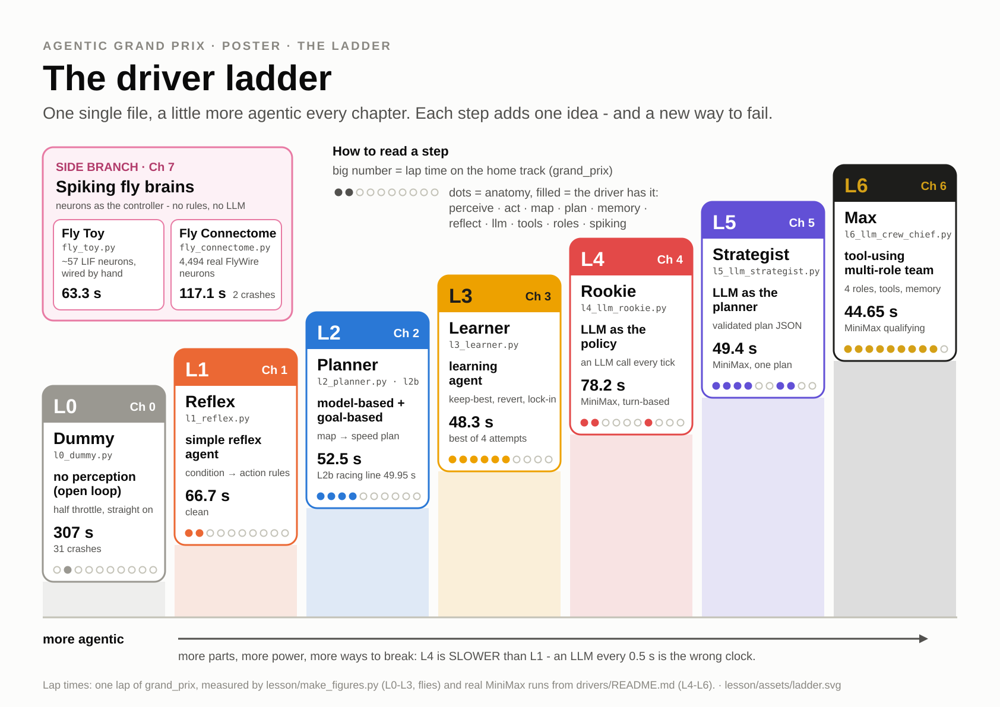
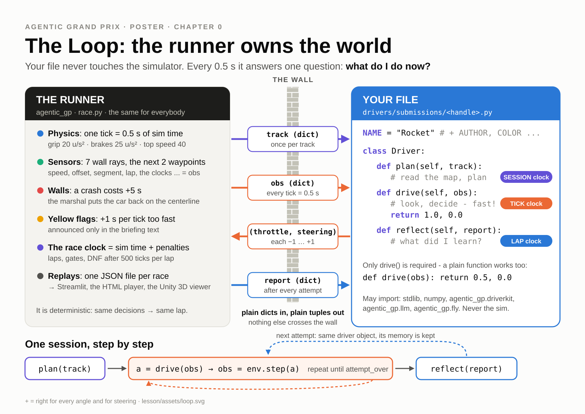
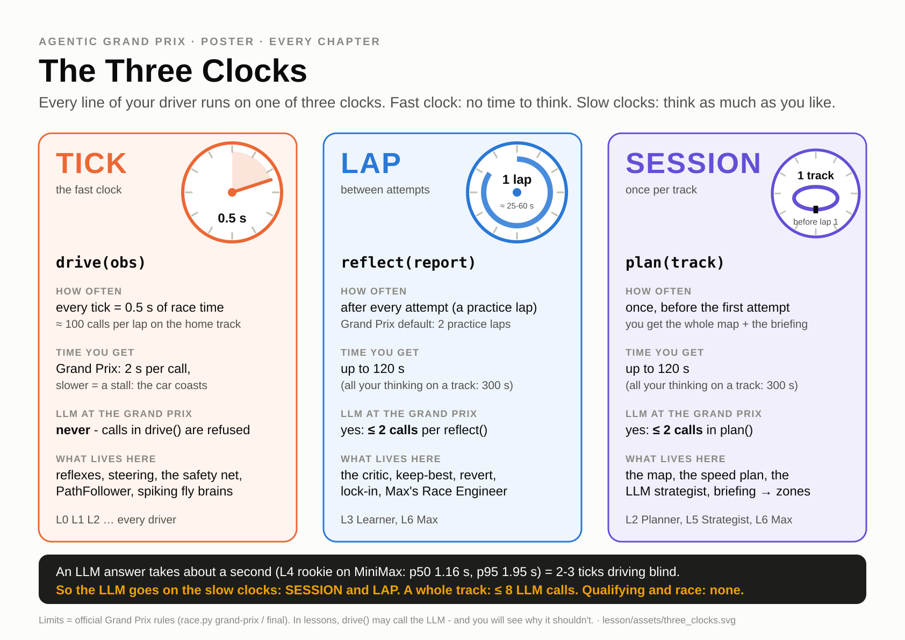
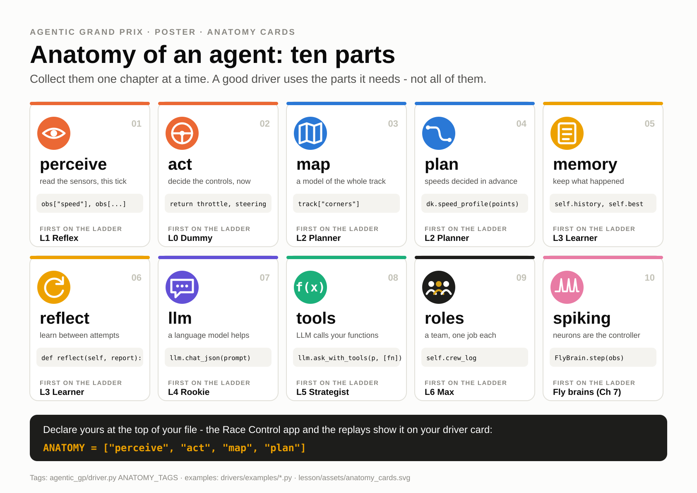

# Ch0 Pit Lane

**Day 1, 09:20-09:45 (25 min).** You leave with your own car on the grid: a driver file with your name and
colour that passes the contract check, and a replay of it lapping the home track.

| | |
|---|---|
| **Agent type** | none yet: you first watch an agent with no perception, then take over a slow, careful starter |
| **Clock** | TICK (0.5 s): the runner calls `drive(obs)` twice a second |
| **Your file** | `drivers/submissions/<handle>.py` v0 (a copy of `drivers/template.py` with your metadata) |
| **Checkpoint CP0** | `python race.py check` says **PASSED**, and your car appears in the Replay page |
| **Handrail** | [`lesson/checkpoints/ch0_pit_lane.py`](checkpoints/ch0_pit_lane.py) |

> **Your handle.** Every Day-1 command uses the example handle **`ada`** (`drivers/submissions/ada.py`).
> Type your own handle instead: lower case, no spaces (`grace_h.py`, not `Grace H.py`). Later chapters
> write `<handle>`.

**Before you start.** Open a terminal in the repo root (the folder with `race.py`) and activate the
course venv once per terminal:

```powershell
# Windows PowerShell
.venv\Scripts\activate
```

```bash
# macOS
source .venv/bin/activate
```

Your prompt now starts with `(.venv)`, and every command in the lesson is `python race.py ...`.
uv users can write `uv run race.py ...` instead.

---

## 1. Goal

[](assets/ladder.svg)

You are at the bottom of the ladder. In 25 minutes you will know the parts of the game: who owns the
world, what your file is allowed to see, and what it answers. You will then put your own car on the
grid.

## 2. Concepts

[](assets/loop.svg)

- **Environment vs agent.** The simulator (the *environment*) owns the world: the track, the car's
  position, the physics, the clock, the crashes. Your file is the *agent*. It never sees the simulator.
  It only answers one question, over and over: **"what do I do now?"**
- **Only four things cross the wall:**
  - `track`: the map, handed to you once (you use it from Ch2 on);
  - `obs`: a small dict of what the car senses *right now* (speed, 7 wall rays, the next gates);
  - `(throttle, steering)`: your answer, both between -1 and 1;
  - `report`: after each attempt, how it went (you use it from Ch3 on).
- **Why the wall?** Fairness and encapsulation. Every driver gets exactly the same information, so the
  race is about how you *use* it. It also means your driver can run in its own process at the Grand
  Prix, and a bug in your file cannot break anybody else's car.
- **Vocabulary you will hear all day:**

  | Word | Meaning |
  |---|---|
  | tick | one decision: 0.5 s of race time. `drive(obs)` is called once per tick |
  | gate (waypoint) | a line across the track; 16 per lap on `grand_prix`. Pass them in order |
  | segment | the stretch from one gate to the next (`obs["segment"]`) |
  | attempt | one run from the start line (one lap unless you ask for more) |
  | session | several attempts on one track, with memory in between (Ch3) |
  | practice / qualifying / race | the three phases of a Grand Prix weekend (Ch3 and Day 2) |
  | crash | touching a wall: +5 s. The **marshals** put your car back on the centreline, stopped |

[](assets/three_clocks.svg)

Today you only meet the fastest clock, TICK. The other two arrive in Ch2 (SESSION: `plan`) and Ch3
(LAP: `reflect`).

## 3. Watch (5 min)

**L0 Dummy** is the "before" picture of the whole course. Its whole brain is one line:

```python
def drive(obs: dict) -> tuple[float, float]:
    """Ignore the world: same command every tick."""
    return PARAMS["throttle"], 0.0
```

It never reads `obs`: half throttle, straight ahead, forever. Its *Anatomy Card* has only one part lit:
**act**. There is no *perceive*.

[](assets/anatomy_cards.svg)

The instructor shows its replay. Every red cross is a crash and costs 5 s.

## 4. Build

### Step 1: is your laptop race-ready?

```
python race.py doctor
```

You should now see a list of `[OK  ]` lines (Python, numpy, streamlit, the simulator, the Streamlit app)
and a last line that starts with `ALL GREEN`, or `OK with ... warning(s)`. A `[WARN]` about the LLM key is
normal today: you get the key on Day 2. A `[WARN]` "spaces in the path" (for example a Windows user
folder like `C:\Users\Ada Lovelace\...`) is harmless for the course, so `OK with 2 warning(s)` is fine
too. The report is written to `doctor_report.txt`. Anything red?
Put your red sticky note up now. The TA fixes setups first.

### Step 2: race the Dummy, then watch the replay

```
python race.py drive drivers/examples/l0_dummy.py --replay races/me_l0.json
```

You should now see one line per crash, then the summary:

```
Dummy by Agentic GP (code) on grand_prix: 1 attempt(s) x 1 lap(s)
plan(): 0.00 s
Attempt 1 [session]
  t=  16.00s tick   22 lap 1 seg  2 v=  0.0 | crash: hit a wall, +5s penalty, speed reset to 0, marshals put the car back on the centerline
  ...
Attempt 1: FINISHED 307.40 s | laps [307.40] | crashes 31 | penalties 155.0 s | 16 waypoints | 305 ticks
Best lap: 307.40 s
drive() time: mean 0.1 ms, max 6.9 ms | wall 1.1 s
Replay: races/me_l0.json  (python race.py watch races/me_l0.json --html | --unity)
```

307.40 s with 31 crashes: the marshals carried it round, one crash at a time. The sim is
deterministic, so you get exactly these numbers.

Now open **Race Control**, the course app. Use a **second terminal** (activate the venv there too), because
the app keeps running:

```
python -m streamlit run app/race_control.py
```

Your browser opens at http://localhost:8501 (open it yourself if it doesn't). Click **Replay** in the
sidebar. The player first opens on the class demo race (`demo/class_demo.json`, 8 cars). Open the
**Replay file** box: your `me_l0.json` is at the top of the list (newest first). Pick it. You should now
see a player showing the grey Dummy driving into the first corner. **Click the player once**, then press
**Space** to play or pause (the keys only work after that click), and click the car to follow it. Leave the app running all day: you will use its pages in every chapter.

> No browser? `python race.py watch races/me_l0.json --html` writes `races/me_l0.html`, a
> stand-alone player you can open in any browser.

### Step 3: your own car

Copy the template to your own file (use your handle instead of `ada`):

```powershell
# Windows PowerShell
Copy-Item drivers/template.py drivers/submissions/ada.py
```

```bash
# macOS
cp drivers/template.py drivers/submissions/ada.py
```

Open `drivers/submissions/ada.py` in your editor. Read the docstring at the top, then find **TODO 0** and
make it yours:

```python
NAME = "Ada"                # <= 16 characters, shown in the standings and the 3D viewer
AUTHOR = "ada"              # your handle (pseudonyms welcome)
COLOR = "#ff006e"           # your car colour (hex)
KIND = "code"               # "code" | "llm" | "fly"
MOTTO = "Brake late, smile early."
```

Pick any hex colour (Google "color picker" gives you one); a colour word like `"red"` gets silently
replaced. Pick a `NAME` nobody else in the class has, without emoji, and not a house car's name (Max,
Planner and Fly Toy are taken). Leave `KIND = "code"` for today. Keep
`ANATOMY` and `PARAMS` as they are.

### Step 4: the contract check

```
python race.py check drivers/submissions/ada.py
```

You should now see:

```
Checking drivers\submissions\ada.py
  static check: OK
  driver: Ada by ada | kind code | color #ff006e | PARAMS {'cap': 22.0, 'steer_gain': 1.0, 'margin': 6.0, 'wall_gain': 1.5}
  smoke test: 40 ticks on grand_prix, 3 waypoints, 0 crashes, drive() mean 0.1 ms / max 0.2 ms
PASSED - ready to race (python race.py validate drivers\submissions\ada.py)
```

`check` reads your file (allowed imports, metadata, no file I/O) and drives 40 ticks. The scrutineers
run exactly this command before every race. (macOS prints `/` instead of `\`.)

### Step 5: your car on the track

```
python race.py drive drivers/submissions/ada.py --replay races/me_v0.json
```

You should now see `Attempt 1: FINISHED 85.85 s | laps [85.85] | crashes 0 | ...`. The template is slow
but careful: no crashes. Go back to the **Replay** page (refresh the browser tab) and pick `me_v0.json`.
You should now see **your name, in your colour**, lapping the Grand Prix circuit. That is CP0.

Open the **Where am I?** box at the top of the sidebar and pick your file. It reads your code (it never runs
it) and ticks off the checkpoints whose *parts* your file already has. The template already has
reflexes, so do not be surprised by a green CP1 box. The lap time is what counts for CP1, and that is
Ch1.

## 5. Check (CP0)

```
python race.py check drivers/submissions/ada.py
python race.py drive drivers/submissions/ada.py
```

| What | Expected (measured, [CALIBRATION.md](instructor/CALIBRATION.md)) |
|---|---|
| `check` | `PASSED - ready to race` |
| `drive` on `grand_prix` | **85.85 s, 0 crashes** (the template's driving is untouched) |
| Replay page | your car, your colour, your name |

**Exercise (5 min): what does each part do?** `--param` changes a `PARAMS` knob for one run without
editing the file.

1. The Dummy has one knob, `throttle` (0.5 by default). Try it:

   ```
   python race.py drive drivers/examples/l0_dummy.py --param throttle=1.0 --quiet
   python race.py drive drivers/examples/l0_dummy.py --param throttle=0.3 --quiet
   ```

   You should now see 262.30 s (full throttle) and 354.70 s (0.3), both with **31 crashes**. More
   throttle only crashes sooner. Why can no throttle setting fix it?

2. Switch the marshals off. With the `classic` crash rule a crashed car just stops at the wall:

   ```
   python race.py drive drivers/examples/l0_dummy.py --crash-rule classic --quiet
   ```

   You should now see `DNF (max ticks) | ... | crashes 239 | ... | 2 waypoints | 500 ticks`. It never
   gets past gate 2. A stopped car pointing at a wall cannot turn away from it.

3. Now *your* car. Switch its steering off, then only half of it:

   ```
   python race.py drive drivers/submissions/ada.py --param steer_gain=0 --param wall_gain=0 --quiet
   python race.py drive drivers/submissions/ada.py --param steer_gain=0 --quiet
   ```

   You should now see 368.55 s with 34 crashes (no steering at all: the marshals carry it round), and
   then 119.35 s **with 0 crashes**. With `steer_gain=0` the car does not aim at any gate, yet it does
   not crash. Which line of `drive()` is still steering? (Hint: TODO 3.)

## 6. Push

- **Bronze:** `check` PASSED and your coloured car in the Replay page.
- **Silver:** answer the three exercise questions in one sentence each.
- **Gold:** open **Sensor X-ray** in Race Control (sidebar, "Day 1 labs"). Step through the demo
  recording tick by tick and predict the sign of `steering` *before* you look. You should get the
  rule you need for Ch1: **+ = right**, for every angle and for steering.

## 7. Stuck?

> **Stuck for 2 minutes? Red sticky note up.** Then compare your file with the handrail:
>
> ```
> git diff --no-index drivers/template.py lesson/checkpoints/ch0_pit_lane.py
> ```
>
> The handrail is the template with only TODO 0 filled in. Copy it to `drivers/submissions/<your handle>.py`,
> put your handle in `AUTHOR`, and carry on.

| Problem | Fix |
|---|---|
| `python` is not found, or `No module named numpy` | The venv is not active: run the activate line at the top of this page. |
| `check` fails with a metadata error | `NAME` at most 16 characters; `COLOR` a hex string like `"#ff006e"`; `KIND = "code"`. |
| `Port 8501 is already in use` | Race Control is already running in another terminal: just use that browser tab. |
| The Replay page does not list your file | Refresh the browser tab; replays are listed newest first. |

## 8. Submit and logbook

Nothing to upload yet. Keep `drivers/submissions/ada.py`: the same file grows all day. The first upload is
CP1 at 10:45.

Logbook line: *"The runner owns ___; my driver only sees ___ and answers ___. The Dummy fails because
it has no ___."*

Next: [Ch1 Reflexes](01_reflexes.md).
