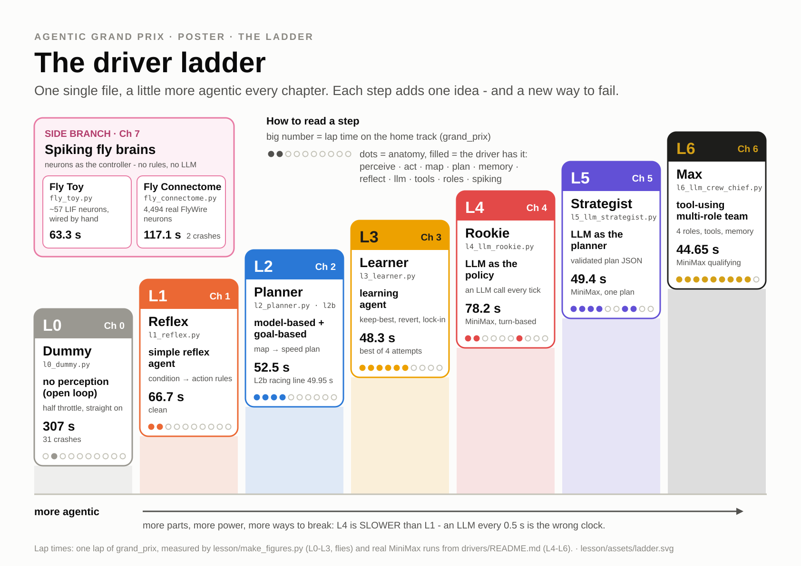
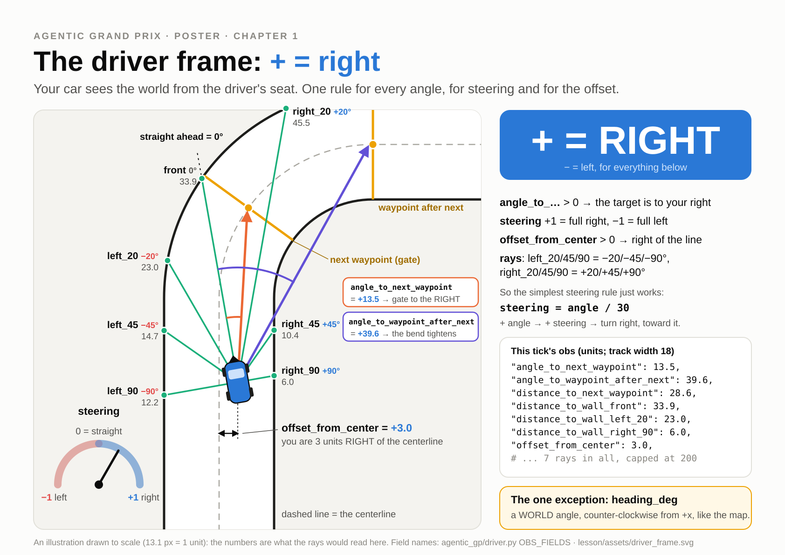
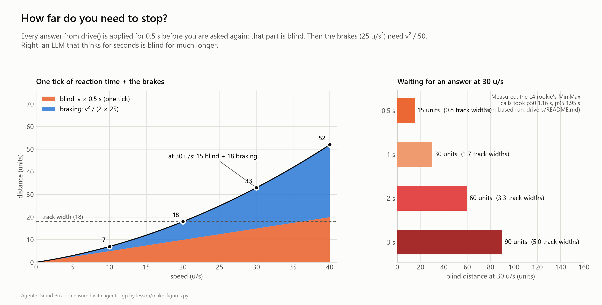
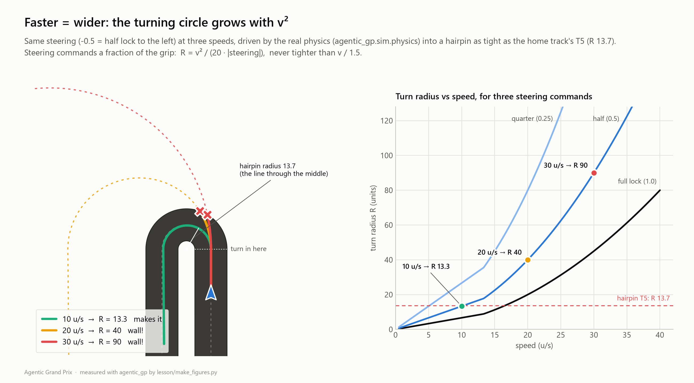
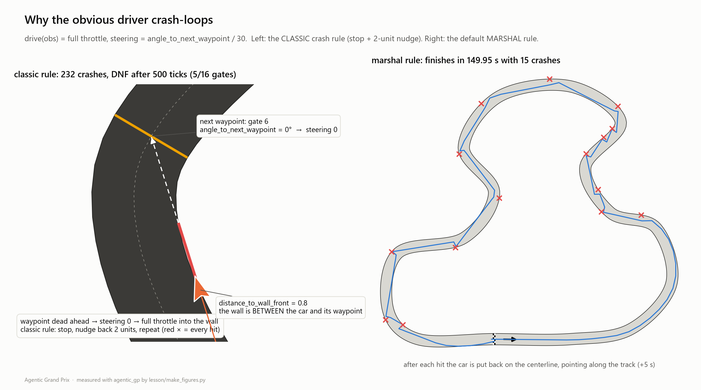

# Ch1 Reflexes: the simple reflex agent

**Day 1, 09:45-10:50 (65 min, including 8 min of Physics Lab hand-driving).** You leave with a reflex
driver that laps the home track clean in 60-80 s, and you know *why* each of its rules is there.

| | |
|---|---|
| **Agent type** | simple reflex agent: condition → action rules on this tick's `obs`, no map, no memory |
| **Clock** | TICK (0.5 s): everything happens inside `drive(obs)` |
| **Your file** | `drivers/submissions/ada.py` v1 (function + `PARAMS`) |
| **Checkpoint CP1** (10:45, Snapshot #1) | `grand_prix` 60-80 s **with 0 crashes**, clean on every public track |
| **Handrail** | [`lesson/checkpoints/ch1_reflex.py`](checkpoints/ch1_reflex.py) |

Remember: `ada` is the example handle. Type yours.

---

## 1. Goal

[](assets/ladder.svg)

L0 had no perception. L1 *perceives* and *acts*: it reads the sensors every tick and turns them into
throttle and steering with a handful of rules. Your template already does that, slowly (85.85 s).
In this chapter you make it fast without making it crash.

## 2. Concepts

### One rule for every angle: + = right

[](assets/driver_frame.svg)

Everything in `obs` is measured **from the driver's seat**. A positive angle means "to your right", a
positive steering command means "turn right", a positive offset means "you are right of the
centreline". The only exception is `heading_deg` (and `position`), which use the map's coordinates;
you need them from Ch2 on.

Here is a real `obs`, tick 25 of the handrail on `grand_prix` (the first 20 of its fields):

```json
{"speed": 25.53, "distance_to_wall_front": 47.2, "distance_to_wall_left_20": 19.9,
 "distance_to_wall_right_20": 28.4, "distance_to_wall_left_45": 7.8, "distance_to_wall_right_45": 17.3,
 "distance_to_wall_left_90": 5.8, "distance_to_wall_right_90": 12.2, "distance_to_next_waypoint": 87.3,
 "angle_to_next_waypoint": -27.7, "distance_to_waypoint_after_next": 151.0,
 "angle_to_waypoint_after_next": -59.6, "next_waypoint_index": 4, "waypoints_passed": 3,
 "waypoints_total": 16, "position": [388.76, 70.25], "heading_deg": 63.0, "offset_from_center": -3.22,
 "segment": 3, "progress": 0.1901}
```

The next gate is 27.7° to the **left**, and the one after it 59.6° left: a left-hander is coming. The
driver answered steering **-0.31** (left). The full list of fields is in
[`agentic_gp/driver.py`](../agentic_gp/driver.py) (`OBS_FIELDS`) and on the [cheat sheet](cheatsheet.md).

### Condition → action, and proportional control

A simple reflex agent is a list of rules: *if the wall in front is close, brake*. The best rules are
**proportional**: not "brake" but "brake *this much*", in proportion to the error. `throttle =
(target - speed) / 6` is proportional control: far below the target speed means full throttle, just
below means a little.

### Two physics facts that every rule in this chapter uses

**Braking takes room, and you only look every 0.5 s.** With brake 25 u/s², stopping from speed `v`
takes `v² / 50` units. But your next chance to react comes a tick later, so you first drive `0.5 v`
units *blind*. At 30 u/s that is 18 + 15 = **33 units**, nearly two track widths.

[](assets/stopping_distance.png)

Turned around, this is the rule your template already uses: never go faster than
`v = √(2 · 25 · (front − margin − 0.5 v))`.

**Steering is a fraction of the grip, so the turning circle grows with v².** A steering command `s`
uses that fraction of the 20 u/s² of sideways grip: `R = v² / (20 · |s|)`. One more limit: the car
can never turn faster than 1.5 rad/s, so below about 13 u/s the circle is `R = v / (1.5 · |s|)`, never
tighter. The same half lock gives R ≈ 13 at 10 u/s (the yaw limit), R = 40 at 20 u/s and R = 90 at
30 u/s. The tightest corner of the home track, T5, has R = 13.7: only the 10 u/s car makes it, just.

[](assets/turn_radius.png)

So a steering rule that ignores speed steers too hard when slow and far too gently when fast.
`dk.steer_towards(angle, speed)` fixes that: it turns "the angle I want" into "the command I need at
this speed".

### Why the obvious first driver crash-loops

The first driver everybody writes is "full gas, aim at the next gate":
`return 1.0, obs["angle_to_next_waypoint"] / 30`. It reaches the first corner far too fast, hits the
wall and stops. Now the gate is dead ahead, *behind the wall*, so the car aims straight at the wall,
accelerates into it, and crashes again. A stopped car cannot turn.

[](assets/crash_loop.png)

The default **marshal** rule puts a crashed car back on the centreline, pointing down the track (+5 s),
which is why every driver in this course finishes. The old **classic** rule (`--crash-rule classic`)
only stops the car at the wall.

## 3. Watch (15 min)

1. **Physics Lab: Hand-Drive (8 min).** In Race Control (`python -m streamlit run app/race_control.py`)
   open **Physics Lab** → **Hand-Drive**. You are the driver now: five buttons (Left, Gas, Coast, Brake,
   Right), and **one click = one tick = 0.5 s**. The arrow keys and Space work too (click the page
   first). Stay in **Turn-based** mode and drive one lap. You should now see how little you can do per
   click, and you will crash at least once: that is the point. Count how many Brake clicks you need
   from 30 u/s. Then switch on **Blind mode**: the map disappears and you drive from the numbers only,
   exactly like your code.
2. **Physics Lab: the other tabs.** *Turning circle*: the car starts before the tightest hairpin. Set
   speed 30 and watch your circle miss the corner; drop to 10 u/s and it fits.
   *Stopping distance*: 30 u/s needs 33 units. *Corner speed*: T5's `√(20 · 13.7)` = 16.5 u/s.
3. **Sensor X-ray.** Open **Sensor X-ray** and step through the demo recording. For each tick, predict
   the sign of `steering` from `angle_to_next_waypoint` before you look.
4. **The crash loop, live.** Build the obvious driver yourself. Make a scratch file
   `races/chaser.py` (the `races/` folder is git-ignored, so it never gets submitted) with this
   content:

   ```python
   NAME, AUTHOR, COLOR, KIND = "Chaser", "me", "#ff006e", "code"


   def drive(obs):
       return 1.0, obs["angle_to_next_waypoint"] / 30     # full gas, aim at the next gate
   ```

   Race it without marshals, then with them:

   ```
   python race.py drive races/chaser.py --crash-rule classic --replay races/chaser_classic.json
   python race.py drive races/chaser.py --quiet
   ```

   You should now see `DNF (max ticks) | ... | crashes 232 | ... | 5 waypoints | 500 ticks` and then
   `FINISHED 149.95 s | ... | crashes 15`. Open `chaser_classic.json` in the Replay page: the car sits
   at the wall of segment 5 for the rest of the 500 ticks.

## 4. Build

Five steps. After each one, save the file and run:

```
python race.py drive drivers/submissions/ada.py
```

Keep the lap time of every step in your logbook: you will see the ladder climb.

### Step 1: steering, the obvious way and the right way (an experiment)

Your template steers with `dk.steer_towards`. First find out why. In `drive()`, find this line
(TODO 1):

```python
    steering = P["steer_gain"] * dk.steer_towards(angle, obs["speed"])
```

and replace it, **for this experiment only**, with the obvious version:

```python
    steering = P["steer_gain"] * angle / 30            # EXPERIMENT: the "obvious" steering
```

Now race it a bit faster, with a higher speed cap and a smaller safety margin, using `--param` (no
file edit needed):

```
python race.py drive drivers/submissions/ada.py --param cap=34 --param margin=4
```

You should now see `FINISHED 72.65 s | ... | crashes 1`. The crash is at T3 (segment 5): the car arrives
at 31 u/s, ends up nose-in to the outside wall, brakes to a stop 4.6 units from it, and clips the wall
while it backs out. Put the original line back (`dk.steer_towards`) and run the same command again.
You should now see **69.55 s, 0 crashes**. On `speedway` (add `--track speedway`): 88.00 s with 1 crash
for `angle / 30`, 80.20 s clean for `steer_towards`.

`angle / 30` is a **fixed gain**: the same angle always gives the same command. But the car's answer to
a command depends on its speed (R = v² / (20 |s|)), so a fixed gain is right at one speed only: far too
twitchy when slow, too lazy when fast. `steer_towards(angle, speed)` works backwards from the turn you
want ("remove this heading error in about one second") to the command that gives it *at this speed*.
For a gate 30° to the left it asks for -0.35 at 10 u/s, -0.52 at 20 u/s and -0.79 at 30 u/s, where
`angle / 30` says -1.0 (full lock) every time.

> Keep `steer_towards` from here on. The `--param` values were just for the experiment: your file
> still says `cap = 22`, `margin = 6`.

### Step 2: look through the corner

Aiming at the next gate makes you turn late: you only start the corner when you are at the gate. A
racing driver looks *through* the corner, at where it ends. Blend in the gate after next as the next
gate gets close.

In `drive()` (TODO 1), replace

```python
    angle = obs["angle_to_next_waypoint"]
```

with

```python
    d_next = obs["distance_to_next_waypoint"]
    w = dk.clamp(1.0 - (d_next - 10.0) / (P["blend_far"] - 10.0), 0.0, P["blend_max"])
    angle = (1.0 - w) * obs["angle_to_next_waypoint"] + w * obs["angle_to_waypoint_after_next"]
```

and add two knobs at the end of `PARAMS` (keep the four that are there):

```python
    "wall_gain": 1.5,       # TODO 3: how hard we push away from close walls
    "blend_far": 40.0,      # TODO 1: start looking through to the next-but-one gate at this distance
    "blend_max": 0.6,       # TODO 1: ... and put at most this much weight on it
}
```

`w` is 0 when the next gate is 40 units away or more, and grows to 0.6 as you reach it.

You should now see **80.30 s, 0 crashes** (from 85.85 s).

### Step 3: speed: stop, turn away, slow for the corner ahead

The template's speed rule is cautious: a cap of 22 u/s and a margin of 6. Now let the car go fast and
add two smarter limits. Replace the whole block under TODO 2, from `front = ...` to `throttle = ...`:

```python
    front = obs["distance_to_wall_front"]
    v_stop = math.sqrt(2 * 25.0 * max(front - P["margin"] - 0.5 * obs["speed"], 0.0))
    v_corner = P["cap"] * max(0.4, math.cos(math.radians(min(abs(angle), 80.0))))
    target = max(4.0, min(P["cap"], v_stop, v_corner))
    if obs["zone_speed_limit"] is not None:              # yellow flag! (+1 s per tick too fast)
        target = min(target, obs["zone_speed_limit"] - 1.0)
    throttle = dk.clamp((target - obs["speed"]) / 6.0)
```

with

```python
    front = obs["distance_to_wall_front"]
    v_stop = math.sqrt(2 * 25.0 * max(front - P["margin"] - 0.5 * obs["speed"], 0.0))
    v_turn = math.sqrt(20.0 * P["turn_k"] * max(front, 0.0))
    turn_ahead = max(abs(angle), 0.7 * abs(obs["angle_to_waypoint_after_next"]) if d_next < P["blend_far"] else 0.0)
    v_corner = P["cap"] * max(0.35, math.cos(math.radians(min(turn_ahead, 80.0))))
    target = max(5.0, min(P["cap"], v_stop, v_turn, v_corner))
    if obs["zone_speed_limit"] is not None:              # yellow flag! (+1 s per tick too fast)
        target = min(target, obs["zone_speed_limit"] - 1.0)
    dv = target - obs["speed"]                           # accelerate gently (12 u/s^2), brake hard (25)
    throttle = dk.clamp((dv + 0.075 * obs["speed"]) / 6.0 if dv >= 0 else dv / 12.5)
```

and set `PARAMS` to (higher cap, smaller margin, one new knob `turn_k`):

```python
PARAMS = {
    "cap": 34.0,            # TODO 2: our top speed (the car can do 40)
    "steer_gain": 1.0,      # TODO 1: how hard we steer towards the waypoint
    "margin": 4.0,          # TODO 2: free space we keep in front of the car
    "wall_gain": 1.5,       # TODO 3: how hard we push away from close walls
    "blend_far": 40.0,      # TODO 1: start looking through to the next-but-one gate at this distance
    "blend_max": 0.6,       # TODO 1: ... and put at most this much weight on it
    "turn_k": 0.6,          # TODO 2: "turn away" limit v = sqrt(20 * turn_k * front)
}
```

What the four limits mean (the target speed is the smallest of them):

| Limit | Rule | Question it answers |
|---|---|---|
| `cap` | a constant | how fast do I dare to go at all? |
| `v_stop` | `√(2·25·(front − margin − 0.5 v))` | can I still **stop** before the wall ahead, after one blind tick? |
| `v_turn` | `√(20 · turn_k · front)` | can I still **turn away** from it? (turning needs less room than stopping) |
| `v_corner` | `cap · cos(turn_ahead)` | how sharp is the turn I am looking at, including the gate after next? |

The new throttle line brakes twice as hard as it accelerates, and adds a little to beat the drag.

You should now see **71.30 s, 0 crashes**.

### Step 4: walls: aim at open space when the gate is hidden

On a hairpin the next gate can be *behind the inside wall*: the straight line to it crosses the wall.
The template only halves the angle then. Better: if there is a wall in the aim direction that is nearer
than the gate, aim halfway towards the most open ray.

First, replace the `_memory` line near the top of the file

```python
_memory: dict = {}          # recover_if_stuck keeps its little state here
```

with the rays table, the same `_memory` line, and a helper that reads the free distance in any
direction:

```python
# The seven wall rays in the driver frame: (angle, obs key). + = right, - = left.
RAYS = [(-90, "left_90"), (-45, "left_45"), (-20, "left_20"), (0, "front"),
        (20, "right_20"), (45, "right_45"), (90, "right_90")]

_memory: dict = {}          # recover_if_stuck keeps its little state here


def free_distance(obs: dict, angle: float) -> float:
    """How far we can see in direction `angle` (between the two nearest rays)."""
    angle = max(-90.0, min(90.0, angle))
    for (a0, k0), (a1, k1) in zip(RAYS, RAYS[1:]):
        if a0 <= angle <= a1:
            d0, d1 = obs["distance_to_wall_" + k0], obs["distance_to_wall_" + k1]
            return d0 + (angle - a0) / (a1 - a0) * (d1 - d0)
    return obs["distance_to_wall_front"]
```

Then, in `drive()` (TODO 1), replace the template's line-of-sight rule

```python
    side = obs["distance_to_wall_left_45"] if angle < 0 else obs["distance_to_wall_right_45"]
    if side < 0.5 * min(obs["distance_to_next_waypoint"], 40.0):
        angle *= 0.5
```

with

```python
    if free_distance(obs, angle) < min(d_next, 40.0):
        open_angle = max((a for a, _ in RAYS if abs(a) <= 45), key=lambda a: free_distance(obs, a))
        angle = 0.5 * angle + 0.5 * open_angle
```

You should now see **66.70 s, 0 crashes**. That is the CP1 handrail's exact time: your `drive()` now
does what [`ch1_reflex.py`](checkpoints/ch1_reflex.py) does.

### Step 5: test your safety nets

Your car has two safety nets: the marshals (the runner's) and `dk.recover_if_stuck` (yours: "stopped
with a wall in front? reverse towards the open side"). Find out whether your car needs them. Race
without marshals:

```
python race.py drive drivers/submissions/ada.py --crash-rule classic
```

You should now see the same **66.70 s, 0 crashes**: a clean driver never meets the marshals. Now
delete the three `recover = ...` lines under TODO 3b, run the same command again, then put them back.
On the public tracks nothing changes, because your car never stops at a wall. `recover_if_stuck` is
insurance for the track you have not seen yet. The Chaser from the Watch section shows why insurance
alone is not enough: a car that drives *into* walls needs speed rules first.

### Your ladder so far (measured on `grand_prix`)

| Version | Change | Lap |
|---|---|---|
| v0 | template | 85.85 s |
| step 2 | + look through the corner | 80.30 s |
| step 3 | + stop / turn-away / corner-ahead speed | 71.30 s |
| step 4 = v1 | + aim at open space | **66.70 s** |

All clean. Watch your own versions back to back: run each step with
`--replay races/ada_step2.json` (and so on) and pick them one by one in the Replay page.

## 5. Check (CP1)

```
python race.py check drivers/submissions/ada.py
python race.py drive drivers/submissions/ada.py
python race.py validate drivers/submissions/ada.py
```

| What | Band | Handrail measured ([CALIBRATION.md](instructor/CALIBRATION.md)) |
|---|---|---|
| `grand_prix` | **60-80 s, 0 crashes** | 66.70 s |
| every public track | 0 crashes | oval 31.65, sprint 50.00, speedway 74.30, briefing_demo 72.75 (one yellow-flag tick, +1 s) |
| `validate` (5 public + `random:1`, `random:2`) | finished 7/7, 0 crashes | score **58.81 s** |

`validate` ends with a table and `Validation score (mean timed lap, DNF = 300 s): 58.81 s | finished 7/7`
for the handrail. Keep it: it is your own generalisation score. (The snapshots measure something
similar but different: one race of the whole class on the unseen track `random:101`.)

**Exercises (5 min).**

1. At the Python prompt (`python`), compare the two steering rules for a gate 30° to the left:

   ```python
   from agentic_gp import driverkit as dk
   [round(dk.steer_towards(-30, v), 2) for v in (10, 20, 30)], -30 / 30
   ```

   You should now see `([-0.35, -0.52, -0.79], -1.0)`. Use R = v² / (20 · |s|), and at 10 u/s the yaw
   limit R = v / (1.5 · |s|): how big is the turning circle of each command at 10 u/s and at 30 u/s? Which rule would spin the car round at
   10 u/s?
2. Step 4 only changed where the car *aims*, yet the lap got 4.6 s faster. Which of the four speed
   limits in step 3 also reads `angle`? Watch your car in Race Control → **Live** to see where it
   now carries more speed.

## 6. Push

- **Bronze:** finish the lap (any time).
- **Silver:** clean and under 75 s on `grand_prix` (the handrail: 66.70 s).
- **Gold:** under **55 s**, clean, **and** clean on `sprint`. Tune with `--param` only; which knobs
  matter? (A hint from our runs: `--param cap=40` alone gives 66.60 s; the time is in `turn_k` and
  `margin`.) Once you have a Gold setting, run it on 20 tracks it has never seen, **with the same
  `--param` flags** (here our setting; use yours):

  ```
  python race.py validate drivers/submissions/ada.py --tracks grand_prix --random 20 --seed 3 --quiet --param cap=40 --param turn_k=1.5 --param margin=2
  ```

  Our Gold-tuned handrail (`cap=40 turn_k=1.5 margin=2`, 53.75 s at home, 42.65 s on sprint) crashed on
  **4 of those 20 tracks** (random:9, 10, 13, 22; score 50.83 s). Without the `--param` flags, the
  untuned handrail is clean on all of them (60.69 s). That is your first taste of **overfitting**:
  knobs tuned on one track are a bet on that track. Ch2 opens with it. Put the setting you trust into
  `PARAMS`.

## 7. Stuck?

> **Stuck for 2 minutes? Red sticky note up.** Then diff your file against the handrail; the variable
> names are the template's, so the diff shows exactly which lines each step changed:
>
> ```
> git diff --no-index drivers/submissions/ada.py lesson/checkpoints/ch1_reflex.py
> ```
>
> Still stuck at 10:40? Copy `lesson/checkpoints/ch1_reflex.py` over your file, put your `NAME`,
> `AUTHOR`, `COLOR` and `MOTTO` back, and run the Check. Handrail files are classified at snapshots
> but are not eligible for design awards.

| Symptom | Likely cause |
|---|---|
| `NameError: name 'd_next' is not defined` | Step 3 or 4 before step 2: `d_next` is defined in the step 2 lines. |
| `KeyError: 'turn_k'` (or `blend_far`) | The new knob is missing from `PARAMS`. |
| Steers the wrong way, crashes on every corner | A sign flip: + = right. `angle` and `steering` must have the **same** sign. |
| Slower after step 3 | `PARAMS` still has `cap: 22.0` / `margin: 6.0`. |
| `IndentationError` | Pasted lines must keep their 4 spaces inside `drive()`. |

## 8. Submit and logbook

**CP1 at 10:45:** upload `drivers/submissions/ada.py` through the class upload channel. It runs in
**Snapshot #1** (2 practice laps + 1 timed lap on the home track, with Max's time as the line to beat),
shown on the projector at the break.

Logbook line: *"Reflexes bought me ___ s (85.85 → ___). They cost me: my car still cannot ___,
because it only sees this tick."*

Next: [Ch2 The Map](02_the_map.md).
