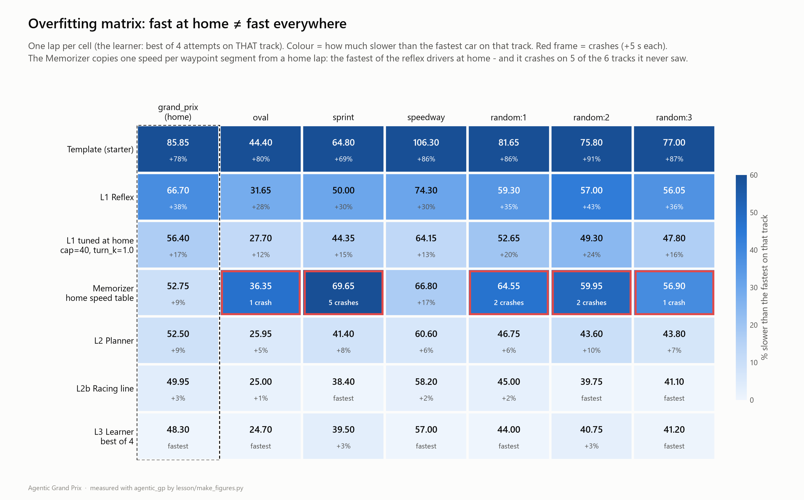
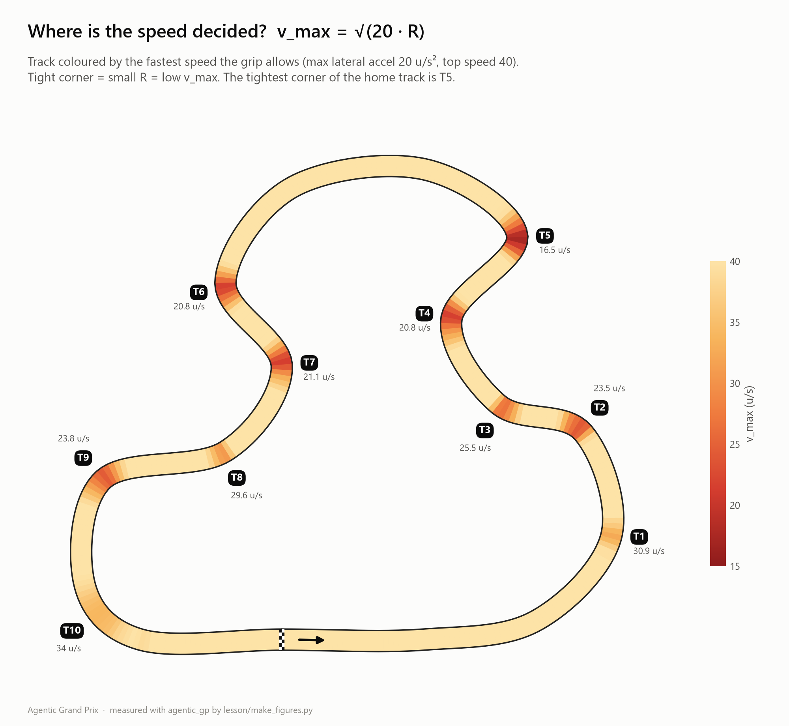
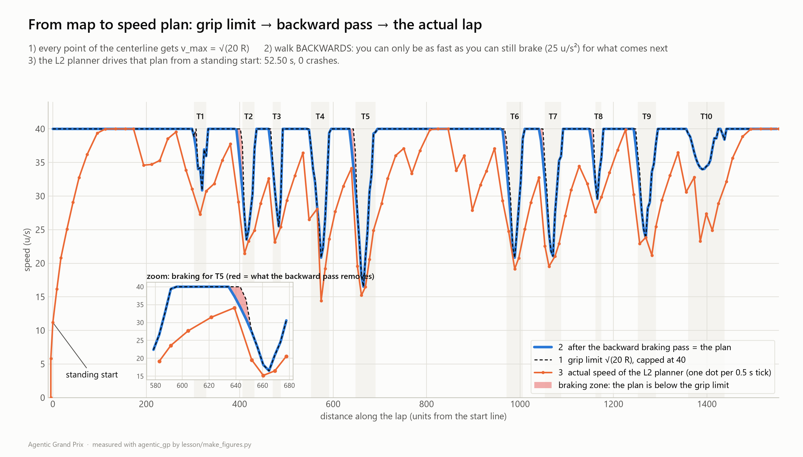

# Ch2 The Map: a model-based, goal-based agent

**Day 1, 11:05-12:30 (85 min).** You leave with a driver that reads the whole track before the lights go
out, plans a speed for every metre of it, and then follows that plan. It is clean on tracks it has never
seen, without retuning.

| | |
|---|---|
| **Agent type** | model-based (a world model: the track dict) and goal-based (a plan to reach the line fastest) |
| **Clocks** | SESSION: `plan(track)` once per session · TICK: `drive(obs)` executes the plan |
| **Your file** | `drivers/submissions/ada.py` v2: `class Driver` with `plan` + `drive` |
| **Checkpoint CP2** (12:20, Snapshot #2) | `grand_prix` 48-55 s clean, clean on every public **and** random track, validation score posted |
| **Handrail** | [`lesson/checkpoints/ch2_planner.py`](checkpoints/ch2_planner.py) |

Remember: `ada` is the example handle. Type yours.

---

## 1. Goal

[](assets/overfitting_matrix.png)

Read the matrix before anything else. Each row is a driver, each column a track; `grand_prix` is the
home track, the other six it has never been tuned on.

- The **Memorizer** copied one speed per segment from a home lap: 52.75 s at home, as fast as the
  planner. On the other tracks it crashes on 5 of 6.
- The tuned reflex (*L1 tuned at home*) is clean here, but your own Gold experiment in Ch1 found
  4 crashes in 20 random tracks.
- The **L2 Planner** has no per-track numbers at all. It computes everything from the map it is given,
  so it is clean everywhere, and fast everywhere.

> "Your reflex is close on the home track. The map buys the last few percent *and* it works on tracks it
> has never seen without retuning. Watch the Validation column."

This is a data-science chapter: **the home track is your training set, the public tracks and
`random:<seed>` are your validation set, and the sealed mystery track on Day 2 is the test set.**

## 2. Concepts

- **The track dict is a world model.** `plan(track)` gets the whole map once, before the first tick:
  `centerline` (360 points about 4 units apart on `grand_prix`), both walls, the 16 gates, the
  auto-detected `corners`, the `physics` constants and the `briefing` text. That is perception
  *beyond the sensor horizon*: the rays see at most 200 units, the map sees the whole lap.
- **Corner speed: v_max = √(20 R).** A circle of radius R can be driven as fast as the grip
  (20 u/s²) allows: `v² / R ≤ 20`. T5, the home track's hairpin, has R = 13.7, so v_max = 16.5 u/s.

  [](assets/vmax_grand_prix.png)

- **The backward braking pass.** The grip limit tells you how fast you *may* be at each point. But you
  cannot go from 40 u/s at one point to 16.5 at the next: braking at 25 u/s² takes room. Walk the lap
  **backwards**: each point may be no faster than the speed from which you can still brake to the next
  point's speed, `v² = v_next² + 2 · 25 · ds`. Twice round, because the lap is a loop.

  [](assets/speed_profile.png)

- **Localisation and pure pursuit.** Every tick the executor finds the centreline point nearest to
  `obs["position"]` (*where am I on the map?*), then aims at a point a little further along the line
  (the *lookahead*: 6 + 0.45 · speed units, between 8 and 22) and steers towards it with
  `steer_towards`. That is **pure pursuit**. Too short a lookahead zig-zags; too long cuts the corner
  into the wall.
- **The safety net stays.** The executor (`dk.PathFollower`) keeps your Ch1 rule: never faster than
  you can stop before the wall in front, after one blind tick. The plan says how fast you *want* to go;
  the safety net says how fast you *may* go right now. Look at the actual lap in the figure above: it
  stays well below the plan almost everywhere.
- **Model fidelity.** The 16 gates are a coarse model of the track; the dense centreline is a fine one.
  Planning on the fine model is why the planner never needs a line-of-sight rule.

## 3. Watch (10 min)

1. **Track Lab** in Race Control (sidebar, "Day 1 labs"), tab *Explore a track*. Pick `grand_prix`.
   You should now see the map with gate numbers, the corner table (T1 ... T10 with their radius and
   v_max; T5 is the tightest, R 13.7 → 16.5 u/s), and below it the speed profile: grey dotted = grip limit, blue =
   after the backward pass. Move the **Aggression** slider and watch the blue line. Try `random:3`:
   a brand-new track, built from a seed, the same on every laptop.
2. **Live**: pick `drivers/examples/l2_planner.py`. The **pink target point** is the pure-pursuit
   lookahead (the `debug` dict). Watch it slide ahead of the car on the straights and pull in at T5.
3. The list of tracks you can validate on:

   ```
   python race.py tracks
   ```

   You should now see `grand_prix` (1554 units, min R 13.7, 10 corners, slowest 16.5), `oval`,
   `sprint`, `speedway` and `briefing_demo`, plus the line "Also: --track random:<seed> (any seed)".

## 4. Build

Your file becomes a **class**. The runner calls `plan(track)` once per session (SESSION clock) and
`drive(obs)` every tick (TICK clock). Your Ch1 reflexes stay in the file as the fallback: if `plan()`
fails, the car still gets home.

First keep a copy of your Ch1 file for the comparison in the Check (`races/` is git-ignored):

```powershell
# Windows PowerShell
Copy-Item drivers/submissions/ada.py races/ada_ch1.py
```

```bash
# macOS
cp drivers/submissions/ada.py races/ada_ch1.py
```

### Step 1: the class skeleton (your Ch1 code moves into `reflexes()`)

Five small edits, then one paste:

1. Under `import math`, add numpy:

   ```python
   import math

   import numpy as np
   ```

2. Update `ANATOMY`:

   ```python
   ANATOMY = ["perceive", "act", "map", "plan"]
   ```

3. Add one knob at the **top** of `PARAMS` (keep all the Ch1 knobs below it: they still drive the
   fallback):

   ```python
   PARAMS = {
       "aggression": 1.0,      # Ch2: x the physics corner speed (1.0 = exactly the grip limit)
   ```

4. Delete the line `_memory: dict = {}` (the class keeps that state itself now).
5. Rename your Ch1 function and give it the memory as an argument. Change

   ```python
   def drive(obs: dict) -> tuple[float, float]:
   ```

   to

   ```python
   def reflexes(obs: dict, memory: dict) -> tuple[float, float]:
   ```

   and inside it, under TODO 3b, change `_memory` to `memory`:

   ```python
       recover = dk.recover_if_stuck(obs, memory)
   ```

6. Delete the commented `LEVEL UP` skeleton at the bottom of the file and paste this class in its
   place:

   ```python
   # =========================================================================== Ch2: the planner
   class Driver:
       def __init__(self) -> None:
           self.follower: dk.PathFollower | None = None
           self.memory: dict = {}                    # recover_if_stuck keeps its little state here

       # ----------------------------------------------------------------------- plan: once per session
       def plan(self, track: dict) -> None:
           pass                                      # Step 2 fills this in

       # ----------------------------------------------------------------------- drive: every tick
       def drive(self, obs: dict) -> dict:
           throttle, steering = reflexes(obs, self.memory)          # Step 4 replaces this
           return {"throttle": throttle, "steering": steering}
   ```

Run it:

```
python race.py check drivers/submissions/ada.py
python race.py drive drivers/submissions/ada.py
```

You should now see `PASSED`, then exactly **66.70 s, 0 crashes**. You moved the furniture; the car
drives exactly as before. (`drive` may now return a dict: `"say"` and `"debug"` come in step 4.)

### Step 2: the map: how fast may I go at every point?

Replace the placeholder `plan()` with this one. Note the `pass` in the inner loop: that is the blank
line you fill in step 3.

```python
    def plan(self, track: dict) -> None:
        phys = dk.physics_of(track)               # grip 20, brake 25, top speed 40 (this sim's numbers)
        points = np.asarray(track["centerline"], dtype=float)

        # Step 2: how tight is the track at every point, and how fast may we go there?  v = sqrt(a_lat * R)
        radii = dk.curvature_radii(points)
        v = np.sqrt(phys["max_lateral_accel"] * np.minimum(radii, 1e9)) * PARAMS["aggression"]
        v = np.clip(v, 5.0, phys["max_speed"])

        # Step 3: backward braking pass. Walking BACKWARDS round the lap, a point may be no faster than
        # the speed from which we can still brake to the next point's speed: v^2 = v_next^2 + 2 * brake * ds.
        ds = np.linalg.norm(np.roll(points, -1, axis=0) - points, axis=1)     # distance to the next point
        n = len(points)
        for _ in range(2):                        # twice: the lap is a loop (the last corner limits the start)
            for i in reversed(range(n)):
                nxt = (i + 1) % n
                pass                              # <- the blank line (Step 3)

        # Step 4: the executor - pure pursuit along the same points at our planned speeds.
        self.follower = dk.PathFollower.from_track(track, speeds=v)
        slowest = int(np.argmin(v))
        self.note = f"Plan: slowest point {v[slowest]:.0f} u/s at index {slowest} of {n}"
```

`drive()` still uses your reflexes, so the lap does not change yet. Look at the plan instead. This
one-liner loads your file, runs `plan()` on the home track and prints the planned speeds of the 14 points
before T5's apex (index 154):

```
python -c "import runpy; from agentic_gp import RaceEnv; d = runpy.run_path('drivers/submissions/ada.py')['Driver'](); d.plan(RaceEnv('grand_prix').track_map()); print(d.note); print(d.follower.base_speeds[142:156].round().astype(int))"
```

You should now see:

```
Plan: slowest point 17 u/s at index 154 of 360
[40 40 40 40 40 40 40 40 37 27 23 18 17 21]
```

40, 40, 37, 27: the grip limit lets you arrive at full speed and then asks you to lose 13 u/s in about
4 units. Impossible: braking from 40 to 27 takes `(40² − 27²) / 50` ≈ 17 units.

### Step 3: fill in the blank line

Replace the `pass` line in the inner loop with:

```python
                v[i] = min(v[i], math.sqrt(v[nxt] ** 2 + 2 * phys["brake"] * ds[i]))     # <- the blank line
```

Run the same one-liner again. You should now see:

```
Plan: slowest point 17 u/s at index 154 of 360
[40 40 40 40 40 40 37 34 31 27 23 18 17 21]
```

The plan now starts braking two points earlier and loses speed at a rate the brakes can deliver:
37, 34, 31, 27. (The slowest point does not move: the backward pass only lowers the run-up.)

### Step 4: drive the plan

Replace `drive()` with the version that follows the plan, keeps the reflexes as the fallback, and says
the plan on the radio at the start:

```python
    def drive(self, obs: dict) -> dict:
        if self.follower is None:                 # plan() failed? The Ch1 reflexes still bring the car home.
            throttle, steering = reflexes(obs, self.memory)
            return {"throttle": throttle, "steering": steering}
        throttle, steering = self.follower.control(obs)
        say = self.note if obs["tick"] == 0 else None
        return {"throttle": throttle, "steering": steering, "say": say, "debug": dict(self.follower.debug)}
```

```
python race.py drive drivers/submissions/ada.py
```

You should now see:

```
Ada by ada (code) on grand_prix: 1 attempt(s) x 1 lap(s)
plan(): 0.01 s
Attempt 1 [session]
  t=   0.50s tick    1 lap 1 seg  0 v=  5.8 | radio: "Plan: slowest point 17 u/s at index 154 of 360"
  t=  52.50s tick  105 lap 1 seg  0 v= 40.0 | lap_complete: lap 1 in 52.50s | finished: 1 lap in 52.50s (incl. 0s penalties)
Attempt 1: FINISHED 52.50 s | laps [52.50] | crashes 0 | penalties 0.0 s | 16 waypoints | 105 ticks
```

**52.50 s**, 14 s faster than your reflexes, still clean. Open **Live** in Race Control, pick your file,
and you should see your pink target point and the radio line.

**Experiment (3 min): which layer does the braking?** Put the `pass` back in place of the step 3 line
and race again. You should see... **52.50 s again**. The plan without the braking pass is wrong, yet
the lap is the same, because the `PathFollower`'s safety net (stopping distance to the wall in front)
brakes for the walls it can *see*. Two layers protect you: the plan brakes for corners it *knows*; the
safety net brakes for walls it *sees*, late and hard. Restore the line anyway. In Ch3 your learner
pushes the plan faster and trusts the walls more, and then the plan has to do more of the braking:
measured over 6 attempts on `grand_prix`, the Ch3 learner reaches 47.45 s with the braking pass and
48.70 s without it.

### Step 5: validate on tracks you have never seen

```
python race.py validate drivers/submissions/ada.py
```

`validate` runs your file like a snapshot (plan → 1 practice lap with `reflect` → 1 timed lap) on the
five public tracks plus `random:1` and `random:2`. You should now see:

```
track          practice  timed lap  crashes  penalties  status  wall s
-------------  --------  ---------  -------  ---------  ------  ------
grand_prix        52.50      52.50        0        0.0  ok         1.6
oval              25.95      25.95        0        0.0  ok         0.6
sprint            41.40      41.40        0        0.0  ok         1.0
speedway          60.60      60.60        0        0.0  ok         2.0
briefing_demo     59.75      59.75        0        2.0  ok         1.5
random:1          46.75      46.75        0        0.0  ok         1.0
random:2          43.60      43.60        0        0.0  ok         1.0

Validation score (mean timed lap, DNF = 300 s): 47.22 s   | finished 7/7
```

(The `wall s` column is how long your laptop took; it varies.) `briefing_demo` shows 2.0 s of
penalties: the race briefing announces a yellow-flag speed limit that your planner does not read yet.
That is Ch5's job.

## 5. Check (CP2)

```
python race.py check drivers/submissions/ada.py
python race.py validate drivers/submissions/ada.py
```

| What | Band | Handrail measured ([CALIBRATION.md](instructor/CALIBRATION.md)) |
|---|---|---|
| `grand_prix` | **48-55 s, 0 crashes** | 52.50 s |
| every public track | 0 crashes (zone penalties on `briefing_demo` are expected) | 25.95 / 41.40 / 60.60 / 59.75 |
| random tracks | 0 crashes, no retuning | 46.75 (random:1), 43.60 (random:2) |
| validation score | posted | **47.22 s** (your Ch1 file: 58.81 s) |

**Exercises (10 min).**

1. **Aggression.** Race `--param aggression=0.9`, `1.1`, `1.2` and `1.3` on `grand_prix` (add `--quiet`)
   and plot lap time against aggression (a pandas one-liner, or on paper). Our measurements:

   | aggression | 0.9 | 1.0 | 1.1 | 1.2 | 1.3 |
   |---|---|---|---|---|---|
   | `grand_prix` | 54.15 | 52.50 | 52.60 | 53.05 | 52.30 |

   Above 1.0 you hit a **plateau**, not a cliff: a more aggressive plan gains nothing, and nothing
   crashes. Which layer is now the limit? (Hint: the experiment in step 4.) What would you have to
   change to go faster?
2. **Generalisation table.** Fill in, from your own `validate` runs:

   | | grand_prix | public mean | random:1 | random:2 | crashes | score |
   |---|---|---|---|---|---|---|
   | my Ch1 file | | | | | | |
   | my Ch2 file | | | | | | |

   Your Ch1 row: `python race.py validate races/ada_ch1.py`. For the handrails, all clean:

   | | grand_prix | public mean | random:1 | random:2 | crashes | score |
   |---|---|---|---|---|---|---|
   | Ch1 handrail | 66.70 | 59.08 | 59.30 | 57.00 | 0 | 58.81 |
   | Ch2 handrail | 52.50 | 48.04 | 46.75 | 43.60 | 0 | 47.22 |
3. **20 unseen tracks.** `python race.py validate drivers/submissions/ada.py --tracks grand_prix --random 20 --seed 3 --quiet`.
   The handrail planner: 0 crashes, score 47.53 s. The Gold-tuned reflex from Ch1 on the same tracks:
   4 crashes, 50.83 s. The untuned reflex: 0 crashes, 60.69 s.

## 6. Push

- **Bronze:** clean on all five public tracks.
- **Silver:** validation score at most the handrail's + 2 s, so **≤ 49.22 s**.
- **Gold: the racing line.** The centreline is not the fastest path: a racing car uses the whole width,
  outside-inside-outside. `dk.racing_line(track, margin)` computes a smooth line that keeps `margin`
  units from the walls. Plan *and* drive on it with two changes in `plan()`:

  ```python
          points = dk.racing_line(track, 3.0)         # Gold: the racing line instead of the centerline
  ```

  instead of the `points = np.asarray(track["centerline"], ...)` line, and

  ```python
          self.follower = dk.PathFollower.from_track(track, line=points, speeds=v)
  ```

  instead of the `self.follower = ...` line. Measured: **49.95 s** on `grand_prix`, clean on every
  public track (oval 25.00, sprint 38.40, speedway 58.20), validation score **44.85 s**. That is
  exactly the `l2b_racing_line` example. Try other margins; can you beat it and stay clean?
  On a busy laptop the very first `racing_line` call can take tens of seconds (it loads SciPy; we saw
  35 s in `plan()`), so the first `validate` looks stuck on `grand_prix`. Later calls are fast. At the
  Grand Prix `plan()` has 120 s, so this fits, but keep the rest of your `plan()` light.

## 7. Stuck?

> **Stuck for 2 minutes? Red sticky note up.** Then compare:
>
> ```
> git diff --no-index drivers/submissions/ada.py lesson/checkpoints/ch2_planner.py
> ```
>
> The handrail is your Ch1 handrail after these five steps. To see only what Ch2 changed:
> `git diff --no-index lesson/checkpoints/ch1_reflex.py lesson/checkpoints/ch2_planner.py`.
> Still stuck at 12:15? Copy the handrail over your file, put your metadata back, run the Check.

| Symptom | Likely cause |
|---|---|
| `NameError: name 'np' is not defined` | Step 1.1: `import numpy as np` is missing. |
| `NameError: name '_memory' is not defined` | Step 1.5: `reflexes()` must use `memory`, not `_memory`. |
| `check` says it found no `drive` | The class must be called exactly `Driver`, at the left margin (no indentation). |
| `plan(): ... - ERROR ...` and the lap is 66.70 s | `plan()` crashed, so the fallback drove (that is what it is for). Read the error. |
| The car drives the Ch1 lap after step 4 | `drive()` still calls `reflexes()` first: paste the step 4 version. |

## 8. Submit and logbook

**CP2 at 12:20:** upload `drivers/submissions/ada.py`. **Snapshot #2** again has the **Validation column**
(there since Snapshot #1): one race of the same field on the unseen track `random:101`. It is a single race,
not your `validate` score. Now that everyone has a map, watch who keeps their position there.

Logbook line: *"The map bought me ___ s at home and ___ s of validation score. It cost me ___ lines
and one ___ (which clock?)."*

After lunch: [the Streamlit block](streamlit_block.md), then [Ch3 Practice Makes Perfect](03_practice.md).
