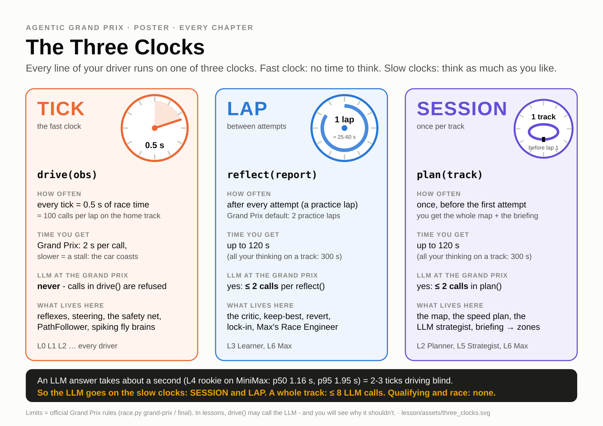
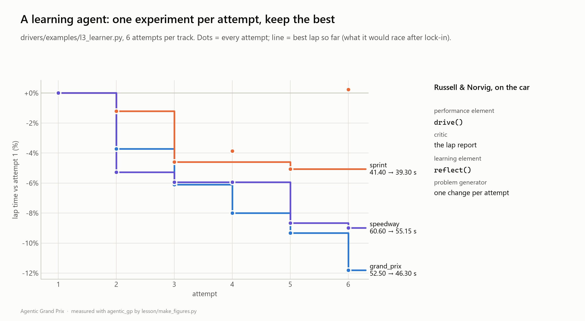
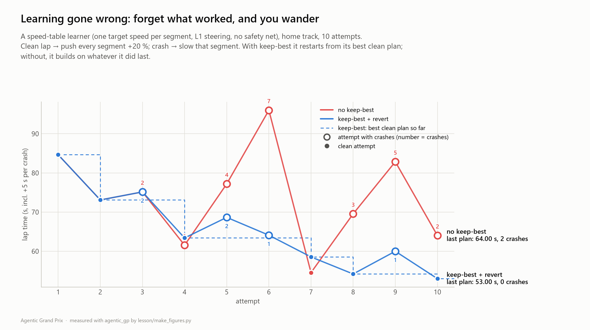

# Ch3 Practice Makes Perfect: the learning agent

**Day 1, 15:45-16:35 (50 min).** You leave with a driver that gets faster lap after lap on a track it has
never seen, keeps the best plan it found, and locks that plan in before qualifying. Your evidence is a
learning curve on the page you built in the Streamlit block.

| | |
|---|---|
| **Agent type** | learning agent (Russell & Norvig): your Ch2 planner + a critic + a learning element |
| **Clocks** | SESSION `plan` · TICK `drive` · **LAP: `reflect(report)` after every attempt** |
| **Your file** | `drivers/submissions/ada.py` v3: + `reflect` |
| **Checkpoint CP3** (16:30, Snapshot #3) | `--track sprint --attempts 6`: best **≥ 3 % faster** than attempt 1, no DNF |
| **Handrail** | [`lesson/checkpoints/ch3_learner.py`](checkpoints/ch3_learner.py) |

Remember: `ada` is the example handle. Type yours.

---

## 1. Goal

[](assets/three_clocks.svg)

You now meet the third clock. Between two attempts the runner calls `reflect(report)` with a full
report of the lap that just ended. A driver that *uses* it is a learning agent. It needs no LLM for that:
a few honest rules about what to try next, and what to keep, are enough to gain 5-10 % on a new track.

[](assets/learning_curve.png)

## 2. Concepts

- **The learning agent, mapped onto the car:**

  | Role (Russell & Norvig) | In your car |
  |---|---|
  | Performance element | `drive()`: the Ch2 planner, unchanged |
  | Critic | the lap report: `race_time`, `crashes`, `crash_log` (with the `segment` of each crash), `segments` |
  | Learning element | `reflect()`: keep the best, revert, change the knobs |
  | Problem generator | **one** change per attempt, so you know what caused the result |

- **Knobs per segment.** Your plan gets one speed factor per gate-to-gate segment (`seg_factor`,
  16 on `grand_prix`) and a safety margin (how much free space the safety net keeps in front of the car).
  A crash in segment 9 tells you exactly which knob to turn.
- **Memory types.** *Working* memory: this tick's `obs`. *Episodic* memory: `self.history`, one row per
  attempt. *Semantic* memory: what you wrote in the file; it is the only thing that survives a session.
  Each session starts with fresh memory, so your driver must learn every new track from scratch.
- **Keep-best and revert.** A change that made the lap slower is undone: the next experiment starts
  from the *best* knobs, not the latest. The sim is deterministic, so the same bad change would give
  the same bad lap; the step for that experiment is halved instead.
- **Lock-in.** `report["next_phase"]` says what comes next. When it says `"qualifying"` or `"race"`, stop
  experimenting and drive your best knobs. Nobody tests a new set-up in the race.
- **Overfitting, again.** Hard-coding the per-segment speeds you learned on the home track into the file
  is the Memorizer from Ch2: fast at home, crashes elsewhere. Your learner *re-learns* on every track
  from its own reports. That is what generalises.

**Learning gone wrong.** The figure shows a learner (a per-segment speed table, 10 attempts on
`grand_prix`) with and without keep-best. Without it, every lap becomes the starting point of the next
experiment: it climbs to 96.0 s with 7 crashes and ends on 64.0 s with 2 crashes. With keep-best it
ends on 53.0 s, clean.

[](assets/learning_gone_wrong.png)

## 3. Watch (5 min)

1. **Your "My learning curve" page** from the Streamlit block (S10). If you skipped that exercise, use
   the solution:

   ```
   python -m streamlit run streamlit_lessons/solutions/s10_race_replay.py
   ```

   Click **My learning curve** in the sidebar. With no results of your own yet, it shows one of the
   reference results in `results/` (the example drivers on `grand_prix`).
2. **Race Control → Learning Curves**, tab *Segment heatmap*: rows = attempts, columns = segments,
   bright = time lost against the best attempt. A good `reflect()` turns the bright cells dark, one
   corner at a time.
3. **Race Control → Replay**, `demo/learner_session_replay.json`: the learner's 5 attempts on `sprint`
   as ghost cars. Is attempt 5 ahead of attempt 1?

## 4. Build

Your Ch2 class gets knobs (step 1) and a `reflect()` that turns them (step 2). Before you start, keep a
copy of your Ch2 file:

```powershell
# Windows PowerShell
Copy-Item drivers/submissions/ada.py races/ada_ch2.py
```

```bash
# macOS
cp drivers/submissions/ada.py races/ada_ch2.py
```

### Step 1: put the knobs in one place

Three edits.

1. Update `ANATOMY`:

   ```python
   ANATOMY = ["perceive", "act", "map", "plan", "memory", "reflect"]
   ```

2. Add the four Ch3 knobs under `"aggression"` in `PARAMS` (the Ch1 knobs stay below them):

   ```python
       "aggression": 1.0,      # Ch2: x the physics corner speed (1.0 = exactly the grip limit)
       "crash_cut": 0.85,      # Ch3: a crash slows that segment and the one before by this factor
       "push": 1.05,           # Ch3: a clean lap -> next attempt tries every segment this much faster
       "start_margin": 3.0,    # Ch3: safety margin of attempt 1 (units kept free in front of the car)
       "min_margin": 1.0,      # Ch3: never brake later than this
   ```

3. Replace your whole Ch2 class (from the `# ===... Ch2: the planner` line to the end of the file) with
   this one. `plan()` now stores the grip limit and builds the plan from the knobs in `_build()`; the
   backward pass and the follower are the ones you wrote in Ch2, with one factor per segment.

   ```python
   # =========================================================================== Ch3: the learner
   EXPERIMENTS = ("push all", "trust walls")     # the problem generator takes turns


   class Driver:
       def __init__(self) -> None:
           self.follower: dk.PathFollower | None = None
           self.memory: dict = {}                    # recover_if_stuck keeps its little state here
           self.history: list[dict] = []             # episodic memory: one row per attempt
           self.say_next: str | None = None

       # ----------------------------------------------------------------------- plan: once per session
       def plan(self, track: dict) -> None:
           self.phys = phys = dk.physics_of(track)
           self.points = points = np.asarray(track["centerline"], dtype=float)

           # Ch2 step 2: the grip limit at every point, v = sqrt(a_lat * R)
           radii = dk.curvature_radii(points)
           self.grip = np.clip(np.sqrt(phys["max_lateral_accel"] * np.minimum(radii, 1e9)), 5.0, phys["max_speed"])
           self.ds = np.linalg.norm(np.roll(points, -1, axis=0) - points, axis=1)

           # Ch3 step 1: the knobs. Segment g runs from gate g to gate g+1 (the same number as obs["segment"]
           # and as "segment" in the report's crash_log).
           self.segment_of = dk.segment_ids(len(points), dk.waypoint_indices(track, points))
           self.seg_factor = [PARAMS["aggression"]] * len(track["waypoints"])
           self.margin = PARAMS["start_margin"]
           self.steps = {"push all": PARAMS["push"] - 1.0, "trust walls": 1.0}
           self.best: dict | None = None             # {"seg_factor", "margin", "time", "attempt"}
           self.experiment = "baseline"
           self.turn = 0                             # whose turn it is in EXPERIMENTS
           self.locked = False
           self._build()
           self.say_next = f"Baseline plan, margin {self.margin:.1f}"

       def _build(self) -> None:
           """Knobs -> planned speeds -> executor (Ch2 steps 2-4 with one factor per segment)."""
           v = self.grip * np.array(self.seg_factor)[self.segment_of]
           v = np.clip(v, 5.0, self.phys["max_speed"])
           n = len(v)
           for _ in range(2):                        # Ch2 step 3: the backward braking pass
               for i in reversed(range(n)):
                   nxt = (i + 1) % n
                   v[i] = min(v[i], math.sqrt(v[nxt] ** 2 + 2 * self.phys["brake"] * self.ds[i]))
           self.follower = dk.PathFollower(self.points, v, physics=self.phys, segments=self.segment_of,
                                           safety_margin=self.margin, blind_factor=min(1.0, self.margin / 3.0))

       # ----------------------------------------------------------------------- drive: every tick
       def drive(self, obs: dict) -> dict:
           if self.follower is None:                 # plan() failed? The Ch1 reflexes still bring the car home.
               throttle, steering = reflexes(obs, self.memory)
               return {"throttle": throttle, "steering": steering}
           throttle, steering = self.follower.control(obs)
           say, self.say_next = self.say_next, None
           return {"throttle": throttle, "steering": steering, "say": say, "debug": dict(self.follower.debug)}
   ```

Run six attempts on `sprint`:

```
python race.py drive drivers/submissions/ada.py --track sprint --attempts 6 --quiet
```

You should now see six identical lines, `FINISHED 41.40 s | ... | crashes 0`. The knobs exist but
nothing turns them yet: memory without learning. (`grand_prix` gives 52.50 s six times: the same as
your Ch2 file, as it should.)

### Step 2: `reflect()`: critic, keep-best, lock-in, one change

Paste this method **inside the class**, below `drive()`, indented by 4 spaces like the other methods:

```python
    # ----------------------------------------------------------------------- reflect: after every attempt
    def reflect(self, report: dict) -> None:
        if self.follower is None:
            return
        time = report["race_time"] if report["completed"] else None          # a DNF has no lap time
        self.history.append({"attempt": report["attempt"], "experiment": self.experiment,
                             "seg_factor": list(self.seg_factor), "margin": self.margin, "time": time,
                             "crashes": report["crashes"],
                             "crash_segments": [c["segment"] for c in report["crash_log"]]})

        # CRITIC: is this the best lap so far?  (keep-best)
        improved = time is not None and (self.best is None or time < self.best["time"])
        if improved:
            self.best = {"seg_factor": list(self.seg_factor), "margin": self.margin, "time": time,
                         "attempt": report["attempt"]}
        elif self.experiment in self.steps:
            self.steps[self.experiment] *= 0.5    # that change hurt: a smaller step next time

        # LOCK-IN: qualifying or the race is next -> no more experiments, drive the best knobs we know.
        if self.locked or report["next_phase"] in ("qualifying", "race"):
            self.locked = True
            if self.best:
                self.seg_factor, self.margin = list(self.best["seg_factor"]), self.best["margin"]
                self._build()
                self.say_next = f"Locked in: knobs of attempt {self.best['attempt']} ({self.best['time']:.2f} s)"
            return

        # LEARN: a crash -> slow down where it happened; else start from the best knobs (revert) + ONE change.
        n = len(self.seg_factor)
        if report["crashes"]:
            for crash in report["crash_log"]:
                for seg in (crash["segment"], (crash["segment"] - 1) % n):
                    self.seg_factor[seg] *= PARAMS["crash_cut"]
            self.margin = PARAMS["start_margin"]
            self.experiment = "crash fix"
            self.say_next = f"{report['crashes']} crash(es): slowing those segments down"
        else:
            if self.best:
                self.seg_factor, self.margin = list(self.best["seg_factor"]), self.best["margin"]
            self.experiment = EXPERIMENTS[self.turn % len(EXPERIMENTS)]
            self.turn += 1
            step = self.steps[self.experiment]
            if self.experiment == "push all":
                self.seg_factor = [min(1.6, f * (1.0 + step)) for f in self.seg_factor]
            else:
                self.margin = max(PARAMS["min_margin"], self.margin - step)
            result = "new best" if improved else "slower - back to the best knobs"
            self.say_next = f"{time:.2f} s ({result}); next: {self.experiment}" if time else \
                f"DNF ({report['ended_by']}); next: {self.experiment}"
        self._build()
```

Read it top to bottom once: **record** (episodic memory) → **judge** (critic, keep-best) → **lock in**
if it counts → otherwise **one change**: a crash slows that segment and the one before it; a clean lap
starts again from the best knobs and tries the next experiment ("push all" segments 5 % faster, or
"trust walls": a smaller safety margin).

### Step 3: practise, and save the curve

```
python race.py drive drivers/submissions/ada.py --track sprint --attempts 6 --save
```

You should now see the radio explain every decision, and the times fall:

```
Attempt 1 [session]
  t=   0.50s tick    1 lap 1 seg  0 v=  5.8 | radio: "Baseline plan, margin 3.0"
Attempt 1: FINISHED 41.40 s | laps [41.40] | crashes 0 | ...
  ...                                      | radio: "41.40 s (new best); next: push all"
Attempt 2: FINISHED 41.65 s | ...
  ...                                      | radio: "41.65 s (slower - back to the best knobs); next: trust walls"
Attempt 3: FINISHED 40.90 s | ...
Attempt 4: FINISHED 40.40 s | ...
Attempt 5: FINISHED 40.35 s | ...
Attempt 6: FINISHED 39.40 s | laps [39.40] | crashes 0 | ...
Best lap: 39.40 s
Result saved: results\ada_sprint.json  (python race.py leaderboard)
```

41.40 → 39.40 s: **4.8 % faster**, every lap clean. Attempt 2 was slower ("push all" did not pay), so
attempt 3 went back to the best knobs and tried the other experiment. That is keep-best and revert at
work. `--save` wrote `results/ada_sprint.json`: one file per car *and* track. The first part of the
name comes from your car's **`NAME`**, not from the file name: `NAME = "Ada"` gives `ada_sprint.json`,
`NAME = "Rocket 2"` would give `rocket-2_sprint.json`. The `Result saved:` line always shows the real
name.

### Step 4: see the curve

Refresh your **My learning curve** page (S10, or the solution app from Watch). Pick
`results/ada_sprint.json`. You should now see your six points falling from 41.40 to 39.40, a "Gain vs
attempt 1" of **4.8 %**, and a green box: *"Checkpoint CP3 reached: at least 3 % faster than attempt 1,
no DNF."*

The same file is in **Race Control → Learning Curves**, tab *Curves* (pick it in the multiselect).
For the *Segment heatmap* tab you need a session file with per-segment times: run your driver on the
**Live** page with 2 or more attempts and press "Save to races/live/".

### Step 5: lock-in in a real weekend

Race your file through a mini Grand Prix weekend (3 practice laps, a qualifying lap, a 1-lap race):

```
python race.py grand-prix drivers/submissions/ada.py --track sprint --practice 3 --laps 1 --out races/ada_weekend.json
```

You should now see practice 41.40, 41.65 and 40.90 s, then **qualifying 40.90 s** and **race 40.90 s**.
After the third practice lap `next_phase` was `"qualifying"`, so `reflect()` locked in the knobs of the
best practice lap instead of trying something new. Open `ada_weekend.json` in the Replay page.

## 5. Check (CP3)

```
python race.py check drivers/submissions/ada.py
python race.py drive drivers/submissions/ada.py --track sprint --attempts 6 --save
```

| What | Band | Handrail measured ([CALIBRATION.md](instructor/CALIBRATION.md)) |
|---|---|---|
| `sprint`, 6 attempts | best **≥ 3 %** faster than attempt 1, **no DNF**, best lap clean | 41.40 → 39.40 s (4.8 %) |
| `grand_prix`, 6 attempts | (not the CP3 track, but a good second curve) | 52.50 → 47.45 s (9.6 %) |
| your curve page | the green CP3 box | |

Measure CP3 on **`sprint`**, as above. On `briefing_demo` the same learner gains only 2.8 % in 6
attempts (59.75 → 58.05 s), and collects 2 yellow-flag penalties on every lap until Ch5 teaches it to
read the briefing.

**Exercise (10 min): the same crash twice in a row.** Your learner has never crashed so far. Make it,
with greedy knobs (an optimistic plan and no safety margin):

```
python race.py drive drivers/submissions/ada.py --track sprint --attempts 6 --param aggression=1.6 --param start_margin=0 --param min_margin=0 --quiet
```

Measured: `65.05 (4 crashes) → 49.65 (1) → 49.65 (1) → 43.70 → 53.85 (2) → 43.40`. Attempts 1 and 2
both crash at T2 (segment 5): one 0.85 cut was not enough. (Find it yourself: each crash in
`report["crash_log"]` has a `segment` and a `corner`.) Write a rule that stops "the same crash twice in a
row". `self.history[-2]["crash_segments"]` holds the crash segments of the attempt before (if there is
one). One possible answer, in the crash branch of `reflect()`, replaces the `for crash ...` loop:

<details>
<summary>Show one solution</summary>

```python
            before = self.history[-2]["crash_segments"] if len(self.history) >= 2 else []
            for crash in report["crash_log"]:
                cut = PARAMS["crash_cut"] ** 2 if crash["segment"] in before else PARAMS["crash_cut"]
                for seg in (crash["segment"], (crash["segment"] - 1) % n):
                    self.seg_factor[seg] *= cut                # crashed here last time too? cut twice
```

With it, the same command gives `65.05 (4) → 49.65 (1) → 44.20 → 55.05 (2) → 49.35 (1) → 44.00`: after
the second T2 crash the rule cuts twice as hard, and attempt 3 is clean (without the rule it crashed
again, at T7). (The best lap is not better here, 44.00 vs 43.40: one
rule rarely fixes everything. Your logbook can say so.) With the default knobs nothing changes:
41.40 → 39.40 s.

</details>

## 6. Push

- **Bronze:** best ≤ first (it never gets worse than attempt 1).
- **Silver:** ≥ 3 % gain on `sprint`, clean best lap (the CP3 band).
- **Gold:** improving **within 3 attempts** on 2 tracks it has never seen:

  ```
  python race.py drive drivers/submissions/ada.py --track random:7 --attempts 3 --quiet
  python race.py drive drivers/submissions/ada.py --track random:12 --attempts 3 --quiet
  ```

  The handrail: random:7 44.45 → 44.45 → 42.60, random:12 42.65 → 41.90 → 40.25. Faster learning means
  bigger first steps, and bigger steps mean more crashes. Find your balance with `--param push=...`.
  (Day 2's Mystery GP gives you only 3 practice laps.)

## 7. Stuck?

> **Stuck for 2 minutes? Red sticky note up.** Then compare:
>
> ```
> git diff --no-index drivers/submissions/ada.py lesson/checkpoints/ch3_learner.py
> ```
>
> Only what Ch3 changed: `git diff --no-index lesson/checkpoints/ch2_planner.py lesson/checkpoints/ch3_learner.py`.
> Still stuck at 16:25? Copy the handrail over your file, put your metadata back, run the Check.

| Symptom | Likely cause |
|---|---|
| Six identical lap times after step 2 | `reflect` is not inside the class (not indented), or misspelt. |
| `NameError: name 'EXPERIMENTS' is not defined` | Paste the `EXPERIMENTS = ...` line too (it sits above `class Driver`). |
| `KeyError: 'push'` | The four Ch3 knobs are missing from `PARAMS`. |
| `TypeError: unsupported format string passed to NoneType` | You changed the `say_next` line: a DNF has `time = None`. |
| My curve page does not list `results/ada_sprint.json` | You did not run step 3 with `--save` yet, or the page was open before: refresh it. |

## 8. Submit and logbook

**CP3 at 16:30:** upload `drivers/submissions/ada.py`. It runs in **Snapshot #3**, where your
`reflect()` gets two practice laps before the timed lap. At 16:35 it races in the **Day-1 Club Race**
(1 practice lap, qualifying, a 2-lap race against the house cars); you watch the replay in your own S10
viewer.

Logbook line: *"reflect() bought me ___ % on sprint in 6 attempts. It cost me: ___ (time? risk? one bad
experiment per two?). Without keep-best, ___."*

**Exit ticket (Club Race):** which clock does each part of your driver live on? `plan` = ___,
`drive` = ___, `reflect` = ___.

Tomorrow: [Ch4 Talking to MiniMax](04_minimax.md).
