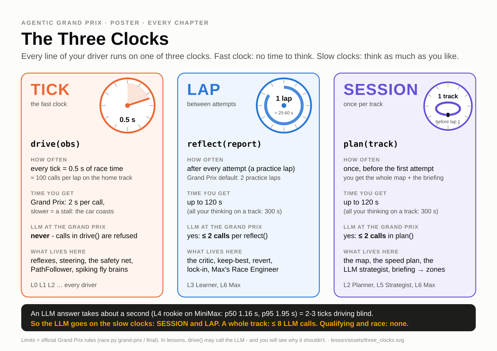
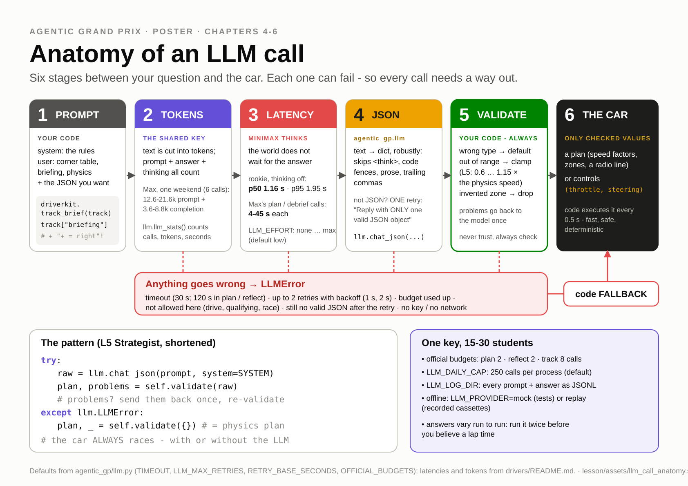
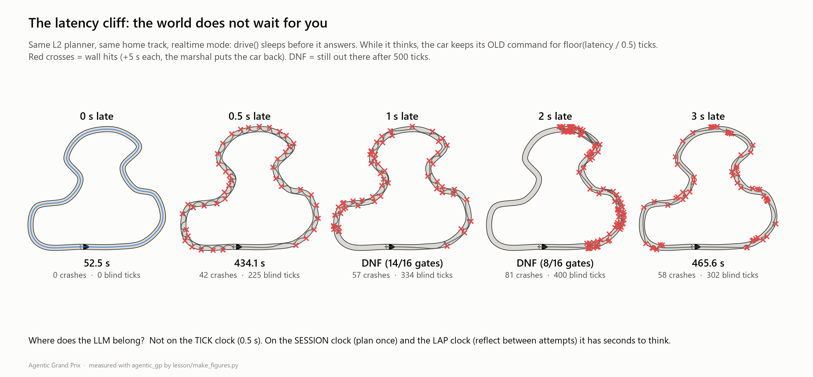

# Ch4 Talking to MiniMax, and the latency wall

**Day 2, 09:00-10:10 (15 min check-in + 55 min chapter).** You leave with a second, throw-away file,
`drivers/submissions/<handle>_pilot.py`, in which an LLM drives the car tick by tick. You will measure
how good its decisions are and how long they take. That number decides where the LLM goes in your
real driver for the rest of the day.

| | |
|---|---|
| **Agent type** | LLM as the reflex policy: the model *is* `drive(obs)` |
| **Clock** | TICK (0.5 s), on purpose, to see why it does not belong there |
| **Your main file** | unchanged (still your Ch3 learner) |
| **Checkpoint CP4** | exam table + your latency p50/p95 + one sentence: "where does the LLM belong?" |
| **Handrail** | [`lesson/checkpoints/ch4_pilot.py`](checkpoints/ch4_pilot.py) |
| **LLM calls** | about 25 on the shared key (budget box below) |

---

## 0. Check-in (09:00-09:15): the key goes into `.env`

You get the class MiniMax key from your instructor at 09:00. It goes into one file, `.env`, in the repo
root. That file is git-ignored, so it never leaves your laptop.

1. Make your own `.env` from the example (once):

   ```powershell
   # Windows PowerShell
   Copy-Item .env.example .env
   ```

   ```bash
   # macOS
   cp .env.example .env
   ```

2. Open `.env` in your editor and paste the key right after `MINIMAX_API_KEY=` (no quotes, no spaces).
   Leave every other line as it is: `LLM_MODEL=MiniMax-M3` and `LLM_EFFORT=low` are the course defaults.

3. With the venv active, ping the model:

   ```
   python race.py doctor --llm
   ```

   You should now see, among the green lines:

   ```
     [OK  ] .env: present, not tracked by git
     [OK  ] LLM config: minimax:MiniMax-M3, effort low, key set
   [llm] llm calls 1/250 (minimax:MiniMax-M3)
     [OK  ] LLM call: minimax:MiniMax-M3 answered in 1.4 s (SDK start-up 86.7 s, 2 chars)
   ```

   *(Example from our test run. Your times will differ.)* The first call in a fresh Python process also
   pays for loading the OpenAI SDK. `doctor` shows that start-up separately. It took 87 s on our busy
   test laptop, and it is usually much faster. The call itself is the number that matters.

> **Never** paste the key into a driver file, a notebook, a chat or a screenshot. The scrutineers
> search every submission for it (Ch8 shows you the same check). If `doctor` says `.env` is tracked by
> git, tell your instructor before you do anything else.

### The shared-key budget

The whole class shares one key, so these limits exist. Each line says who enforces it.

| Rule | Enforced by |
|---|---|
| **Official events** (snapshots, dress rehearsal, Grand Prix): LLM calls only in `plan()` (at most 2) and in `reflect()` after a *practice* lap (at most 2 each), **at most 8 per track**, at most 60 s per request. In `drive()`, qualifying and the race, `agentic_gp.llm` raises `LLMNotAllowed`. | the runner (`llm_policy`, official mode). You cannot switch it off. |
| **Lessons** (`race.py drive`, `exam`, your Python prompt): no per-phase limit. Each Python process stops at **250 calls** (`LLM_DAILY_CAP`) and prints `[llm] llm calls 47/250` on every call so you can see your count. | `agentic_gp/llm.py` |
| **Ch4 pilot**: at most **20 LLM ticks per run** (`PARAMS["MAX_LLM_TICKS"]`), then your code drives. | your file (you write it in step 4) |
| **Latency Lab** page: at most **30 real calls per app server**. | Race Control |
| **Ch4 as a whole**: about 25 calls per person (steps 2, 3 and two 10-state exams). Step 6 adds up to 40 more (20 per run), so it is the instructor's demo; run it yourself only if the instructor says the budget allows, and then with `--param MAX_LLM_TICKS=5` (10 calls). Run the exam steps (4 and 5) **in waves by row** (A, B, C, 5 min each) when the instructor calls your row. | you |

If your instructor puts `LLM_MAX_RPM=6` in `.env`, every process waits so it makes at most 6 calls a
minute. You then see `[llm] 6 calls/min limit: waiting 9s`. That is the shared key's etiquette, not a
bug. While it is on, the exam's `ms` column includes that waiting time, so measure your latency in a
wave with it off.

---

## 1. Goal



So far every decision in your car was code. Today an LLM joins the crew. Before you give it a job, you
answer two questions with data:

1. **Quality.** Given the sensors, does the model make the same call your reflexes would make? Does it
   get "+ = right" right?
2. **Speed.** How long does one answer take, compared with the 0.5 s tick?

## 2. Concepts

[](assets/llm_call_anatomy.svg)

- **One call = messages in, text out.** `agentic_gp.llm` speaks the OpenAI chat API to MiniMax
  (`https://api.minimax.io/v1`, model `MiniMax-M3`). You send a *system* message (the job description)
  and a *user* message (the situation). You get text back. You never import `openai` yourself:
  `race.py check` refuses raw SDKs in driver files.
- **Structured output.** `llm.chat_json(...)` asks for one JSON object and parses it robustly. If the
  text is not JSON it asks once more, and if that fails too it raises `LLMError`. Code then
  **validates**: are the numbers there, finite, and inside -1..1? Anything else counts as "no answer".
- **Tokens cost time.** The model reads and writes *tokens* (word pieces), not characters. In our
  run a five-word "Say hi" prompt was billed as 204 prompt tokens, because the chat format adds its
  own. The model's thinking counts as completion tokens too. More tokens in or out means a slower
  answer, so keep prompts short.
- **`effort` = thinking.** MiniMax-M3 *thinks* before it answers unless you switch that off.
  `effort="none"` turns thinking off, which is fast. The course default `low` keeps a little thinking,
  which is slower but smarter. `llm.last_reasoning()` shows what it thought.
- **No temperature.** The library never sends `temperature`, so you cannot make answers repeatable.
  Ask twice and you may get two different answers. Always design for that.
- **Mandatory fallback.** Every LLM error (no key, timeout, budget, `LLMNotAllowed`, bad JSON) is an
  `llm.LLMError`. The pattern is always:

  ```python
  try:
      answer = llm.chat_json(prompt, system=SYSTEM)
  except llm.LLMError:
      answer = None            # -> your code decides
  ```

- **Sim time vs wall time.** In a normal run the simulator *waits* for `drive()`: a 1 s answer costs
  you nothing on the clock (turn-based). In `--realtime` mode the world keeps moving. The car keeps
  doing its last command while the model thinks, so it drives **blind**:
  **blind distance = speed × latency**. At 30 u/s a 1 s answer means 30 units, almost two track
  widths, with nobody steering.

## 3. Watch (5 min)

1. **The latency cliff** (measured, `races/demo/latency_cliff.json`). The L2 planner is a *perfect*
   code driver. Here it is in realtime mode, with every answer arriving late by a fixed delay:

   

   | Answer delay | Ticks driven blind | Result on `grand_prix` | Crashes |
   |---|---|---|---|
   | 0 s | 0 | 52.5 s | 0 |
   | 0.5 s (one tick) | 1 | 434.15 s | 42 |
   | 1 s | 2 | DNF (14 of 16 gates) | 57 |
   | 2 s | 4 | DNF (8 of 16 gates) | 81 |
   | 3 s | 6 | 465.65 s | 58 |

   Yes, 3 s finishes and 1 s does not. That is luck plus the marshals, not skill. After each crash the
   marshals put the car back on the centreline pointing down the track, and a stale "full throttle,
   straight on" sometimes carries it to the next gate. 58 crashes is not driving.

2. **Race Control → Latency Lab** (`python -m streamlit run app/race_control.py`). Section 1 times
   real calls. Pick *Simulated* if you want to keep your budget. You should now see a histogram with
   a red line at 0.5 s, and the "ticks driven blind per call" metric. Sections 2 and 3 show the blind
   distance and the cliff above.

3. **Instructor demo: the same pilot, turn-based vs realtime** (20 LLM ticks each):

   ```
   python race.py drive lesson/checkpoints/ch4_pilot.py
   python race.py drive lesson/checkpoints/ch4_pilot.py --realtime
   ```

   Example from our run (abbreviated, real MiniMax):

   ```
   Attempt 1: FINISHED 67.20 s | laps [67.20] | crashes 0 | penalties 0.0 s | 16 waypoints | 135 ticks
   drive() time: mean 253.1 ms, max 9289.8 ms | LLM: 20 calls, 8937 tokens | wall 224.2 s

   ... [realtime]
     t=   5.00s tick   10 ... radio: "Straight ahead, accelerate to speed" | late: +9 tick(s) with the previous command
     t=  19.00s tick   28 ... crash: hit a wall, +5s penalty ... | radio: "BRAKE AND TURN LEFT" | late: +1 tick(s) ...
   Attempt 1: FINISHED 113.20 s | laps [113.20] | crashes 4 | penalties 20.0 s | 16 waypoints | 187 ticks
   ```

   Turn-based, the slow answers cost almost nothing: 67.20 s, clean. (LLM answers vary: in other runs
   the same pilot did 65.75 s and 72.20 s with 1 crash, so expect 65-73 s with 0-1 crashes, and
   105-115 s with 3-4 crashes in realtime.) In realtime the car gets the
   *first* answer only at tick 10 ("+9 ticks with the previous command"). It hits the wall while the
   model is still saying "BRAKE AND TURN LEFT". The result is 113.20 s with 4 crashes, and the code
   reflexes still drove most of the lap after the 20 LLM ticks.

---

## 4. Build

Work in a terminal in the repo root with the venv active (`.venv\Scripts\activate` on Windows,
`source .venv/bin/activate` on macOS). Steps 2 and 3 use the Python prompt. Start it with `python`, and
paste one block at a time.

### Step 1: ping the model

You did this at 09:00 (`python race.py doctor --llm`). Green means your key works. Red: read the
message. `1004` / `2049` means a key problem (re-paste it). `1008` means the account has no balance
(tell the instructor).

### Step 2: your first call

Start Python (`python`) and keep this one prompt open for steps 2 and 3: every new Python process pays
the SDK start-up again (`doctor` showed you how long that takes on your laptop). The first line,
`llm.warm_up()`, pays it now, so the start-up does not count in `seconds` below.

```python
from agentic_gp import llm
llm.warm_up()
llm.chat("Say hi in 5 words")
llm.last_reasoning()
llm.llm_stats()
```

You should now see five words, then the model's thinking about them, then your usage. Example from
our run:

```
'Hi there! How are you?'
'We need exactly five words saying hi. "Hi there! How are you?" Count Hi1 there2 How3 are4 you5. Punctuation okay.'
{'calls': 1, 'errors': 0, 'prompt_tokens': 204, 'completion_tokens': 42, 'seconds': 3.123, 'cache_hits': 0}
```

Now switch the thinking off and compare `seconds`:

```python
llm.chat("Say hi in 5 words", effort="none")
llm.llm_stats()
```

Example: the answer `'Hi! How are you today?'` came back in 0.6 s instead of 3.1 s (`seconds` went
from 3.123 to 3.722). Thinking costs time. The pilot will use `effort="none"`.

### Step 3: the sensors in, the controls out

Load one recorded moment of a real lap: tick 34 on `grand_prix`, where the next waypoint is
23.5° to the **right**.

```python
import json
obs = json.load(open("races/demo/exam_states.json"))["states"][17]
sensors = {k: obs[k] for k in ("speed", "distance_to_wall_front", "angle_to_next_waypoint", "distance_to_next_waypoint")}
SYSTEM = 'You drive a race car in a 2D sim, one decision every 0.5 s. Reply ONLY with JSON: {"throttle": -1..1, "steering": -1..1, "say": "<= 6 words"}'
llm.chat_json(json.dumps(sensors), system=SYSTEM, effort="none")
```

You should now see a Python dict, not text. Example from our run, asked three times:

```
{'throttle': 1.0, 'steering': 0.4, 'say': 'Turn right toward waypoint'}           1.05 s
{'throttle': 1.0, 'steering': 0.4, 'say': 'Turn right toward waypoint'}           3.09 s
{'throttle': 1.0, 'steering': 0.4, 'say': 'Full throttle, steering toward waypoint'}  0.94 s
```

Steering +0.4 means right, which is correct this time. The same question can take 1 s or 3 s, and the
words change between calls (no temperature!). One correct answer proves nothing, so in step 4 you
measure the model on ten situations instead of one. Type `exit()` to leave Python.

### Step 4: the pilot file and the exam

Your main file is a Ch3 class by now, so the pilot starts from the Ch1 handrail. It is a plain
function driver with the same reflexes you wrote in Ch1.

1. Copy it (this works in PowerShell and on macOS):

   ```
   cp lesson/checkpoints/ch1_reflex.py drivers/submissions/<handle>_pilot.py
   ```

2. Make the imports at the top of the new file look like this (`json`, `time` and `llm` are new):

   ```python
   import json
   import math
   import time

   from agentic_gp import driverkit as dk
   from agentic_gp import llm
   ```

3. Change `NAME` (for example `"Ada Pilot"`), set `AUTHOR` to your handle, and set `KIND = "llm"`.
   Add the line `MODEL = "MiniMax-M3"` under `KIND`, and add `"llm"` to the `ANATOMY` list (it becomes
   `ANATOMY = ["perceive", "act", "llm"]`). Then add one knob as the **first line inside**
   `PARAMS = {`:

   ```python
       "MAX_LLM_TICKS": 20,    # Ch4: LLM decisions per run, then the reflexes drive
   ```

4. Rename your reflex function. Change the line `def drive(obs: dict) -> tuple[float, float]:` to:

   ```python
   def reflexes(obs: dict) -> tuple[float, float]:
   ```

5. Paste this block at the **very bottom** of the file. It is the new `drive()`: the LLM decides
   while it has budget, every answer is validated, and anything unusable falls back to your
   reflexes.

   ```python
   # =========================================================================== Ch4: the LLM pilot
   _memory.update(llm_ticks=0, failures=0, latencies=[])   # counters for this run

   SYSTEM = ("You drive a race car in a 2D sim, one decision every 0.5 s. "
             'Reply ONLY with JSON: {"throttle": -1..1, "steering": -1..1, "say": "<= 6 words"}')

   # The sensor values the model gets (short prompt = fast answer).
   KEYS = ("speed", "distance_to_wall_front", "distance_to_wall_left_45", "distance_to_wall_right_45",
           "distance_to_wall_left_90", "distance_to_wall_right_90", "angle_to_next_waypoint",
           "distance_to_next_waypoint", "angle_to_waypoint_after_next", "zone_speed_limit")


   def drive(obs: dict) -> dict:
       if _memory["llm_ticks"] < PARAMS["MAX_LLM_TICKS"] and llm.llm_allowed():
           _memory["llm_ticks"] += 1
           action = ask_llm(obs)
           if action is not None:
               return action
           _memory["failures"] += 1
       throttle, steering = reflexes(obs)          # budget used up / bad answer: your Ch1 code drives
       return {"throttle": throttle, "steering": steering}


   def ask_llm(obs: dict) -> dict | None:
       """One LLM decision, validated. None if anything goes wrong (then the reflexes take this tick)."""
       sensors = {k: (round(obs[k], 1) if isinstance(obs.get(k), float) else obs.get(k)) for k in KEYS}
       t0 = time.perf_counter()
       try:
           answer = llm.chat_json(json.dumps(sensors), system=SYSTEM, effort="none", max_tokens=200)
       except llm.LLMError:
           return None
       finally:
           _memory["latencies"].append(round(time.perf_counter() - t0, 3))
       try:
           throttle, steering = float(answer["throttle"]), float(answer["steering"])
       except (KeyError, TypeError, ValueError):
           return None
       if not (math.isfinite(throttle) and math.isfinite(steering)):
           return None
       say = str(answer.get("say") or "")[:60] or None
       return {"throttle": dk.clamp(throttle), "steering": dk.clamp(steering), "say": say}
   ```

6. Check the contract. `check` always uses the mock LLM, so it costs nothing:

   ```
   python race.py check drivers/submissions/<handle>_pilot.py
   ```

   You should now see:

   ```
     static check: OK
     LLM: mock (offline: chat() answers 'OK (mock LLM)', chat_json() returns {}; use --real-llm to test with MiniMax)
     smoke test: 40 ticks on grand_prix, 5 waypoints, 0 crashes, drive() mean 0.3 ms / max 1.1 ms
   PASSED - ready to race (...)
   ```

   The mock's `{}` has no `"throttle"`, so every tick fell back to your reflexes. That is the fallback
   working.

7. **The exam (wait for your row's wave).** `race.py exam` gives your pilot 10 recorded moments of a
   real lap and compares each decision with the reference reflex driver (`drivers/examples/l1_reflex.py`):

   ```
   python race.py exam drivers/submissions/<handle>_pilot.py --states races/demo/exam_states.json --n 10
   ```

   You should now see a table with one row per moment. The columns `steer sign` and `thr sign` say
   `ok` or `WRONG`. `WRONG` usually means the opposite direction. One exception: when the reference
   is about straight (between -0.05 and +0.05), the model must also be about straight (within 0.1 of
   it). So reference +0.02 and model +0.30 counts as `WRONG` too: right direction, but far too much. Below it come the agreement percentages and the latency line. Example from our
   run (real MiniMax, abbreviated):

   ```
   Exam: Demo Pilot vs reference Reflex on 10 recorded states (from Planner on grand_prix)
    #  speed  angle  front    thr  steer  ref thr  ref steer  steer sign  thr sign     ms  note
    4   29.1     -1    142  +0.50  +0.40    +1.00      -0.02  WRONG       ok          546  Steer right toward waypoint
    5   36.2     -1    118  +0.50  +0.65    -0.18      -0.10  WRONG       WRONG       617  Aim right toward next waypoint
    9   35.3    -11     55  +0.90  -0.40    -0.76      -0.33  ok          WRONG      4268  Bracing for sharp right turn a

   Steering sign agreement: 30 %   Throttle sign agreement: 40 %
   ```

   Read row 5 aloud. The waypoint is 1° to the **left** (`angle -1`). The model says "Aim right" and
   steers +0.65. That is a mirror-image bug, the classic one from Ch1, and nobody told the model the
   sign rule. Row 9 steers the right way (-0.40), but its words say "sharp right turn". The words and
   the numbers do not even agree with each other.

   Write your two percentages and your p50/p95 in your logbook.

### Step 5: teach it the rules, re-run the exam

Replace the `SYSTEM = (...)` lines in your block with this version. It adds the sign rule and the
stopping rule:

```python
SYSTEM = ("You drive a race car in a 2D sim, one decision every 0.5 s. Sign rule: + = RIGHT, - = LEFT for "
          "every angle and for steering. Steer towards the next waypoint: steering ~ angle_to_next_waypoint / 30. "
          "Stopping rule: brake (throttle < 0) when distance_to_wall_front < speed * speed / 50 + 10. "
          'Reply ONLY with JSON: {"throttle": -1..1, "steering": -1..1, "say": "<= 6 words"}')
```

Run the same exam again (same 10 moments, same command as step 4.7).

Example, our runs side by side (real MiniMax; we also ran `--n 20` on the same states):

| Prompt | Moments | Steering sign agreement | Throttle sign agreement | p50 | p95 |
|---|---|---|---|---|---|
| step 4 (no rules) | 10 | 30 % | 40 % | 1623 ms | (see note) |
| step 5 (sign rule + stopping rule) | 10 | **90 %** | 60 % | 1169 ms | (see note) |
| step 4 (no rules) | 20 | 55 % | 35 % | 1030 ms | 3927 ms |
| step 5 (sign rule + stopping rule) | 20 | **90 %** | 30 % | 1104 ms | 1572 ms |

*Note:* our 10-moment runs had `LLM_MAX_RPM=6` switched on, so one row waited 57 s for the
calls-per-minute limit, and that wait shows up as p95. Ignore such rows, or measure in a wave with
the limit off.

Two lessons hide in that table:

- **One sentence of domain knowledge fixed the steering.** The sign rule took steering agreement to
  90 % in both runs.
- **The throttle hardly improved.** The reference reflex brakes for corners it can *see coming*
  (look-through, the turn-away limit from Ch1). The model only got a wall-distance rule, so it often
  says "full throttle" into corners. A prompt only carries the knowledge you put into it.

### Step 6: the latency wall (instructor demo, or yours if your budget allows)

```
python race.py drive drivers/submissions/<handle>_pilot.py
python race.py drive drivers/submissions/<handle>_pilot.py --realtime
```

Each run makes up to 20 LLM calls, 40 for both: only with the instructor's OK, and preferably with
`--param MAX_LLM_TICKS=5` added to both lines. Compare with the instructor's demo in section 3:
turn-based 65-73 s with 0-1 crashes, realtime 105-115 s with several crashes.

---

## 5. Check (CP4)

Your CP4 is three things in your logbook (and on the snapshot slide):

1. **The exam table:** steering and throttle sign agreement, before and after step 5.
2. **Your latency:** p50 and p95 from the exam's last line. Our measurements: p50 between 1.0 and 1.6 s
   per decision with thinking off; p95 from 1.5 s up to 3.9 s (not counting rate-limit waits). The handrail's calibration run
   ([CALIBRATION.md](instructor/CALIBRATION.md)) measured p50 1.04 s, p95 1.45 s.
3. **One sentence:** where does the LLM belong in your race car, and why? Use your p50.

Under the mock LLM the pilot must still finish (this is what the official rules do to it, because
`drive()` may not call the LLM there):

```powershell
# Windows PowerShell
$env:LLM_PROVIDER="mock"; python race.py drive drivers/submissions/<handle>_pilot.py; Remove-Item Env:LLM_PROVIDER
```

```bash
# macOS
LLM_PROVIDER=mock python race.py drive drivers/submissions/<handle>_pilot.py
```

You should now see a clean finish, the same as your Ch1 reflexes (the handrail does 66.70 s on
`grand_prix`). In PowerShell, `Remove-Item Env:LLM_PROVIDER` switches the real LLM back on. Without
it, the mock stays on in that window.

**Exercise (2 min).** Ticks per call = p50 / 0.5. With p50 ≈ 1.1 s that is about 2 ticks: in realtime
the car always acts on a picture that is 1 s old. Now look at the latency-cliff table. Even the
perfect L2 planner does not finish at 1 s delay. What is the best realtime lap an LLM pilot could
hope for?

## 6. Push

- **Bronze:** one valid JSON answer (step 3), and a pilot that passes `check`.
- **Silver:** at least 70 % steering sign agreement in the exam.
- **Gold:** a hybrid. Every 10 ticks, the LLM only picks a mode, `"push"` or `"careful"`, and the code
  turns it into a speed cap. Your reflexes do all the steering. Hints: `obs["tick"]` tells you when 10
  ticks have passed; keep the mode in `_memory`; an `LLMError` keeps the previous mode. How many calls
  does a lap cost now, and what does realtime mode do to it? (The L4 example has a related knob:
  `python race.py drive drivers/examples/l4_llm_rookie.py --param DECIDE_EVERY_N_TICKS=4`.)

## 7. Submit and logbook

The pilot is **never raced**: keep it as `drivers/submissions/<handle>_pilot.py`. Your main file stays
your Ch3 learner until Ch5.

Logbook line: *"An LLM pilot bought me ___ % steering agreement and cost ___ s per decision. In my
race car the LLM belongs on the ___ clock, because ___."*

> **Stuck?** Compare your pilot with the handrail, then copy it if you need to:
>
> ```
> git diff --no-index lesson/checkpoints/ch1_reflex.py lesson/checkpoints/ch4_pilot.py
> cp lesson/checkpoints/ch4_pilot.py drivers/submissions/<handle>_pilot.py
> ```
>
> The handrail already contains the step 5 prompt. Common errors:
> - `NameError: name 'reflexes' is not defined`: step 4.4 was skipped.
> - `KeyError: 'MAX_LLM_TICKS'`: step 4.3 was skipped.
> - `LLM: 20 calls, 0 tokens`, and no radio from the model: those were mock calls. `LLM_PROVIDER` is
>   still `mock` in this window (`Remove-Item Env:LLM_PROVIDER`).
> - Red sticky note after two minutes.

Next: [Ch5 The Strategist](05_strategist.md). The LLM moves to the SESSION clock, where seconds are free.
