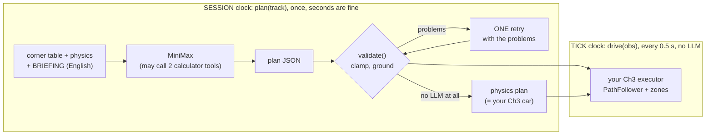
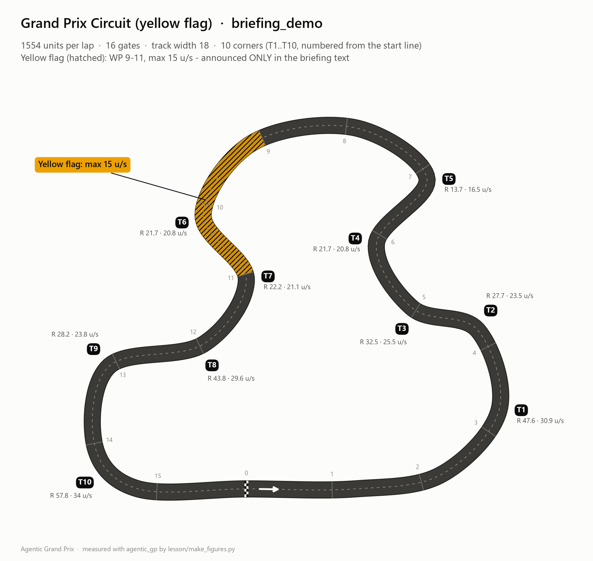

# Ch5 The Strategist: plan once, execute fast

**Day 2, 10:25-11:35 (70 min).** In Ch4 you measured that an LLM answer takes about a second, two ticks.
So the LLM leaves the TICK clock. It moves to the **SESSION clock**: `plan(track)` runs once, before
lap 1, and may take seconds. There the LLM gets a job code cannot do: **reading the race briefing**, a
paragraph of English from race control, and turning it into rules your car obeys.

| | |
|---|---|
| **Agent type** | goal-based agent with an LLM planner and a code executor |
| **Clock** | SESSION (`plan`): the LLM writes the plan. TICK (`drive`): your Ch2/Ch3 executor, no LLM |
| **Your main file** | `drivers/submissions/<handle>.py`, from Ch3 learner to **v5** |
| **Checkpoint CP5 (11:30, Snapshot #4)** | within ±5 % of your Ch3 time, 0 zone violations on `briefing_demo`, at most 3 calls in `plan` (official events stop at 2: a third call raises `LLMError` and your code keeps the first plan), still finishes with `LLM_PROVIDER=mock` |
| **Handrail** | [`lesson/checkpoints/ch5_strategist.py`](checkpoints/ch5_strategist.py) |
| **LLM calls** | 1-3 per `plan()`; about 15 for the whole chapter |

---

## 1. Goal



The LLM thinks slowly, once. The code acts fast, every tick. That is the "slow thinking, fast acting"
split that every serious agent in this course uses, Max included.

## 2. Concepts

- **The briefing is the LLM's real edge.** On `briefing_demo` race control says, in plain English,
  *"Yellow flag between waypoints 9 and 11: max speed 15."* Your Ch3 car cannot read. It drives
  through at 36 u/s and collects +1 s per tick too fast: 2 zone violations, +2 s. The track map
  deliberately does **not** contain the zone, so only a reader can know about it.
- **Schema-validated JSON.** You tell the model the exact shape you want:
  `{"cap", "corners": [{"id", "speed_factor", "note"}], "zones": [{"from_wp", "to_wp", "max_speed"}], "say"}`.
  Then **code** checks every field. The model is a colleague whose work you review, not an oracle.
- **Clamp, drop, fall back, per field.** A `speed_factor` outside 0.6-1.15 is clamped. A corner id that
  does not exist is dropped, and that corner keeps the physics speed. If there is no usable answer at
  all, the physics plan drives, which is exactly your Ch3 car.
- **One retry, with the problems.** If the validator found problems, the model gets its own answer back
  with the list of problems and one chance to fix them. That is the official budget: 2 calls in `plan()`.
- **Grounding.** A zone whose numbers are not in the briefing text is *invented*. It is dropped. An
  LLM that makes up a speed limit would cost you the whole weekend.
- **Tools: the LLM asks, code does the arithmetic.** `corner_speed(radius)` and
  `braking_distance(v_from, v_to)` are plain Python functions. Their name, type hints and docstring
  become a *tool schema*. The model can call them instead of guessing a square root.

## 3. Watch (5 min)

1. **The track and its briefing.** `briefing_demo` is the home track plus a yellow flag:

   

2. **Race Control → Pit Wall.** Open `class_demo/Strategist.jsonl` from the demo race (the first call
   is the real MiniMax one). You should now see the prompt with the corner table and the briefing, the
   two tools it was offered, and the final JSON plan, with its seconds (34 s) and tokens. In that run
   the model answered without calling a tool. In yours it may call them, and then each tool call and
   its result appear as their own steps.

3. **The L5 example strategist** does all of this in one file:
   [`drivers/examples/l5_llm_strategist.py`](../drivers/examples/l5_llm_strategist.py). Read its
   docstring diagram. Today you build the same thing on top of *your* Ch3 learner.

---

## 4. Build

Your main file is `drivers/submissions/<handle>.py` (your Ch3 learner). Save a copy first, because
you need it for the A/B race in step 5. It goes into `races/`, which git ignores, so it can never be
raced or uploaded by mistake:

```
cp drivers/submissions/<handle>.py races/<handle>_ch3.py
```

Then open `races/<handle>_ch3.py` and give the copy its own name, for example
`NAME = "Ada Ch3"`. Two cars with the same `NAME` in one race are hard to tell apart in the
standings, the radio and the replay, and their log files get confusing suffixes.

### Step 1: read what the strategist will read

Start `python` in the repo root and paste:

```python
from agentic_gp import RaceEnv, make_track
from agentic_gp import driverkit as dk
track = RaceEnv(make_track("briefing_demo")).track_map()
print(dk.track_brief(track))
```

You should now see the whole situation as text:

```
Track: Grand Prix Circuit (yellow flag) (briefing_demo): lap 1554 u, half-width 9.0, 16 waypoints, 1 lap(s).
Physics: top speed 40, accel 12, brake 25 u/s^2, grip 20 u/s^2 -> corner speed v_max = sqrt(20 * R). One tick = 0.5 s. Sign convention: + = right.
Corners (10):
   id      wp    dir  min_R  v_max
   T1    3->4   left   47.6   30.9
   ...
   T5    6->8   left   13.7   16.5
   ...
Longest straight: 419 u from T10 to T1 (braking from 40 to 15 needs 28 u).
Briefing: Race control briefing - Grand Prix Circuit (yellow flag). Yellow flag between waypoints 9 and 11: max speed 15. Every tick that ends inside a zone faster than its limit (+0.5 tolerance) costs +1s. Wall contact costs +5s. Marshals are recovering a car near the hairpin. Expect the flag for the whole session.
```

`track["briefing"]` holds just the last paragraph. Find the one sentence that matters, and the one
that is only colour. Type `exit()`.

### Step 2: prepare the file (imports, metadata, the job description, two tools)

1. At the top, add `import json`, `import re` and `from agentic_gp import llm`, so the imports read:

   ```python
   import copy
   import json
   import math
   import re

   import numpy as np

   from agentic_gp import driverkit as dk
   from agentic_gp import llm
   ```

2. Metadata: set `KIND = "llm"` and add the line `MODEL = "MiniMax-M3"` under it. Add `"llm"` and
   `"tools"` to your `ANATOMY` list.

3. Add three knobs to `PARAMS`, right after the `"min_margin"` line:

   ```python
       "min_factor": 0.6,      # Ch5: clamp range for the LLM's corner speed factors
       "max_factor": 1.15,
       "max_calls": 3,         # Ch5: LLM calls we allow ourselves in plan() (official events allow 2)
   ```

4. Paste the strategist's job description and the two tools **below the `EXPERIMENTS = ...` line**
   (above `class Driver:`):

   ```python
   # Ch5 step 1: the strategist's job description and the JSON it must return.
   SYSTEM = """You are the race strategist of a 2D racing team. A code executor drives the car along the
   track centerline; you choose how fast it takes each corner. speed_factor 1.0 = the physics grip limit
   v_max = sqrt(20 * R) of that corner; allowed 0.6 .. 1.15 (above 1.0 is aggressive). The briefing from
   race control is binding: every speed-limit / yellow-flag zone in it MUST appear in "zones" (waypoint
   numbers as written there). Reply with ONE JSON object only:
   {"cap": <top speed u/s>, "corners": [{"id": "T1", "speed_factor": 1.0, "note": "<= 6 words"}],
    "zones": [{"from_wp": 9, "to_wp": 11, "max_speed": 15}], "say": "<radio message, <= 80 chars>"}"""


   # Ch5 step 2: tools - the model asks, code does the arithmetic (docstrings = the tool descriptions).
   def corner_speed(radius: float) -> float:
       """Fastest speed (u/s) through a corner of this radius at the grip limit (20 u/s^2, top speed 40).

       Args:
           radius: corner radius in units
       """
       return round(min(40.0, math.sqrt(20.0 * max(float(radius), 0.0))), 2)


   def braking_distance(v_from: float, v_to: float) -> float:
       """Distance (units) needed to brake from v_from to v_to (u/s) at 25 u/s^2.

       Args:
           v_from: speed before braking
           v_to: target speed
       """
       return round(max(0.0, (float(v_from) ** 2 - float(v_to) ** 2) / 50.0), 2)
   ```

5. Run `python race.py check drivers/submissions/<handle>.py`. You should now see `PASSED`. Nothing
   calls the new parts yet, so the car still drives exactly like your Ch3 learner.

### Step 3: ask, validate, retry once, fall back

1. In `__init__`, add three lines at the end:

   ```python
           self.raw_plan: object = None              # what the model wrote
           self.problems: list[str] = []             # what validate() fixed
           self.source = "physics"                   # "llm" | "llm (fixed)" | "physics"
   ```

2. Paste these two methods **inside `class Driver`, right after `plan()`** (before `def _build`).
   `ask_strategist()` makes at most `max_calls` LLM calls, and every failure ends in a plan you can
   drive. `validate()` never raises: model output in, a drivable plan plus a list of problems out.

   ```python
       def ask_strategist(self) -> dict:
           prompt = (dk.track_brief(self.track) + "\n\nWrite the corner plan (every corner id) and the zones "
                     "from the briefing (an empty list if there are none).")
           calls_before = llm.llm_stats()["calls"]
           try:
               self.raw_plan = llm.chat_json(prompt, system=SYSTEM, tools=[corner_speed, braking_distance], max_rounds=2)
           except llm.LLMError as exc:                   # no LLM: the physics plan races
               self.problems, self.source = [f"LLM unavailable: {exc}"[:200]], "physics"
               return self.validate({})[0]
           strategy, self.problems = self.validate(self.raw_plan)
           calls_left = PARAMS["max_calls"] - (llm.llm_stats()["calls"] - calls_before)
           if self.problems and calls_left > 0 and llm.llm_allowed():      # ONE retry, WITH the problems
               fix = (prompt + "\n\nYour previous answer:\n" + json.dumps(self.raw_plan)[:1500] +
                      "\n\nProblems found by the validator:\n- " + "\n- ".join(self.problems) +
                      "\nReturn the corrected, complete JSON.")
               try:
                   raw2 = llm.chat_json(fix, system=SYSTEM)
                   strategy2, problems2 = self.validate(raw2)
                   if len(problems2) <= len(self.problems):
                       self.raw_plan, strategy, self.problems = raw2, strategy2, problems2
               except llm.LLMError as exc:               # the retry failed: keep the first (usable) plan
                   self.problems.append(f"retry failed, first plan kept: {exc}"[:200])
           self.source = "llm" if not self.problems else "llm (fixed)"
           if not strategy["factors"] and not strategy["zones"]:
               self.source = "physics"
           return strategy

       # Ch5 step 3: the validator. Model output -> (a plan we can drive, the list of problems). Never raises.
       def validate(self, raw: object) -> tuple[dict, list[str]]:
           problems: list[str] = []
           raw = raw if isinstance(raw, dict) else {}
           plan = {"cap": self.phys["max_speed"], "factors": {}, "notes": {}, "zones": [], "say": None}
           cap = number(raw.get("cap"))
           if cap is not None:
               plan["cap"] = min(max(cap, 10.0), self.phys["max_speed"])
           known = {c["id"] for c in self.corners}
           for item in raw.get("corners") if isinstance(raw.get("corners"), list) else []:
               cid = item.get("id") if isinstance(item, dict) else None
               f = number(item.get("speed_factor")) if isinstance(item, dict) else None
               if cid not in known or f is None:
                   problems.append(f"bad corner entry {str(item)[:60]} (ids: {', '.join(sorted(known))})")
                   continue
               clamped = min(max(f, PARAMS["min_factor"]), PARAMS["max_factor"])
               if clamped != f:
                   problems.append(f"{cid}: speed_factor {f} clamped to {clamped}")
               plan["factors"][cid] = clamped
               plan["notes"][cid] = str(item.get("note") or "")[:40]
           said = {float(x) for x in re.findall(r"\d+(?:\.\d+)?", self.track.get("briefing") or "")}
           n_wp = len(self.track["waypoints"])
           for z in raw.get("zones") if isinstance(raw.get("zones"), list) else []:
               a, b, v = (number(z.get(k)) if isinstance(z, dict) else None for k in ("from_wp", "to_wp", "max_speed"))
               if None in (a, b, v) or not (0 <= a < n_wp and 0 <= b < n_wp and 3 <= v <= 40):
                   problems.append(f"bad zone {str(z)[:60]} (from_wp/to_wp 0..{n_wp - 1}, max_speed 3..40)")
               elif not {a, b, v} <= said:          # grounding: only zones race control announced
                   problems.append(f"zone WP{a:g}-{b:g} max {v:g} is not in the briefing (dropped)")
               else:
                   plan["zones"].append({"from_wp": int(a), "to_wp": int(b), "max_speed": float(v)})
           if isinstance(raw.get("say"), str):
               plan["say"] = raw["say"].strip()[:80] or None
           return plan, problems
   ```

3. Paste this helper **below the class**, just above the line
   `# ===... the Ch1 reflexes (fallback)`:

   ```python
   def number(x: object) -> float | None:
       """A finite float, or None (the model may write "fast", null, NaN, ...)."""
       try:
           f = float(x)
       except (TypeError, ValueError):
           return None
       return f if math.isfinite(f) else None
   ```

### Step 4: plug the plan into your Ch3 executor

1. In `plan(track)`, make the **first line** `self.track = track`.

2. Still in `plan()`, replace its **last two lines** (`self._build()` and
   `self.say_next = f"Baseline plan, ..."`) with:

   ```python
           # Ch5: ask the strategist (never more than max_calls LLM calls; any failure -> physics plan)
           self.corners = dk.track_corners(track)
           self.strategy = self.ask_strategist()
           self._build()
           zones = "; ".join(f"WP{z['from_wp']}-{z['to_wp']} max {z['max_speed']:g}" for z in self.strategy["zones"])
           self.say_next = (self.strategy["say"] or f"Plan ({self.source})") + (f" | zones: {zones}" if zones else "")
   ```

3. Replace your whole `_build()` with this version. The planned speed is now grip limit × your Ch3
   segment knob × the LLM's corner factor, and the briefing zones become speed limits the executor
   brakes for *before* the yellow flag:

   ```python
       def _build(self) -> None:
           """Knobs -> planned speeds -> executor: grip x segment knob (Ch3) x corner factor (Ch5), + zones."""
           corner = np.ones(len(self.points))
           n = len(self.points)
           for c in self.corners:                    # Ch5 step 4: the LLM's factor inside each corner
               idx = np.arange(c["start_index"], c["end_index"] + 1 + (n if c["end_index"] < c["start_index"] else 0)) % n
               corner[idx] = self.strategy["factors"].get(c["id"], 1.0)
           v = self.grip * np.array(self.seg_factor)[self.segment_of] * corner
           v = np.clip(v, 5.0, min(self.strategy["cap"], self.phys["max_speed"]))
           for _ in range(2):                        # Ch2 step 3: the backward braking pass
               for i in reversed(range(n)):
                   nxt = (i + 1) % n
                   v[i] = min(v[i], math.sqrt(v[nxt] ** 2 + 2 * self.phys["brake"] * self.ds[i]))
           self.follower = dk.PathFollower(self.points, v, physics=self.phys, segments=self.segment_of,
                                           safety_margin=self.margin, blind_factor=min(1.0, self.margin / 3.0))
           for z in self.strategy["zones"]:          # brake BEFORE the yellow flag
               self.follower.set_speed_limit(z["from_wp"], z["to_wp"], z["max_speed"])
   ```

4. In `drive()`, change the last `return` so the debug panel shows where the plan came from:

   ```python
           return {"throttle": throttle, "steering": steering, "say": say,
                   "debug": dict(self.follower.debug, plan=self.source)}
   ```

5. Check it, then drive it **without** the LLM first. The mock answers `{}`, so the physics plan must
   race:

   ```
   python race.py check drivers/submissions/<handle>.py
   ```

   ```powershell
   # Windows PowerShell
   $env:LLM_PROVIDER="mock"; python race.py drive drivers/submissions/<handle>.py --track briefing_demo; Remove-Item Env:LLM_PROVIDER
   ```

   ```bash
   # macOS
   LLM_PROVIDER=mock python race.py drive drivers/submissions/<handle>.py --track briefing_demo
   ```

   You should now see `radio: "Plan (physics)"`, two `zone_violation` lines at ticks 60 and 61, and
   `FINISHED 59.75 s`. That is exactly your Ch3 car (the mock cannot read).

6. Now with MiniMax:

   ```
   python race.py drive drivers/submissions/<handle>.py --track briefing_demo
   ```

   `plan()` now takes a while (the model thinks). Example from our run (real MiniMax, abbreviated):

   ```
   plan(): 50.56 s
     t=   0.50s tick    1 lap 1 seg  0 v=  5.8 | radio: "Yellows wp9-11 hold 15. Hairpin T5 has marshals, lifting early and braking well | zones: WP9-11 max 15"
     t=  61.80s tick  124 lap 1 seg  0 v= 40.0 | lap_complete: lap 1 in 61.80s | finished: 1 lap in 61.80s (incl. 0s penalties)
   Attempt 1: FINISHED 61.80 s | laps [61.80] | crashes 0 | penalties 0.0 s | 16 waypoints | 124 ticks
   drive() time: mean 1.7 ms, max 65.0 ms | LLM: 2 calls, 11810 tokens | wall 66.0 s
   ```

   No `zone_violation` lines, and `penalties 0.0 s`: **the car read the briefing.** `drive()` still
   takes under 2 ms, because the LLM is nowhere near the TICK clock.

7. **What did the model write?** `run_session` accepts your driver *object*, so you can race it from
   Python and look inside it afterwards (1-3 real calls). In `python`:

   ```python
   import importlib.util
   from agentic_gp import run_session, SessionConfig, llm
   llm.warm_up()
   spec = importlib.util.spec_from_file_location("me", "drivers/submissions/<handle>.py")
   me = importlib.util.module_from_spec(spec); spec.loader.exec_module(me)
   d = me.Driver()
   result = run_session(d, SessionConfig(track="briefing_demo"))
   [a.result.race_time for a in result.attempts]
   d.source, d.problems
   d.raw_plan
   ```

   `llm.warm_up()` loads the LLM SDK *before* `plan()` starts its 120 s clock. Example from three of
   our runs (real MiniMax, abbreviated):

   ```
   # run A (race.py drive): the model called both tools first, then answered (2 calls, 61.80 s)
   tool calls: corner_speed({"radius": 13.7}), braking_distance({"v_from": 40, "v_to": 15})
   {"cap": 40, "corners": [{"id": "T1", "speed_factor": 0.98, "note": "long left sweeper at end"}, ...,
    {"id": "T5", "speed_factor": 0.70, "note": "hairpin, marshals on track"}, ...],
    "zones": [{"from_wp": 9, "to_wp": 11, "max_speed": 15}], "say": "Yellows wp9-11 hold 15. ..."}

   # run B (official grand prix): no tools; T8 got 0.5 -> validator: "T8: speed_factor 0.5 clamped to 0.6"
   # -> the retry sent that problem back -> the model answered again with T8 = 0.6 (2 calls, 63.35 s)

   # run C (the snippet above): no tools, no problems, 1 call
   [59.75]
   ('llm', [])
   {'cap': 40, 'corners': [{'id': 'T1', 'speed_factor': 1.0, 'note': 'Wide left, commit hard'}, ...,
    {'id': 'T5', 'speed_factor': 1.0, 'note': 'Hairpin, full lock'}, ...],
    'zones': [{'from_wp': 9, 'to_wp': 11, 'max_speed': 15}], 'say': 'Yellow flag wp 9-11, cap 15. Marshals near hairpin, stay sharp.'}
   ```

   Run B is the retry loop doing its job, live. Now compare T5 in runs A and C. The briefing only says
   *"Marshals are recovering a car near the hairpin"*. Run A slowed the hairpin to 0.70 × v_max
   anyway, and run C left it at 1.0. That sentence is information, not a rule. Same prompt, same
   track, a different judgement each time. Run A paid for it in lap time (see the A/B race).

   To read the whole conversation in Race Control → **Pit Wall**, run with logging on:

   ```powershell
   # Windows PowerShell
   $env:LLM_LOG_DIR="races/ch5/llm_logs"; python race.py drive drivers/submissions/<handle>.py --track briefing_demo; Remove-Item Env:LLM_LOG_DIR
   ```

   ```bash
   # macOS
   LLM_LOG_DIR=races/ch5/llm_logs python race.py drive drivers/submissions/<handle>.py --track briefing_demo
   ```

   Then pick `ch5/llm_logs/<your NAME>.jsonl` in Pit Wall. (`Remove-Item Env:LLM_LOG_DIR` switches
   logging off again in that PowerShell window; otherwise every later run appends to the same file.)

### Step 5: A/B race, LLM plan vs your Ch3 car

Same executor and same track. The only difference is who wrote the plan:

```
python race.py grand-prix drivers/submissions/<handle>.py races/<handle>_ch3.py --track briefing_demo --practice 0 --laps 1 --out races/ab/ab.json
```

(No Ch3 copy? Use `lesson/checkpoints/ch3_learner.py` instead; its `NAME` is "CP3 Learner". Still
two cars with your name? Rename the copy as described at the start of the Build section.) Example from our run (real MiniMax,
official rules, so at most 2 calls in `plan`):

```
Race: Agentic Grand Prix - Grand Prix Circuit (yellow flag), 1 laps
pos  driver          kind  grid  race time     gap  laps  best lap  crashes  LLM  status
  1  CP3 Learner     code     1      59.75       -     1     59.75        0    0  finished
  2  CP5 Strategist  llm      2      63.35  +3.60s     1     63.35        0    2  finished
```

Be honest about what you see. The LLM car obeyed the yellow flag (0 violations, so 2 s of penalties
saved) but lost 5.6 s by being careful everywhere else (T5 at 0.70, T6-T8 at 0.65). In this race the
Ch3 car wins by taking its penalties. In run C, with factors left at 1.0, the LLM car tied the Ch3
time *without* a single violation. The LLM's plan is only as good as its judgement, and in this race
it over-reacted to "marshals near the hairpin". Making that judgement reliable is your Gold task.
Replay it:
`python race.py watch races/ab/ab.json --html races/ab/ab.html`, or open Race Control → Replay.

---

## 5. Check (CP5, 11:30)

| What | Command | Expected |
|---|---|---|
| contract | `python race.py check drivers/submissions/<handle>.py` | `PASSED` (it uses the mock LLM) |
| works without an LLM | the mock drive in step 4.5 | finishes; same time as your Ch3 car (handrail: 59.75 s on `briefing_demo`, 52.50 s on `grand_prix`) |
| reads the briefing | `python race.py drive drivers/submissions/<handle>.py --track briefing_demo` | 0 `zone_violation` lines, `LLM: 1-3 calls` |
| speed | the same run vs your Ch3 time | within ±5 %. Our real runs: 59.75 s, 61.15 s, 61.80 s and 63.35 s, all with 0 violations, vs Ch3's 59.75 s with 2 (+0.0 %, +2.3 %, +3.4 %, +6.0 %). LLM runs vary, so run twice |

Snapshot #4 races everyone's file under official rules (at most 2 calls in `plan`). Your retry only
happens if the first answer had problems, so most plans cost 1-2 calls.

### Exercises

1. **The yellow flag.** In your Pit Wall trace, find where the model wrote the zone. Then hide the
   briefing from the model: in `ask_strategist()`, change `dk.track_brief(self.track)` to
   `dk.track_brief(self.track).split("Briefing:")[0]` and drive `briefing_demo` again. How many zone
   violations now, and what did the model put in `"zones"`? Undo the change afterwards.
2. **Force invalid JSON, and watch the fallback.** In `python`, with the mock LLM scripted to answer
   nonsense:

   ```python
   import os; os.environ["LLM_PROVIDER"] = "mock"
   import importlib.util
   from agentic_gp import RaceEnv, make_track, llm
   track = RaceEnv(make_track("briefing_demo")).track_map()
   spec = importlib.util.spec_from_file_location("me", "drivers/submissions/<handle>.py")
   me = importlib.util.module_from_spec(spec); spec.loader.exec_module(me)
   llm.set_mock_responder(lambda messages, tools: "banana")
   d = me.Driver(); d.plan(track); print(d.source, d.problems)
   ```

   You should now see
   `physics ["LLM unavailable: the model did not return valid JSON after a retry: 'banana'"]`.
   Then script a *half-wrong* answer and see each field handled on its own:

   ```python
   llm.set_mock_responder(lambda messages, tools: {"cap": "fast", "corners": [{"id": "T5", "speed_factor": 3}, {"id": "T99", "speed_factor": 1}], "zones": [{"from_wp": 9, "to_wp": 11, "max_speed": 15}, {"from_wp": 2, "to_wp": 3, "max_speed": 12}]})
   d = me.Driver(); d.plan(track); print(d.source); print(d.problems); print(d.strategy["zones"])
   ```

   ```
   llm (fixed)
   ['T5: speed_factor 3.0 clamped to 1.15', "bad corner entry {'id': 'T99', 'speed_factor': 1} (ids: T1, T10, T2, ...)", 'zone WP2-3 max 12 is not in the briefing (dropped)']
   [{'from_wp': 9, 'to_wp': 11, 'max_speed': 15.0}]
   ```

   The invented zone is gone, the real one stays, and "fast" became the default cap.
3. **With vs without tools.** Remove `tools=[corner_speed, braking_distance], max_rounds=2` from the
   first `chat_json` call and run twice with logging on. In Pit Wall, compare: did the model do
   square roots in its thinking, and were they right? Put the tools back afterwards.

## 6. Push

- **Bronze:** the LLM plan drives clean (`source` is `llm` or `llm (fixed)`, 0 crashes).
- **Silver:** clean on every public track *and* briefing-compliant:
  `python race.py validate drivers/submissions/<handle>.py` (official rules, so it makes real calls:
  about 2 per track).
- **Gold:** beat your own Ch3 time on `briefing_demo` **with** 0 violations. Prompt ablation: tell the
  strategist what things cost ("a tick too fast in a zone costs 1 s; slowing a corner to 0.7 costs about
  1 s") and that only *numbers* in the briefing are rules. Measure before and after, twice each.

## 7. Submit and logbook

Upload `drivers/submissions/<handle>.py` (v5) for Snapshot #4. Your Ch3 copy stays in `races/`.

Logbook line: *"The strategist bought me ___ (zone violations ___ → ___) and cost ___ s of `plan()`
time, ___ calls and ___ s of lap time."*

> **Stuck?** Compare, then copy the handrail over your main file and put your `NAME` / `AUTHOR` /
> `COLOR` back:
>
> ```
> git diff --no-index lesson/checkpoints/ch3_learner.py lesson/checkpoints/ch5_strategist.py
> cp lesson/checkpoints/ch5_strategist.py drivers/submissions/<handle>.py
> ```
>
> Common errors:
> - `NameError: name 'number' is not defined`: step 3.3 was skipped.
> - `AttributeError: ... 'track'`: step 4.1 was skipped.
> - `KeyError: 'min_factor'`: step 2.3 was skipped.
> - `source` is always `physics` with a real key: is `LLM_PROVIDER` still `mock` in this window?

Next: [Ch6 The Crew Chief](06_crew_chief.md). The LLM moves onto the LAP clock too, as a race engineer
who reads your lap report.
