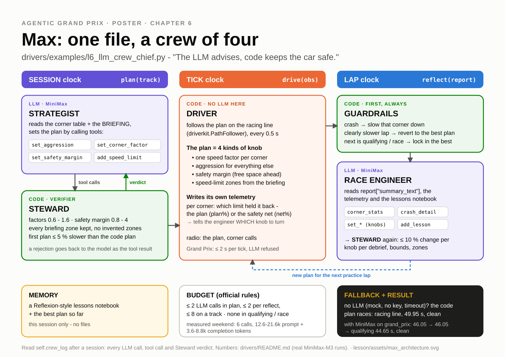

# Ch6 The Crew Chief: tools, reflection, memory, roles

**Day 2, 11:35-12:35 (60 min).** This chapter builds Max's architecture. Max is the house racer you
will race against this afternoon, and his code is public. Your car gets a crew. The Strategist (Ch5)
still writes the plan. A new **Race Engineer** reads your lap report after every practice lap, looks
things up with tools, and proposes changes. A code **Steward** checks every change before it reaches
the car. A **notebook** remembers what was learned.

| | |
|---|---|
| **Agent type** | learning agent built as a small team with roles (tool-using, multi-role) |
| **Clocks** | SESSION: Strategist (LLM). LAP: Race Engineer (LLM) + Steward (code). TICK: Driver (code) |
| **Your main file** | `drivers/submissions/<handle>.py`, from v5 to **v6, your final LLM candidate** |
| **Checkpoint CP6 (12:35)** | 4 clean attempts on a `random:<seed>` track with the crew's radio in the log, best lap within about ±0.5 s of your Ch3 car or better, at most 3 LLM calls per `reflect` (we use 2), still finishes with `LLM_PROVIDER=mock`, **dress-rehearsal upload** |
| **Handrail** | [`lesson/checkpoints/ch6_crew_chief.py`](checkpoints/ch6_crew_chief.py) |
| **LLM calls** | 2 in `plan` + up to 2 per practice `reflect`: about 8 per 4-attempt run |

---

## 1. Goal

[](assets/max_architecture.svg)

| Role | Implemented as | Clock | Job |
|---|---|---|---|
| **Strategist** | LLM, `plan()` | SESSION | writes the corner plan and the zones (your Ch5 code, unchanged) |
| **Race Engineer** | LLM critic, `reflect()` | LAP | reads `report["summary_text"]` and the notebook, calls tools (`segment_stats`, `crash_detail`), answers with a JSON patch |
| **Steward** | code | LAP | checks every change: bounds, at most 10 % per debrief, no pushing inside a yellow-flag zone. Can trim or reject. |
| **Driver** | code, `drive()` | TICK | executes the plan (your Ch2 executor) |

"**The LLM advises, code keeps the car safe.**" The LLMs only ever *propose*: numbers in a JSON object.
Code decides what reaches the car, and code drives.

## 2. Concepts

- **Tools.** A tool is a plain Python method whose docstring the model reads. The Engineer does not
  get the whole telemetry in its prompt. It *asks* for the segment it is curious about
  (`segment_stats(7)`) and gets a small dict back. `llm.ask_with_tools(prompt, tools, max_rounds=2)`
  runs that loop: model → tool call → your function → result → model. Every round is one LLM call.
- **Reflection (critic).** After a lap, the lap report is the critic's verdict. `report["summary_text"]`
  is that report already written as text for an LLM: result, lap times, a per-segment table and a
  per-corner table.
- **Memory: the lessons notebook** (Reflexion-style). After each debrief the Engineer writes one line,
  `"lesson"`. The next debrief starts by reading the notebook, so the crew can avoid repeating an
  experiment that already failed. Memory lives **only inside the session**: each track starts fresh.
- **The Steward is a verifier, not a second opinion.** It is about 40 lines of code with three checks. If it
  rejects a change, the reason goes into the notebook, so the Engineer learns the rules too.
- **Guardrails before the LLM.** Your Ch3 critic still runs first. A crash slows that segment down, and
  a slower lap reverts to the best knobs. The Engineer starts from a safe state.
- **Stop on budget, then lock in.** In official events: at most 2 calls per practice
  `reflect`, and the reflect *before qualifying* makes no call at all. It locks in the best knobs.
  With 2 practice laps (the Home GP) that is 2 + 2 = 4 calls per track. With 3 (the Mystery GP),
  2 + 2 + 2 = 6. Both are under the 8-call track budget.
- **Fallback, again.** Engineer gives no usable JSON, or there is no LLM at all? Your Ch3 experiment
  ("push all" / "trust walls") runs instead. With `LLM_PROVIDER=mock` the car is exactly your Ch3
  learner.

## 3. Watch (5 min)

1. **Read Max's docstring diagram:** the top of
   [`drivers/examples/l6_llm_crew_chief.py`](../drivers/examples/l6_llm_crew_chief.py). Find the four
   roles, then the two places where code stands between the LLM and the car.
2. **Race Control → Pit Wall**, log `llm_gp_oval/Max.jsonl` (Max in a real-MiniMax race on `oval`; all
   4 calls are real. `class_demo/Max.jsonl` also starts with 4 real calls, but it ends with mock rows
   from a later offline rebuild of the demo that only say `OK (mock LLM)`). You should now see the Strategist's plan conversation (2 calls) and the Engineer's debrief after
   practice lap 1 (2 calls). Max's tools *set* the knobs (`set_corner_factor`, `set_aggression`,
   `set_safety_margin`) and look things up (`corner_stats`, `segment_stats`). The Steward's verdict
   comes back to the model as each tool's result. Every step shows its seconds and tokens.
3. **Max with real MiniMax** ([drivers/README.md](../drivers/README.md)): qualifying 44.65 s on
   `grand_prix` after 3 practice laps (46.05 → 46.05 → 44.65), clean, 6 calls per weekend. (That is one
   real run; the [CALIBRATION.md](instructor/CALIBRATION.md) run qualified at 44.90 s. LLM runs vary.) Max is
   beatable, though: a hand-tuned fixed setting did 43.00 s.

---

## 4. Build

Start from your v5 (the Ch5 strategist). Keep a copy outside the submissions folder, so you can
always go back: `cp drivers/submissions/<handle>.py races/<handle>_ch5.py`.

### Step 1: name the crew

Set `ANATOMY` to include `"roles"`, then add four knobs to `PARAMS`, right after the `"max_calls"`
line:

```python
    "engineer_rounds": 2,   # Ch6: LLM calls per debrief (official events allow 2 per reflect)
    "max_step": 0.10,       # Ch6 Steward: at most 10 % change per knob per debrief
    "max_seg_factor": 1.6,  # Ch6 Steward: segment knob bounds
    "min_seg_factor": 0.6,
```

### Step 2: two tools the Engineer can call

1. Three new lines at the end of `__init__`:

   ```python
           self.notebook: list[str] = []             # Ch6: Reflexion-style lessons (this session only)
           self.crew_log: list[dict] = []            # Ch6: every engineer call: tokens, seconds, tools, patch, verdicts
           self.last_report: dict = {}
   ```

2. Paste the two tools **at the end of `class Driver`** (after `reflect()`, above `def number`). They
   are methods because they read `self.last_report`, the report of the lap just driven. Their
   docstrings are what the model reads, so they say exactly what comes back:

   ```python
       # Ch6 step 2: the engineer's tools (docstrings = the tool descriptions the model reads).
       def segment_stats(self, segment: int) -> dict:
           """Last lap in one waypoint segment: time, entry/min/max speed, crashes, and our speed factor there.

           Args:
               segment: segment number (segment g runs from waypoint g to waypoint g+1)
           """
           for row in self.last_report.get("segments") or []:
               if row.get("segment") == int(segment):
                   return dict(row, factor=round(self.seg_factor[int(segment)], 3))
           return {"error": f"no segment {segment}"}

       def crash_detail(self, index: int = 0) -> dict:
           """One crash of the last lap (0 = the first): where, how fast, the controls and the wall rays.

           Args:
               index: which crash (0 = the first)
           """
           log = self.last_report.get("crash_log") or []
           if not log:
               return {"error": "no crashes on the last lap"}
           return log[max(0, min(int(index), len(log) - 1))]
   ```

   `race.py check` should still say `PASSED`: nothing calls them yet.

### Step 3: the Race Engineer (`ask_with_tools` in `reflect`)

1. Paste the Engineer's job description **under your `SYSTEM = """..."""`** (the strategist's):

   ```python
   # Ch6: the race engineer's job description and the JSON patch it must return.
   ENGINEER = """You are the RACE ENGINEER of a 2D racing team. After each practice lap you read the lap report
   and the current knobs, then change the knobs for the next lap. Goal: the fastest CLEAN lap (a crash costs
   5 s, a tick too fast in a yellow-flag zone 1 s). Knobs: one speed factor per waypoint segment (x the grip
   limit; 0.6 .. 1.6) and the safety margin (free space kept in front of the car; lower = brakes later).
   A code Steward checks everything: at most 10 % change per factor and 1 unit of margin per debrief.
   You may call segment_stats(segment) and crash_detail(index) first. Recipe: slow segments with no crash
   -> raise 3-8 %; a crash -> lower that segment 5-10 %; lots of braking for walls -> lower the margin.
   Lap times jitter by a few tenths (0.5 s ticks): judge trends, use the notebook. Keep reasoning SHORT.
   Final answer: ONE JSON object only:
   {"segments": {"3": 1.05, "7": 0.95}, "margin": 2.5, "lesson": "<one line for the notebook>", "say": "<radio, <= 80 chars>"}"""
   ```

2. Paste `ask_engineer()` **right after `reflect()`**, above the two tools. It builds the debrief
   prompt (the lap report, your lap times, the current knobs, the zone segments, the notebook), lets
   the model call the tools for at most `engineer_rounds` LLM calls, and logs every call in
   `self.crew_log`:

   ```python
       # ----------------------------------------------------------------------- Ch6: the RACE ENGINEER (LLM)
       def ask_engineer(self, report: dict) -> dict | None:
           """One debrief (<= engineer_rounds LLM calls) -> a JSON patch, or None (then the Ch3 rule decides)."""
           if not llm.llm_allowed():
               return None
           knobs = ", ".join(f"{k}:{f:.3f}" for k, f in enumerate(self.seg_factor))
           laps = ", ".join(f"{h['time']:.2f}" if h["time"] else "DNF" for h in self.history)
           best = f"Best: {self.best['time']:.2f} s (attempt {self.best['attempt']})." if self.best else "No clean lap yet."
           prompt = "\n".join([
               "LAP REPORT (from race control):", report["summary_text"], "",
               f"Lap times so far: {laps}. {best}",
               "KNOBS for the next lap (the code already reverted to the best knobs / slowed crash segments):",
               f"  segment speed factors (x grip limit), segment:factor: {knobs}",
               f"  safety margin: {self.margin:.2f} units (allowed {PARAMS['min_margin']} .. 4)",
               f"  segments inside a yellow-flag zone (do not push): {sorted(self.zone_segments()) or 'none'}",
               "LESSONS NOTEBOOK:", *(f"- {x}" for x in self.notebook[-6:] or ["(empty)"]), "",
               "Debrief now."])
           before = llm.llm_stats()
           entry = {"attempt": report["attempt"], "calls": 0, "tokens": 0, "seconds": 0.0, "tool_calls": [],
                    "patch": None, "verdicts": [], "error": None}
           try:
               run = llm.ask_with_tools(prompt, [self.segment_stats, self.crash_detail], system=ENGINEER,
                                        max_rounds=int(PARAMS["engineer_rounds"]))
               entry["tool_calls"] = [(c["name"], c["args"]) for c in run.calls]
               patch = llm.extract_json(run.final_text)
           except (llm.LLMError, ValueError) as exc:  # no LLM / no JSON: the Ch3 rule decides
               entry["error"] = f"{type(exc).__name__}: {exc}"[:200]
               patch = None
           after = llm.llm_stats()
           entry.update(calls=after["calls"] - before["calls"], seconds=round(after["seconds"] - before["seconds"], 2),
                        tokens=after["prompt_tokens"] + after["completion_tokens"]
                        - before["prompt_tokens"] - before["completion_tokens"], patch=patch)
           self.crew_log.append(entry)
           if not isinstance(patch, dict):
               return None
           if isinstance(patch.get("lesson"), str) and patch["lesson"].strip():
               self.notebook.append(f"Lap {report['attempt']}: {patch['lesson'].strip()[:160]}")
           return patch
   ```

### Step 4: the Steward, three checks in code

Paste this **at the end of the class** (after `crash_detail`). Check 1: bounds (reject). Check 2: at
most 10 % change per debrief (trim). Check 3: never push inside a yellow-flag zone (reject). Every
verdict goes into `self.crew_log`, and every non-OK verdict also goes into the notebook:

```python
    # Ch6 step 4: the STEWARD (code). Three checks on every change; its verdicts go into the notebook.
    def steward(self, patch: dict) -> list[str]:
        verdicts = []
        zone_segs = self.zone_segments()
        segments = patch.get("segments") if isinstance(patch.get("segments"), dict) else {}
        for key, value in segments.items():
            seg, f = number(key), number(value)
            if seg is None or seg != int(seg) or not 0 <= seg < len(self.seg_factor) or f is None:
                verdicts.append(f"REJECTED segment {key}={value}: unknown segment or not a number")
                continue
            seg, old = int(seg), self.seg_factor[int(seg)]
            # check 1: bounds
            if not PARAMS["min_seg_factor"] <= f <= PARAMS["max_seg_factor"]:
                verdicts.append(f"REJECTED segment {seg}={f}: outside "
                                f"{PARAMS['min_seg_factor']}..{PARAMS['max_seg_factor']}")
                continue
            # check 2: at most max_step (10 %) change per debrief - trimmed, not rejected
            lo, hi = old * (1 - PARAMS["max_step"]), old * (1 + PARAMS["max_step"])
            if not lo <= f <= hi:
                f = min(max(f, lo), hi)
                verdicts.append(f"TRIMMED segment {seg} to {f:.3f} (max {PARAMS['max_step']:.0%} per debrief)")
            # check 3: zones - never push inside a yellow-flag zone (it can only cost penalties)
            if seg in zone_segs and f > old:
                verdicts.append(f"REJECTED segment {seg}: inside a yellow-flag zone, no pushing")
                continue
            self.seg_factor[seg] = f
            verdicts.append(f"OK segment {seg} {old:.3f} -> {f:.3f}")
        m = number(patch.get("margin"))
        if m is not None:                         # margin: bounds, and at most 1 unit per debrief
            m2 = min(max(m, PARAMS["min_margin"], self.margin - 1.0), 4.0, self.margin + 1.0)
            verdicts.append(f"OK margin {self.margin:.2f} -> {m2:.2f}" + (" (trimmed)" if m2 != m else ""))
            self.margin = m2
        self.crew_log[-1]["verdicts"] = verdicts
        not_ok = [v for v in verdicts if not v.startswith("OK")]
        if not_ok:
            self.notebook.append("Steward: " + "; ".join(not_ok)[:200])
        return verdicts

    def zone_segments(self) -> set[int]:
        """Segments inside the strategist's yellow-flag zones (from_wp .. to_wp - 1, wrapping)."""
        n = len(self.seg_factor)
        return {(z["from_wp"] + k) % n for z in self.strategy["zones"] for k in range((z["to_wp"] - z["from_wp"]) % n)}
```

### Step 5: the new `reflect()`: critic, crew, notebook, lock-in

Replace your **whole** `reflect()` with this one. Read it top to bottom. It is the Ch3 critic (keep
best, lock-in, crash guardrail), then "the Race Engineer proposes, the Steward disposes", and the Ch3
experiment as the fallback:

```python
    # ----------------------------------------------------------------------- reflect: critic + crew
    def reflect(self, report: dict) -> None:
        if self.follower is None:
            return
        self.last_report = report                 # the engineer's tools read it
        time = report["race_time"] if report["completed"] else None          # a DNF has no lap time
        self.history.append({"attempt": report["attempt"], "experiment": self.experiment,
                             "seg_factor": list(self.seg_factor), "margin": self.margin, "time": time,
                             "crashes": report["crashes"],
                             "crash_segments": [c["segment"] for c in report["crash_log"]]})
        improved = time is not None and (self.best is None or time < self.best["time"])
        if improved:
            self.best = {"seg_factor": list(self.seg_factor), "margin": self.margin, "time": time,
                         "attempt": report["attempt"]}
        elif self.experiment in self.steps:
            self.steps[self.experiment] *= 0.5
        # Ch6 step 5: lock-in - qualifying / race next (or the session is over: None) -> no experiments, no LLM
        if self.locked or report["next_phase"] in ("qualifying", "race", None):
            self.locked = True
            if self.best:
                self.seg_factor, self.margin = list(self.best["seg_factor"]), self.best["margin"]
                self._build()
                self.say_next = f"Locked in: knobs of attempt {self.best['attempt']} ({self.best['time']:.2f} s)"
            return

        # Code guardrails first (your Ch3 critic): a crash -> slow down there; else back to the best knobs.
        n = len(self.seg_factor)
        if report["crashes"]:
            for crash in report["crash_log"]:
                for seg in (crash["segment"], (crash["segment"] - 1) % n):
                    self.seg_factor[seg] *= PARAMS["crash_cut"]
            self.margin = PARAMS["start_margin"]
            self.notebook.append(f"Lap {report['attempt']}: crash in segment(s) "
                                 f"{sorted({c['segment'] for c in report['crash_log']})} - code slowed them down.")
        elif self.best:
            if not improved:
                self.notebook.append(f"Lap {report['attempt']} ({self.experiment}): {time:.2f} s, no better than the "
                                     f"best {self.best['time']:.2f} s - reverted to the best knobs.")
            self.seg_factor, self.margin = list(self.best["seg_factor"]), self.best["margin"]

        # The RACE ENGINEER proposes, the STEWARD disposes.
        patch = self.ask_engineer(report)
        if patch is not None:
            verdicts = self.steward(patch)
            self.experiment = "engineer"
            self.say_next = patch.get("say") or f"Engineer: {len(verdicts)} change(s) checked by the Steward"
        elif report["crashes"]:
            self.experiment = "crash fix"
            self.say_next = f"{report['crashes']} crash(es): slowing those segments down"
        else:                                     # no LLM (mock, error, budget): your Ch3 experiment
            self.experiment = EXPERIMENTS[self.turn % len(EXPERIMENTS)]
            self.turn += 1
            step = self.steps[self.experiment]
            if self.experiment == "push all":
                self.seg_factor = [min(1.6, f * (1.0 + step)) for f in self.seg_factor]
            else:
                self.margin = max(PARAMS["min_margin"], self.margin - step)
            result = "new best" if improved else "slower - back to the best knobs"
            self.say_next = f"{time:.2f} s ({result}); next: {self.experiment}" if time else \
                f"DNF ({report['ended_by']}); next: {self.experiment}"
        self._build()
```

Note the lock-in line: `next_phase` in `("qualifying", "race", None)`. `None` means "the session is
over", so a plain `race.py drive` run makes no pointless LLM call after its last attempt.

Then:

```
python race.py check drivers/submissions/<handle>.py
```

You should now see `PASSED`, with all the new `PARAMS` keys listed.

### Step 6: four laps on a track nobody tuned for, and the trace

1. Without an LLM first. This must be your Ch3 learner exactly:

   ```powershell
   # Windows PowerShell
   $env:LLM_PROVIDER="mock"; python race.py drive drivers/submissions/<handle>.py --track random:7 --attempts 4 --quiet; Remove-Item Env:LLM_PROVIDER
   ```

   ```bash
   # macOS
   LLM_PROVIDER=mock python race.py drive drivers/submissions/<handle>.py --track random:7 --attempts 4 --quiet
   ```

   You should now see `44.45 → 44.45 → 42.60 → 42.25 s`, 0 crashes. That is the Ch3 handrail's curve
   to the hundredth.

2. With the crew, and with logging on for Pit Wall (its own folder, so the Ch5 calls do not mix in):

   ```powershell
   # Windows PowerShell
   $env:LLM_LOG_DIR="races/ch6/llm_logs"; python race.py drive drivers/submissions/<handle>.py --track random:7 --attempts 4; Remove-Item Env:LLM_LOG_DIR
   ```

   ```bash
   # macOS
   LLM_LOG_DIR=races/ch6/llm_logs python race.py drive drivers/submissions/<handle>.py --track random:7 --attempts 4
   ```

   It takes a few minutes (8 LLM calls, plus the SDK start-up of a fresh process).

   Example from our run (real MiniMax, abbreviated):

   ```
   plan(): 11.54 s
   Attempt 1 ... radio: "No restrictions. Commit 93-102%, no wall hits today."
   Attempt 1: FINISHED 44.75 s | crashes 0
   Attempt 2 ... radio: "Clean lap, all corners well under grip: pushing them +6-7%, margin to 2.0."
   Attempt 2: FINISHED 42.30 s | crashes 0
   Attempt 3 ... radio: "42.30 s (new best); next: push all"
   Attempt 3: FINISHED 41.90 s | crashes 0
   Attempt 4 ... radio: "Clean 41.90. Pushing T3 and T5 exit six percent, margin down to 1.8."
   Attempt 4: FINISHED 41.40 s | crashes 0
   drive() time: mean 1.7 ms, max 81.2 ms | LLM: 8 calls, 22086 tokens | wall 216.7 s
   ```

   Read the radio. Attempts 2 and 4 carry the Engineer's message. Attempt 3's message is your **Ch3
   fallback** talking: that debrief returned no usable JSON, so "push all" ran instead. Expect that
   in about one debrief in three: the Engineer sometimes spends its calls on tool lookups and answers
   in prose.

   Be honest about the result. This run, our best, ended 0.85 s faster than the Ch3 rules alone
   (41.40 vs 42.25 s). Other real runs of the same file did 44.55 → 44.45 → 44.50 → 42.50 s and
   44.90 → 42.75 → 42.80 → 42.80 s (CALIBRATION: 45.05 → 43.35 → 43.30 s): the curve is not always
   steady, and the best lap usually lands within about half a second of the Ch3 car. The crew's
   value is what it *explains* and what it can read that code cannot, not a guaranteed second.

3. **Open the trace.** Race Control → **Pit Wall** → pick `ch6/llm_logs/<your NAME>.jsonl`. You should
   now see each debrief as a chat: the prompt, `segment_stats` calls with their arguments, the
   results, the final JSON patch, and the seconds and tokens per step.

4. **Optional: read the crew log from Python.** Pit Wall already shows the trace of step 2, so skip
   this step when the clock is tight: it is another 8 real calls and, on a busy laptop, 5-8 minutes.
   `run_session` accepts your driver *object*, so you can look inside it afterwards. Paste the block
   into one `python` prompt and **press Enter once more** after the last line (the `for` line needs
   an empty line to finish):

   ```python
   import importlib.util
   from agentic_gp import run_session, SessionConfig, llm
   llm.warm_up()
   spec = importlib.util.spec_from_file_location("me", "drivers/submissions/<handle>.py")
   me = importlib.util.module_from_spec(spec); spec.loader.exec_module(me)
   d = me.Driver()
   result = run_session(d, SessionConfig(track="random:7", attempts=4))
   [a.result.race_time for a in result.attempts]
   for e in d.crew_log: print(e["attempt"], e["calls"], e["seconds"], e["tool_calls"], e["verdicts"], e["error"])

   ```

   Then look at the notebook:

   ```python
   d.notebook
   ```

   `llm.warm_up()` loads the SDK *before* `plan()` starts its 120 s clock. Skip it on a slow laptop and
   `plan()` may run out of time just importing, and fall back to the physics plan. That happened to us
   once: `'LLM unavailable: no time left for an LLM call (0.0s before the plan() time limit)'`.
   Example crew log from our run (real MiniMax, abbreviated):

   ```
   1 2 36.95 [('segment_stats', {'segment': 7}), ('segment_stats', {'segment': 11}), ('segment_stats', {'segment': 4}), ...] []
     "ValueError: no JSON object in: 'Tight corners T4/T5 are running near grip limit ... Plan: push most segments +5%...'"
   2 2 11.21 [('segment_stats', {'segment': 4}), ('segment_stats', {'segment': 7}), ...]
     ['OK segment 4 1.000 -> 1.050', 'OK segment 14 1.000 -> 1.050', 'OK margin 3.00 -> 2.00'] None
   3 1 44.95 [] ['OK segment 3 1.000 -> 1.050', 'OK segment 11 1.000 -> 1.050', 'OK margin 2.00 -> 2.00'] None
   ```

   ```
   ['Lap 2 (push all): 44.45 s, no better than the best 44.45 s - reverted to the best knobs.',
    'Lap 2: ... margin 3.0->2.0 (brake later) + seg4/14 factor 1.05; corners already at grip limit, gain must come from braking point, not from more speed.',
    'Lap 3: Pushed seg3+seg11 by 5%; T2/T5 apex min still under v_max (2.1/1.7 u/s headroom), margin 2.0 holds.']
   ```

   Debrief 1 used both of its calls on tool lookups and then answered in prose, not JSON. The fallback
   caught it. Debrief 2 wrote a lesson, *"gain must come from braking point, not from more speed"*,
   and debrief 3 built on it. That is the notebook working.

5. **See the Steward say no.** Under the mock, give the Steward a patch by hand:

   ```python
   import os; os.environ["LLM_PROVIDER"] = "mock"
   import importlib.util
   from agentic_gp import RaceEnv, make_track, llm
   track = RaceEnv(make_track("briefing_demo")).track_map()
   spec = importlib.util.spec_from_file_location("me", "drivers/submissions/<handle>.py")
   me = importlib.util.module_from_spec(spec); spec.loader.exec_module(me)
   llm.set_mock_responder(lambda messages, tools: {"corners": [], "zones": [{"from_wp": 9, "to_wp": 11, "max_speed": 15}]})
   d = me.Driver(); d.plan(track); d.crew_log.append({})
   for v in d.steward({"segments": {"3": 1.5, "9": 1.05, "99": 1.0}, "margin": 0.2}): print(v)
   ```

   You should now see:

   ```
   TRIMMED segment 3 to 1.100 (max 10% per debrief)
   OK segment 3 1.000 -> 1.100
   REJECTED segment 9: inside a yellow-flag zone, no pushing
   REJECTED segment 99=1.0: unknown segment or not a number
   OK margin 3.00 -> 2.00 (trimmed)
   ```

---

## 5. Check (CP6, 12:35)

| What | Command | Expected |
|---|---|---|
| contract | `python race.py check drivers/submissions/<handle>.py` | `PASSED` |
| works without an LLM | step 6.1 | finishes, `44.45 → 44.45 → 42.60 → 42.25 s` on `random:7` (= Ch3) |
| learns with the crew | step 6.2 | 4 clean attempts, the Engineer's radio on at least one lap, best within about ±0.5 s of the Ch3 car (42.25 s) or better. Ours: 41.40, 42.50 and 42.75 s best in three real runs (CALIBRATION: 45.05 → 43.35 → 43.30 s) |
| budget | crew log / Pit Wall | at most 2 calls per debrief (`engineer_rounds`), at most 2 in `plan` |

Then **upload your file for the dress rehearsal (12:35).** Over lunch the instructor races every CP6
file on the home track and a `random:<seed>` track under the full official rules. At 13:30 you see who
generalised and who overfit, and Snapshot #5 puts you next to Max.

### Exercises (ablations)

1. **No memory.** Make the first line of `ask_engineer()` `self.notebook.clear()` and run step 6.2
   again. Does the Engineer repeat an experiment that already failed? Remove the line afterwards.
2. **No Steward.** Loosen its limits from the command line, without editing code:
   `--param max_step=1 --param max_seg_factor=3 --param min_margin=0.1`. What reaches the car now,
   and does it crash? (Check 3, the zone rule, still holds. Why is that the one you never loosen?)

## 6. Push

- **Bronze:** at least one tool call per debrief (see `tool_calls` in the crew log, or Pit Wall).
- **Silver:** best lap at least 3 % faster than attempt 1, clean, in two runs out of two (all four of
  our real runs made it: 3.9 % to 7.5 %). Then make every debrief return JSON: the Engineer's prose
  answers are your enemy, so tighten `ENGINEER` and check the radio.
- **Gold** (in addition to Silver): beat your own Ch3 learner within 4 attempts on `random:7` (the
  Ch3 handrail's best: 42.25 s). Only our best real run did (41.40 s), so it takes real work.
- **Gold+**, pick one:
  - **A new tool the trace proves the LLM used.** For example `corner_report(corner_id)` built from
    `self.last_report["corners"]`. Add it to the `ask_with_tools([...])` list, then show the call in
    Pit Wall.
  - **The LangGraph variant.** [`drivers/examples/l6b_pit_crew_langgraph.py`](../drivers/examples/l6b_pit_crew_langgraph.py)
    is the same crew as an explicit graph. An analyst (code) feeds a strategist (LLM), and a safety
    officer (code) either sends the proposal back with reasons, at most twice, or commits it:

    ```mermaid
    graph TD
        START([start]) --> analyst
        analyst --> strategist
        strategist --> safety_officer
        safety_officer -. retry .-> strategist
        safety_officer -.-> commit
        commit --> END([end])
    ```

    That diagram is a simplified version of the graph's own output. Print the real one yourself (no
    LLM needed). It adds a `config:` header, `__start__` / `__end__` nodes for start and end, and
    `classDef` style lines. The first `import langgraph` can take minutes on a busy laptop:

    ```python
    import importlib.util
    spec = importlib.util.spec_from_file_location("crew", "drivers/examples/l6b_pit_crew_langgraph.py")
    crew = importlib.util.module_from_spec(spec); spec.loader.exec_module(crew)
    print(crew.Driver().graph.get_graph().draw_mermaid())
    ```

    Then race it on the same track and compare it with your crew:
    `python race.py drive drivers/examples/l6b_pit_crew_langgraph.py --track random:7 --attempts 4`.
    Our run (real MiniMax): 44.15 → 44.50 → 42.55 → 42.65 s, clean, 3 LLM calls, best 42.55 s, against
    41.40 s for the handrail crew above. What does the graph make easy (the retry loop is visible), and what does it make
    hard (another dependency, more code)?

## 7. Submit and logbook

Upload `drivers/submissions/<handle>.py` (v6) by **12:35**. This is your dress-rehearsal file.

Logbook line: *"The crew bought me ___ s over my Ch3 rules on random:7 and cost ___ calls / ___ tokens
per track. The Steward trimmed or rejected ___ changes."*

> **Stuck?** Compare, then copy the handrail over your main file and put your `NAME` / `AUTHOR` /
> `COLOR` back. It is a valid dress-rehearsal upload.
>
> ```
> git diff --no-index lesson/checkpoints/ch5_strategist.py lesson/checkpoints/ch6_crew_chief.py
> cp lesson/checkpoints/ch6_crew_chief.py drivers/submissions/<handle>.py
> ```
>
> Common errors:
> - `AttributeError: ... 'crew_log'` or `'notebook'`: step 2.1 was skipped.
> - `NameError: name 'ENGINEER' is not defined`: step 3.1 was skipped.
> - `IndexError` in `steward()` when you call it by hand: run `d.crew_log.append({})` first.
> - Every debrief says `ValueError: no JSON object`: fine now and then (the fallback drives). Every
>   time? Check that the `ENGINEER` text ends with the JSON example.

Next: [Ch7 Fly Brains](07_fly_brains.md). A brain with no language at all.
