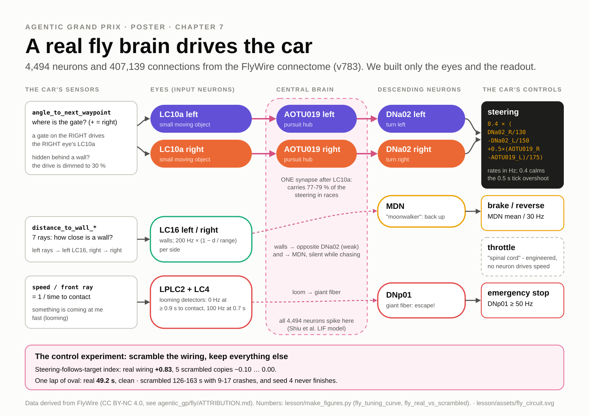
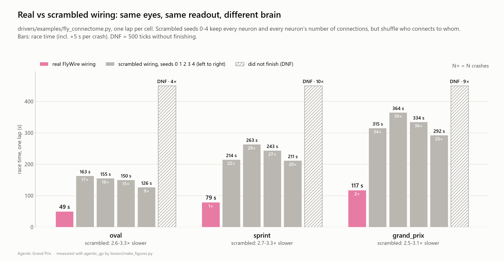
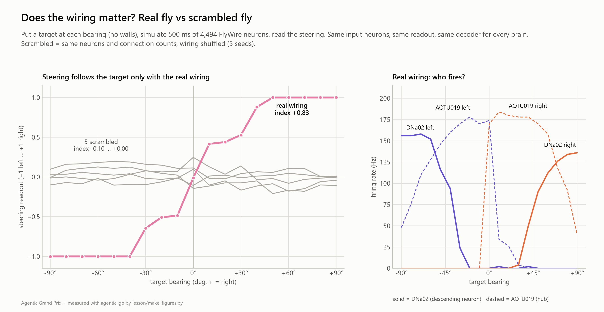

# Ch7 Fly Brains: a brain with no language

**Day 2, 13:40-14:30 (50 min).** After a morning of LLMs, here is a completely different kind of agent:
a brain made of spiking neurons. In **Part A** (25 min) you repair a 57-neuron toy fly that has one
miswired synapse bundle. In **Part B** (20 min) you drive the car with **4,494 real fruit-fly neurons**
from the FlyWire connectome, then run the experiment that tells you whether the wiring matters:
the same neurons, wired at random.

| | |
|---|---|
| **Agent type** | spiking neural controller (no map, no plan, no words) |
| **Clock** | TICK. A toy decision takes a few ms; the connectome simulates 100 ms of brain time per tick |
| **Your file** | optional `drivers/submissions/<handle>_fly.py` for the **Fly Cup**. Your main file is not touched |
| **Checkpoint CP7** | your fixed toy fly finishes a lap; the real connectome wiring gives a lateralised tuning curve and passes ≥ 8 of 16 gates; scrambled wiring gives a flat curve or an early DNF |
| **Handrail** | [`lesson/checkpoints/ch7_fly_fixed.py`](checkpoints/ch7_fly_fixed.py) |
| **LLM calls** | none. A good chapter to run while the key cools down |

---

## 1. Goal

[](assets/fly_circuit.svg)

Every other driver you built has code that says "if the wall is close, brake". A fly brain has no such
line. It has neurons that fire, synapses that connect them, and muscles at the end. Today's question:
**can wiring alone be a driving skill, and how would you prove it?**

## 2. Concepts

- **Leaky integrate-and-fire (LIF) neuron.** A neuron is a leaky bucket. Input current fills it, and
  it slowly leaks. When it reaches the threshold it *spikes*, resets and rests for 2 ms. The toy's
  equation is `tau * dv/dt = -v + I`. The connectome uses the published Shiu et al. 2024 model.
- **Rate coding.** A single spike means little. *How often* a neuron fires (Hz) carries the message.
  The decoder reads firing rates:
  `steering = (DNa02_R − DNa02_L) / STEER_HZ`, `throttle = P9/GO_HZ − GF/BRAKE_HZ − MDN/BACK_HZ`.
- **Braitenberg's crossed wiring.** A wall on the **left** must excite the neuron that turns **right**.
  Cross the wires and a simple vehicle avoids walls. Uncross them and it drives *into* them.
- **Coincidence ("AND") neuron.** `AND_STUCK` fires only when "wall ahead" *and* "standing still"
  arrive together. That triggers MDN, the "moonwalker" neuron: reverse.
- **Named cell types** (real fly names; in the toy the wiring between them is a hand-drawn cartoon):

  | Neuron type | Role in the car |
  |---|---|
  | LC10a L/R | sees the target (the next waypoint) on the left / right |
  | AOTU019 L/R | pursuit hub: "chase it on this side" |
  | DNa02 L/R | descending neuron: turn left / right |
  | P1 | arousal, the fly's "mood": drives forward walking and pursuit |
  | P9 | descending neuron: walk forward (throttle) |
  | LPLC2 | looming detector: the wall ahead grows fast |
  | GF (Giant Fiber) | escape: emergency brake |
  | MDN | "moonwalker": walk backward (reverse) |
  | WALL_L*/WALL_R* | wall-ray neurons, crossed to DNa02 |

- **Which clock?** A toy decision takes a few milliseconds of compute (7.5 ms on average in our run,
  on a busy laptop), so this lives on the TICK clock. Brains are
  fast reflex machines. That is the opposite of an LLM.

---

## Part A: the toy fly (25 min)

### Watch (3 min)

```
python race.py drive drivers/examples/fly_toy.py
```

You should now see radio lines that describe the brain, then a clean lap:

```
  t=   8.00s tick   16 lap 1 seg  2 v= 21.6 | radio: "GF fired 60 Hz: wall looming (LPLC2 120 Hz), brake! DNa02 L 130 / R 0 Hz: turning left; loudest inputs LC10a_L 105 Hz, LC10a_R 20 Hz"
  ...
Attempt 1: FINISHED 63.30 s | laps [63.30] | crashes 0 | penalties 0.0 s | 16 waypoints | 127 ticks
drive() time: mean 7.5 ms, max 94.9 ms | wall 1.4 s
```

63.30 s, clean, with no `if` on any sensor. For comparison, the L2 planner does 52.50 s.

Race Control → **Fly Lab** → *The fly drives* shows the spike raster next to the car.

### Step 1: read one raster event aloud

Take the line above: *"GF fired 60 Hz: wall looming (LPLC2 120 Hz), brake!"*. Which neuron made the
Giant Fiber fire, and what did the car sense? (LPLC2, the looming detector: the wall ahead was growing
fast.) And why is the car turning left at the same moment? (LC10a_L, the target is on the left, drove
DNa02_L through AOTU019_L.) Say it to your neighbour in one sentence.

### Step 2: fix the broken fly

[`drivers/examples/fly_broken.py`](../drivers/examples/fly_broken.py) is the same toy with **one wrong
row** in its `WIRING` table.

1. Make it yours (Fly Cup file):

   ```
   cp drivers/examples/fly_broken.py drivers/submissions/<handle>_fly.py
   ```

   Then set `NAME`, `AUTHOR` and `COLOR`. In this file they sit inside `class Driver:`, further down
   than the `WIRING` table. `KIND = "fly"` is already set.

2. Race it:

   ```
   python race.py drive drivers/submissions/<handle>_fly.py
   ```

   You should now see two crashes around T5, the hairpin, and a slow lap:

   ```
     t=  26.50s tick   53 lap 1 seg  6 v= 11.2 | radio: "GF fired 130 Hz: wall looming (LPLC2 193 Hz), brake! DNa02 L 150 / R 115 Hz: turning left; loudest inputs WALL_L45 100 Hz, WALL_L20 90 Hz"
     t=  32.00s tick   54 lap 1 seg  6 v=  0.0 | crash: hit a wall, +5s penalty, speed reset to 0, marshals put the car back on the centerline
   ...
   Attempt 1: FINISHED 93.05 s | laps [93.05] | crashes 2 | penalties 10.0 s | 16 waypoints | 167 ticks
   ```

3. Be the neuroscientist. The rules: change exactly **one row** of `WIRING`, nothing else, and do not
   diff against `fly_toy.py`. Read the neurons instead. Use the hints in the docstring of your file one
   at a time. The strongest tool is the mirror self-check: a stimulus on the left must give exactly the
   mirror image of the same stimulus on the right:

   ```
   python drivers/submissions/<handle>_fly.py -v
   ```

   You should now see one line per stimulus, ending in `NOT SYMMETRIC - check the WIRING`. One of the
   stimuli is not a mirror image of its twin. Follow that neuron in the `WIRING` table.

4. **Fixed means both of these** (a lucky weight that just misses the hairpin is not a fix):

   ```
   python drivers/submissions/<handle>_fly.py
   python race.py drive drivers/submissions/<handle>_fly.py --quiet
   ```

   You should now see `SYMMETRIC - now race it on grand_prix`, and then exactly
   `FINISHED 63.30 s ... crashes 0`. The brain has no noise, so the right fix reproduces the healthy
   fly's lap to the tick.

### Step 3: tune it

The toy's `PARAMS` are its "neuromodulators". Change one at a time with `--param`:

| Knob | What it is | Measured on `grand_prix` |
|---|---|---|
| `arousal` (P1, default 2.2) | mood: forward drive and pursuit | 1.6 → 79.75 s; 2.2 → 63.30 s; 2.8 → 59.55 s; 3.6 → 72.10 s with 1 crash |
| `lc10a_gain` (default 1.0) | how strongly the eyes see the target | 1.3 → 63.45 s |
| `wall_gain` (default 1.0) | wall-ray → DNa02 strength | 0 → DNF (stuck: the fly stares at a waypoint behind a wall) |

`python race.py drive drivers/submissions/<handle>_fly.py --param arousal=2.8 --quiet`

The arousal column has a **sweet spot**: faster up to 2.8, then 3.6 crashes. (Unlike Ch2's aggression
knob, which hit a plateau because the PathFollower's safety net caught the extra speed, the fly has no
safety net.)

### Part A exercises

1. **Uncross the wall wiring:** `--param crossed=false`. Prediction first! *(Measured: DNF, 6 of 16
   gates.)* Braitenberg's vehicle now steers *into* the walls.
2. **Remove MDN where it matters.** MDN only matters without the marshals:
   `--track oval --crash-rule classic --param crossed=false` finishes in 126.05 s with 4 crashes,
   because MDN backs the car off the wall. Add `--param mdn=false` and it stays pinned: DNF.
3. **Your own control:** `--param SCRAMBLE=0` shuffles *where* every `WIRING` row goes (same rows, same
   weights, random targets). *(Measured: DNF on `grand_prix` with 100 crashes; seed 1: DNF.)*

---

## Part B: the FlyWire connectome (20 min)

> **Data and licence.** The circuit file `data/fly/steering_circuit_783.npz` is derived from the
> FlyWire connectome v783 (Dorkenwald et al. 2024, Schlegel et al. 2024), licensed **CC BY-NC 4.0**:
> non-commercial teaching only. The spiking model follows Shiu et al. 2024. It is not in git. Your
> instructor gives you the file. Put it in `data/fly/`, or point `AGENTIC_GP_FLY_CIRCUIT` to it. Full
> attribution: [`agentic_gp/fly/ATTRIBUTION.md`](../agentic_gp/fly/ATTRIBUTION.md). Without the file the
> driver prints a message and coasts. That message starts "No fly connectome file. Instructor: run python -m agentic_gp.fly.extract";
> as a student you do not need to: ask for the one file `steering_circuit_783.npz` and copy it into
> `data/fly/` (create the folder if needed). Then follow along on the projector (the cut list makes Part B an
> instructor demo when needed).

### Concepts

- **Real wiring, real weights.** 4,494 neurons and 407,139 connections from an adult fly brain, with
  synapse counts as weights. We did **not** design it.
- **The pursuit path:** target bearing → LC10a L/R → AOTU019 L/R (one synapse) → DNa02 L/R. Walls → LC16
  → MDN (brake/reverse). Fast looming → LPLC2 + LC4 → DNp01 (giant fibre, emergency stop).
- **What is ours, and what is the fly's** (the honesty table from
  [`agentic_gp/fly/README.md`](../agentic_gp/fly/README.md)):

  | Part | Who made it |
  |---|---|
  | Encoder: sensors → input spike rates | **engineered** by us (smooth functions, input neurons only) |
  | Brain: 4,494 neurons, 407k connections | **connectome** (FlyWire v783) + a published model |
  | Decoder: rates → steering / brake / stop | **engineered** gains on connectome-driven neurons. Steering reads DNa02 **and AOTU019** |
  | Speed rule (`SPINAL_CORD`) | **engineered, declared**. No neuron in this circuit drives forward speed |

### Step 1: drive with real fly wiring

```
python race.py drive drivers/examples/fly_connectome.py --track oval --quiet
python race.py drive drivers/examples/fly_connectome.py --quiet
```

You should now see (our runs; each tick simulates 100 ms of brain, so a lap takes 10-30 s of wall time):

```
Attempt 1: FINISHED 49.20 s | laps [49.20] | crashes 0 | penalties 0.0 s | 8 waypoints | 99 ticks       (oval)
Attempt 1: FINISHED 117.10 s | laps [117.10] | crashes 2 | penalties 10.0 s | 16 waypoints | 215 ticks  (grand_prix)
```

### Step 2: the control: same neurons, wiring scrambled

`SCRAMBLE=<seed>` keeps every neuron, every neuron's number of connections and every sign. It only
randomises *which* neuron each connection goes to. The encoder and decoder stay the same. Run five
seeds on `oval` (split them across your table):

```
python race.py drive drivers/examples/fly_connectome.py --track oval --param SCRAMBLE=0 --quiet
```

Our results (`oval`, 8 gates):

| Brain | Lap | Crashes |
|---|---|---|
| **real wiring** | **49.20 s** | 0 |
| scrambled seed 0 | 162.60 s | 17 |
| scrambled seed 1 | 154.95 s | 16 |
| scrambled seed 2 | 149.50 s | 15 |
| scrambled seed 3 | 126.35 s | 9 |
| scrambled seed 4 | DNF (0 of 8 gates, drives in circles) | 4 |



### Step 3: read the tuning curve (Race Control → Fly Lab → *Electrophysiology*)

Stimulate the eyes with a target at every bearing from −90° to +90°, and record the steering the brain
produces. Do it for the real brain and for 5 scrambled copies.



Decide from the data which side the response lives on. A target on the left (negative bearing) should
drive DNa02_L and steer left. The real brain's lateralisation index is **+0.83**. The five scrambled
brains score −0.10 to 0.00: flat. This is the same kind of plot an electrophysiologist makes.

### Discussion (5 min): what does the control prove, and what does it not?

**It proves:** with the same neurons, the same number of connections per neuron, the same encoder and
the same decoder, the *real wiring* steers toward targets and the scrambled wiring does not. The
skill is in the wiring, not in the neuron count or in our encoder.

**It does not prove**, so say these out loud:

- **That the whole brain drives.** `--param SHALLOW=true` keeps only the 566 direct input → readout
  connections (0.14 %) and still does `oval` in 64.65 s with 2 crashes. Most of the skill is the
  one-synapse relay LC10a → AOTU019.
- **That DNa02 is "the steering neuron" here.** Our decoder also reads AOTU019, a central hub, and in
  races that term carries 77-79 % of the steering signal. Lesion results are partly facts about *our
  readout*, not about the fly.
- **That the fly controls speed.** Speed comes from the declared, engineered `SPINAL_CORD` rule.
- **That left/right differences are biology.** They may also come from how the dataset was
  reconstructed and proofread.
- **A sanity check:** `--param MIRROR=eyes` swaps only the eyes, so the fly must steer *away* from
  every target. It does: `oval` in 452.15 s with 42 crashes, exactly as predicted.

---

## 3. Check (CP7)

| What | Command | Expected (measured) |
|---|---|---|
| your fixed toy | `python drivers/submissions/<handle>_fly.py` | `SYMMETRIC - now race it on grand_prix` |
| | `python race.py drive drivers/submissions/<handle>_fly.py --quiet` | `FINISHED 63.30 s`, 0 crashes |
| contract | `python race.py check drivers/submissions/<handle>_fly.py` | `PASSED` |
| Fly-class lint | `python -m agentic_gp.fly.rules drivers/submissions/<handle>_fly.py` | `Fly-class OK (lint)` |
| real connectome | step 1 on `oval` | finishes, 8 of 8 gates (on `grand_prix`: 16 of 16) |
| the control | step 2 | scrambled: much slower, or DNF |

## 4. Push

- **Bronze:** the broken fly fixed (both conditions).
- **Silver:** a tuned toy that is faster than 63.30 s on `grand_prix` *and* still clean on `sprint`
  (`--track sprint`).
- **Gold:** your fly beats its own scrambled controls (`--param SCRAMBLE=0`, `1`, `2`) on two tracks.
  That is the entry ticket for the **Best Fly Brain** award.

**The Fly Cup** (2 laps on the home track, the warm-up during the Home GP grid walk) is for
`<handle>_fly.py` files that follow the **Fly-class rule**
([full text](../agentic_gp/fly/README.md)):

1. Throttle and steering are decoded from neuron activity, with a fixed decoder.
2. Sensors enter only through the encoder, as smooth functions, and only into *input* neurons. No
   `if`/`else` on sensors in the control path.
3. An engineered speed rule may combine neurons with the car's own `speed` only inside a section
   marked `SPINAL_CORD`, declared in `SPINAL_CORD = "..."`. It never reads walls, waypoints or the map.
4. A contact reflex into a decoded neuron is allowed only if declared in `REFLEX = "..."`.
5. To win Best Fly Brain, a finisher must beat its own scrambled control (`PARAMS["SCRAMBLE"]`).

## 5. Submit and logbook

Optional: upload `drivers/submissions/<handle>_fly.py` for the Fly Cup by 15:15. It is never raced in
the main events.

Logbook line: *"57 hand-wired neurons drove ___ s; 4,494 real ones drove ___ s; the scrambled control
drove ___. The control proves ___, but not ___."*

> **Stuck?** Work through the four hints in your file's docstring first (the self-check with `-v` is
> hint 3). Still stuck after the hints? The handrail is the broken fly with its one row fixed, and its
> docstring explains the fix:
>
> ```
> git diff --no-index drivers/examples/fly_broken.py lesson/checkpoints/ch7_fly_fixed.py
> cp lesson/checkpoints/ch7_fly_fixed.py drivers/submissions/<handle>_fly.py
> ```
>
> Common errors:
> - A connectome run prints that the circuit file is missing (the message talks to the instructor):
>   ask for `steering_circuit_783.npz` and copy it into `data/fly/`. That one file is enough.
> - A connectome lap takes minutes: that is 100 ms of brain per tick on a busy laptop.
>   `pip install numba` speeds it up (optional).

Next: [Ch8 Garage and Grand Prix](08_garage_gp.md). Make your race car bullet-proof, and submit it.
