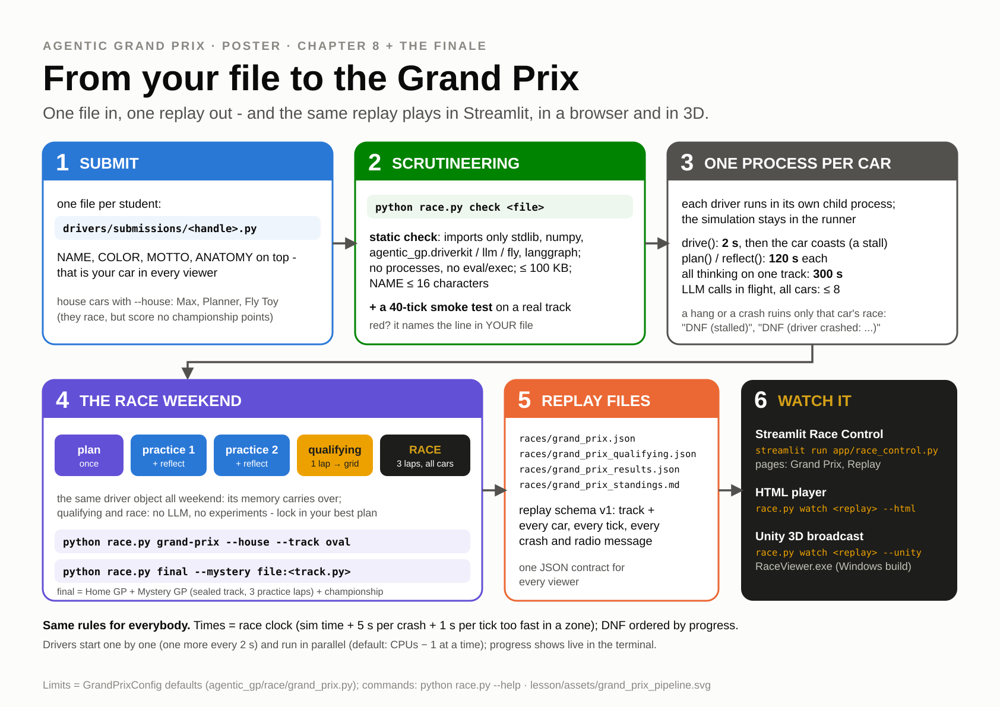
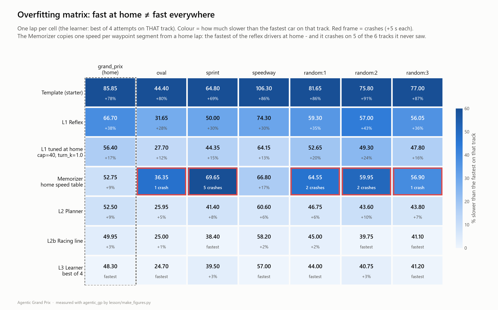

# Ch8 Garage and Grand Prix

**Day 2, 14:30-15:15 (45 min), then the show.** No new features now. In the garage you make the car
you already have **bullet-proof**, write its driver card and hand it in. At 15:15 the files are
locked. From then on, the only thing that races is what is in your file.

| | |
|---|---|
| **Concepts** | generalisation (train / validation / test) and robustness (it must work when things fail) |
| **Your file** | `drivers/submissions/<handle>.py`, final |
| **Final checkpoint** | `race.py check` green, clean on the public tracks, finishes with the mock LLM, driver card filled in |
| **Deadlines** | last LLM call **15:10** (quiet zone for the race batch); upload **15:15**, a hard lock |
| **Handrail** | [`lesson/checkpoints/ch6_crew_chief.py`](checkpoints/ch6_crew_chief.py) is a valid final file (put your metadata in) |

---

## 1. Goal

[](assets/grand_prix_pipeline.svg)

**Your file is everything you bring.** Each session starts with fresh memory: a new process, a fresh
`Driver()`, `plan()` on a track it may never have seen. The Mystery GP track is sealed. Nobody, not even
your instructor's code, has tuned for it. What generalises wins. What was memorised breaks.

## 2. Concepts

- **Train / validation / test.** The home track is your training set: you tuned on it all day. The
  other public tracks and `random:<seed>` tracks are the validation set. The sealed mystery track is the
  test set, and you see it exactly once. The overfitting matrix from Ch2 is the warning:

  

- **Robustness = graceful failure.** Everything that can fail will fail for someone in the batch.
  Your car must keep racing when it does:

  | What fails | What the runner does | What your file must do |
  |---|---|---|
  | the LLM (no key, timeout, 429, budget, `LLMNotAllowed`) | raises `llm.LLMError` | catch it, race the code plan |
  | the LLM answers nonsense | nothing: it is your problem | validate, clamp, drop, fall back |
  | `drive()` raises or returns NaN | the car coasts that tick, logs a `driver_error` | not crash in the first place |
  | `drive()` is slow | over 2 s = a stall, the car coasts; 10 in a row or 30 in total = DNF | stay under 50 ms on average |
  | `plan()` / `reflect()` too slow | 120 s each, 300 s of thinking per track, then DNF (timeout) | never wait on the LLM without a fallback |

- **The official rules** (at every snapshot and both Grand Prix): LLM calls only in `plan()` (at most 2)
  and in `reflect()` after a **practice** lap (at most 2), **at most 8 per track**, at most 60 s per
  request. In `drive()`, qualifying and the race the library raises `LLMNotAllowed`. Every prompt and
  answer is logged.
- **One official run.** The batch runs once. Its replay files get a SHA-256 on the results slide. A
  re-run happens only after a documented infrastructure fault, never because an LLM had a bad day.

## 3. Watch (5 min)

The class demo race: 8 example cars, Max included, 2 laps on `grand_prix`. If it was made with the
mock LLM (the default of `races/demo/make_demo.py`), several cars tie. As we write this, four tie at
96.85 s: without an LLM they all race the same racing-line code plan.

```
python race.py watch races/demo/class_demo.json --html races/class_demo.html
```

It prints `HTML replay: races/class_demo.html (open it in any browser)`. Open it:
`start races/class_demo.html` (PowerShell) or `open races/class_demo.html` (macOS), or double-click
the file. You should now see the replay player in your browser: timing tower, team radio, crash flashes and the
chequered flag. Race Control → **Replay** shows the same file. The projector will show the Grand Prix
in the **Unity 3D viewer** (`python race.py watch <replay>.json --unity`, Windows, when the viewer is
built).

---

## 4. Build: the garage checklist

### Step 1: choose your final file

Any honest level is a valid final file:

| Your file is | Pick it if | Class |
|---|---|---|
| your v6 crew chief (Ch6) | it improved over practice laps and stayed clean | Open + **LLM class** |
| your v5 strategist (Ch5) | the Engineer made things worse, or you want **Most Efficient** (at most 3 calls) | Open + LLM class |
| your v3 learner (Ch3) | you prefer a code-only car. Write *why* on your driver card | Open |

LLM class means `KIND = "llm"`, *and* the logs show a validated LLM output that changed your plan.

### Step 2: validate on tracks you never tuned for

```
python race.py validate drivers/submissions/<handle>.py --random 3
```

This runs the official rules on every public track plus `random:1`, `random:2` and `random:3`: `plan`,
1 practice lap with `reflect`, 1 timed lap. With an LLM driver that is up to 2 real calls per track,
about 16 in total, before 15:10. Example: the Ch6 handrail with real MiniMax:

```
track          practice  timed lap  crashes  penalties  status  wall s
-------------  --------  ---------  -------  ---------  ------  ------
grand_prix        52.80      52.80        0        0.0  ok       112.9
oval              25.95      25.95        0        0.0  ok         4.2
sprint            41.70      41.70        0        0.0  ok        12.5
speedway          60.35      60.35        0        0.0  ok        17.2
briefing_demo     61.30      61.30        0        0.0  ok        11.8
random:1          47.30      47.30        0        0.0  ok        16.7
random:2          43.50      43.50        0        0.0  ok         7.0
random:3          43.65      43.65        0        0.0  ok         5.5

Validation score (mean timed lap, DNF = 300 s): 47.07 s   | finished 8/8
```

You want **0 crashes and `ok` on every row**. A crash or a DNF on one track is a bug to fix now, not a
time to shave. Did the first track take long? That is the LLM SDK loading, once.

What this does **not** test: your Ch6 crew. With only one practice lap, that lap's `reflect()` is
already the lock-in (`next_phase` = `"qualifying"`), so the Engineer never runs and every LLM call
comes from `plan()`. That is also why the LLM can make the score a little *worse* than the mock in
step 3 (ours: 47.07 s real vs 46.79 s mock; another run 47.13 s, with `grand_prix` 53.50 vs 52.50 s):
the Strategist's plan was more careful than the physics plan. The crew gets its chance in the Grand
Prix, with 2 or 3 practice laps.

Extra validation: `--seed 20 --random 3` gives three *different* random tracks.

### Step 3: the LLM-off test (it must finish)

Plan B for the Mystery GP is "everyone races with the mock LLM". It is fair only because every file
must pass this test:

```powershell
# Windows PowerShell
$env:LLM_PROVIDER="mock"; python race.py validate drivers/submissions/<handle>.py --random 3 --quiet; Remove-Item Env:LLM_PROVIDER
```

```bash
# macOS
LLM_PROVIDER=mock python race.py validate drivers/submissions/<handle>.py --random 3 --quiet
```

You should now see `finished 8/8` and no crashes. The Ch6 handrail under the mock: mean 46.79 s,
8/8, and 2.0 s of penalties on `briefing_demo`, because the mock cannot read the yellow flag. That
is expected. A crash or a DNF here means your fallback path is broken. Go back to the "Stuck?" box of
Ch5 or Ch6.

### Step 4: scrutineering, the way the Grand Prix runs your file

```
python race.py check drivers/submissions/<handle>.py
python race.py check drivers/submissions/<handle>.py --isolate
```

`--isolate` runs your driver in its own process, as the Grand Prix does. There the API key is not in
the environment, so your file must not need it at import time. You should now see `PASSED` twice
(the two outputs look the same). Does the first command print nothing for more than a minute? Your
`drive()` probably never returns (an endless loop): press Ctrl+C and run the `--isolate` line, which
stops it and names the problem. Read
every `warning:` line too. Threads and a computed `NAME` are flagged; file I/O (`open()`,
`Path.read_text()`, `np.load()`) is an error.

### Step 5: the key check

The scrutineers search every file for the class key. Do it first (this prints nothing secret):

```
python -c "from agentic_gp import llm; k = llm.load_env().get('MINIMAX_API_KEY', ''); print('KEY FOUND - remove it!' if k and k in open('drivers/submissions/<handle>.py', encoding='utf-8').read() else 'no key in file')"
```

You should now see `no key in file`.

### Step 6: the driver card

Five lines at the very top of your file's docstring. Judges read them for **Best Agent Design**, and
they are your 60-second pit-interview script. Your file already starts with a docstring (`"""HANDRAIL
...` or `"""MY DRIVER ...`). Put the card **inside** it: replace the opening `"""` of the first line
with these lines, so there is still exactly one `"""` at the start and one at the end of the docstring:

```text
"""DRIVER CARD
    Approach:      <e.g. Ch2 map planner + Ch3 learner + LLM strategist that reads the briefing + crew>
    LLM:           <what the LLM does in your driver, or "none, because ...">
    reflect():     <what your driver learns between attempts>
    Anatomy:       <perceive, act, map, plan, memory, reflect, llm, tools, roles>
    Another day:   <what you would build next>

HANDRAIL CP6 ...   (your old first line, now without its """; the rest of the docstring follows)
```

Do not add a closing `"""` after the card: that would make two strings, and `check` fails with
`from __future__ imports must occur at the beginning of the file`. Run `check` again after the edit.
Keep the rest of your docstring below it. Check that `NAME` (at most 16 characters), `AUTHOR` (your
handle), `COLOR`, `KIND`, `MOTTO` and `ANATOMY` are all set. `MOTTO` is read out on the grid walk.

### Step 7 (optional, before 15:10): race the house

A small official weekend against Max, the Planner and the Fly Toy on `oval`:

```
python race.py grand-prix drivers/submissions/<handle>.py --house --track oval --practice 2 --laps 1 --out races/me/house_oval.json
```

Example from our run (real MiniMax, the Ch6 handrail as the student car, 86 s of wall time):

```
pos  driver           kind  grid  race time     gap  laps  best lap  crashes  LLM  status
  1  Max (house)      llm      1      23.85       -     1     23.85        0    4  finished
  2  CP6 Crew Chief   llm      2      25.85  +2.00s     1     25.85        0    4  finished
  3  Planner (house)  code     3      25.95  +2.10s     1     25.95        0    0  finished
  4  Fly Toy (house)  fly      4      29.00  +5.15s     1     29.00        0    0  finished
```

Both LLM cars used 4 calls: 2 in `plan` and 2 in the first practice `reflect`. The second practice
lap's `reflect` is the lock-in (`next_phase` = `"qualifying"`), and it calls no LLM. Max is 2 s
faster here. He drives the racing line, while the handrail drives the centreline. That gap is your
Ch2 Gold, still on the table.

### Step 8: upload by 15:15

Upload **one file**, `drivers/submissions/<handle>.py`, the way your instructor told you (LMS, shared
folder or pull request). Optionally add `<handle>_fly.py` for the Fly Cup. Your pilot and your backups
in `races/` stay home.

---

## 5. Final checkpoint

| Check | Command | Must say |
|---|---|---|
| contract | `python race.py check drivers/submissions/<handle>.py --isolate` | `PASSED` |
| generalises | `python race.py validate drivers/submissions/<handle>.py --random 3` | 0 crashes, `finished 8/8` |
| survives without an LLM | the mock validate in step 3 | `finished 8/8` |
| no key | step 5 | `no key in file` |
| driver card | open your file | five filled lines |

## 6. The Grand Prix (15:15-16:35)

- **15:15-15:35 Scrutineering and the Home GP batch.** A TA runs the same `check` on every file. A file
  that fails gets the 15:15-15:20 one-fix window. Meanwhile: vote on the design cards, and take a break.
- **15:35 Show 1: Home GP** on `grand_prix`: grid walk (name and motto), `plan`, 2 practice laps with
  `reflect`, a qualifying lap for the grid and pole, then a **3-lap race**. The Fly Cup runs as the
  warm-up.
- **15:50 Show 2: Mystery GP.** Track reveal (v_max heatmap fly-over). The briefing is read aloud.
  Then `plan(track + briefing)`, **3 practice laps** with `reflect` (watch the learning curves),
  qualifying, and a 3-lap race with team radio.
- **Scoring.** Race time = sim time + 5 s per crash + 1 s per tick too fast in a yellow-flag zone. Ties go
  to fewer crashes, and DNFs are ranked by progress. Championship: N + 1 − position points per race; a
  DNF that passed at least 8 gates scores 1. The Mystery GP breaks ties. House cars (Max, the Planner,
  the Fly Toy) race but score no points. Finish ahead of Max for the **Beat the House** badge.
- **Awards (16:15)** include Champion, Home and Mystery winners, Pole, Best Learner, Cleanest Driver,
  Most Efficient, LLM Class, Best Fly Brain, Best Agent Design and Best Radio. The full list:
  [lesson/README.md](README.md#the-competition-in-one-page).

## 7. Logbook and retro

Last logbook line: *"My final car is a ___ agent. On the mystery track its ___ helped and its ___
hurt. The LLM belonged on the ___ clock."*

At the retro (16:35) you place your driver on the anatomy cards and on the class overfitting matrix,
and answer the question of the day: **where did the LLM belong?**

> **Stuck?**
> - `validate` shows a crash or a DNF: run that track alone with
>   `python race.py drive drivers/submissions/<handle>.py --track <track> --replay races/me/bug.json`,
>   watch it in Race Control → Replay, and read the radio just before the crash.
> - It only fails with the mock: your fallback path has a bug. Compare with the handrail:
>   `git diff --no-index lesson/checkpoints/ch6_crew_chief.py drivers/submissions/<handle>.py`.
> - `check` says `from __future__ imports must occur at the beginning of the file` after step 6:
>   the driver card has its own closing `"""`. Delete it, so the card and your old docstring are one
>   string.
> - Out of time: copy the handrail, put your metadata and driver card in, and upload. A handrail
>   raced verbatim is classified, but it is not eligible for the design awards.
>
>   ```
>   cp lesson/checkpoints/ch6_crew_chief.py drivers/submissions/<handle>.py
>   ```
