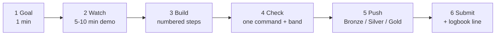
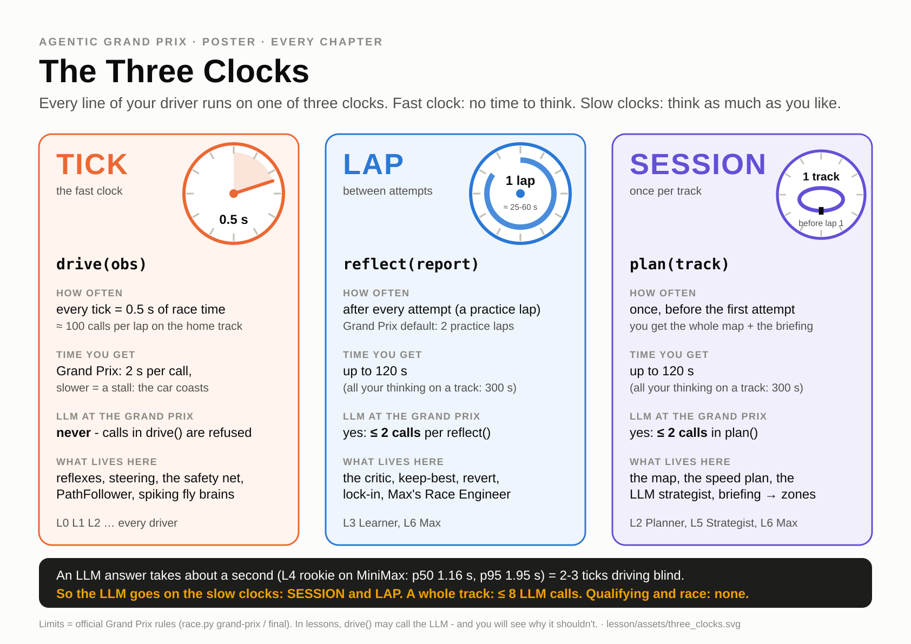

# The lesson: Agentic Grand Prix 2.0

Two days, one file, one championship. You write a single Python file, an AI driver, and grow it chapter
by chapter from reflexes to an LLM crew. On Day 2 afternoon it races everyone else's driver and **Max**,
the house LLM racer, on the home track and on a **sealed mystery track** nobody has seen.

Keep two things open all course long: the **[cheat sheet](cheatsheet.md)** (one page with every field,
formula and command) and **Race Control** (`python -m streamlit run app/race_control.py`).

**On this page:** [Learning objectives](#learning-objectives) · [Before Day 1](#before-day-1-pre-work-about-30-min) ·
[Day 1](#day-1-from-reflexes-to-plans) · [Day 2](#day-2-brains-that-think) ·
[Chapter rhythm](#the-chapter-rhythm) · [How your file grows](#how-your-one-file-grows) ·
[The Three Clocks](#the-three-clocks) · [Getting unstuck](#getting-unstuck) ·
[Competition](#the-competition-in-one-page) · [Cut list](#cut-list-instructor)

---

## Learning objectives

By the end of Day 2 you can:

1. **Write perceive → think → act** as a single-file driver against a dict API, and explain why your driver
   never sees the simulator (encapsulation and fairness).
2. **Place every part of a driver on the Three Clocks**: TICK (`drive`), LAP (`reflect`) and SESSION
   (`plan`). Justify the placement with numbers: blind distance = speed × latency.
3. **Turn four physics facts into code**: stopping distance, corner speed `v = √(20R)`, turn radius
   `R = v²/(20|s|)` (never tighter than `v / 1.5`, the yaw limit; hence speed-aware steering), and the
   0.5 s tick.
4. **Name the agent type** of any driver (simple reflex, model-based, goal-based, learning, LLM policy,
   LLM planner, tool-using multi-role, spiking) and predict how it fails.
5. **Build a map planner** (curvature → speed profile with a backward braking pass → pure pursuit) and
   evaluate it like a data scientist: validation tracks, an overfitting matrix, a held-out mystery test.
6. **Write a learning agent** with episodic memory, keep-best, revert and lock-in, and show a learning
   curve as evidence.
7. **Call MiniMax M3 robustly** with `agentic_gp.llm`: structured JSON, validate and clamp, retries,
   a mandatory code fallback, budgets and logging. Measure latency and tokens.
8. **Design a role-based agent** (Strategist LLM, Race Engineer LLM, Steward code, Driver code) with
   tools and memory, and justify it with the latency-cliff data.
9. **Build Streamlit apps**: the rerun model, widgets, layout, caching, `session_state`, fragments and
   animation, a multi-car replay, multipage navigation.
10. **Run a controlled experiment** on a connectome-derived controller (real vs scrambled wiring) and
    explain what the control shows and what it does not.
11. **Ship** a scrutineered, budget-compliant single file that still works with the LLM switched off,
    and pitch its design in 60 seconds.

---

## Before Day 1 (pre-work, about 30 min)

1. Install [uv](https://docs.astral.sh/uv/) and git. Clone the repo to a short local path (not OneDrive).
2. In the repo folder run `uv sync`. Python 3.12 is pinned, so uv fetches it for you.
3. Run `uv run race.py doctor`. You should see `[OK  ]` lines and a last line that starts with
   `ALL GREEN` or `OK with N warning(s)`. A `[WARN]` "key not set" is expected until Day 2, and a
   `[WARN]` "spaces in the path" (a user folder like `C:\Users\Ada Lovelace`) is harmless.
   Send the file `doctor_report.txt` to your instructor.
4. Read the [cheat sheet](cheatsheet.md): "+ = right", the obs fields, the Three Clocks.

No uv? The [pip route](../README.md#option-b-pip-and-a-virtual-environment) works too.

---

## Day 1: "From reflexes to plans"

| Time | Min | Block | You leave with |
|---|---|---|---|
| 08:30-09:00 | 30 | Pit desk (optional): red doctor reports get fixed | `doctor` all green |
| 09:00-09:20 | 20 | **Lights out.** The house grid races on the home track: which one is smartest? Then the same field on a twisty track. Rules, the Three Clocks, the two-race final with a sealed mystery track. | the map of the two days |
| 09:20-09:45 | 25 | [**Ch0 Pit Lane**](00_pit_lane.md) | **CP0**: your coloured car in the viewer, `check` PASSED |
| 09:45-10:50 | 65 | [**Ch1 Reflexes**](01_reflexes.md), with 8 min of Physics Lab hand-driving | **CP1 at 10:45 → Snapshot #1** |
| 10:50-11:05 | 15 | Break (Snapshot #1 on the projector) | |
| 11:05-12:30 | 85 | [**Ch2 The Map**](02_the_map.md) | **CP2 at 12:20 → Snapshot #2** (now watch the unseen-track race) |
| 12:30-13:30 | 60 | Lunch | |
| 13:30-15:30 | 120 | [**Streamlit block S01-S10**](streamlit_block.md) (5-min stretch after S05) | your own replay viewer + "My learning curve" page |
| 15:30-15:45 | 15 | Break | |
| 15:45-16:35 | 50 | [**Ch3 Practice Makes Perfect**](03_practice.md) | **CP3 at 16:30 → Snapshot #3** |
| 16:35-17:00 | 25 | **Day-1 Club Race**: code only, 1 practice + 2 laps, replayed in your own S10 viewer. Max's home time is revealed as "the number to beat". Exit ticket: "which clock does each part of your driver live on?" | the first race |

## Day 2: "Brains that think"

| Time | Min | Block | You leave with |
|---|---|---|---|
| 09:00-09:15 | 15 | Overnight board. Paste the key into `.env`, run `python race.py doctor --llm`. One budget slide. | a green LLM ping |
| 09:15-10:10 | 55 | [**Ch4 Talking to MiniMax and the latency wall**](04_minimax.md) | **CP4**: exam table + your latency p50/p95 |
| 10:10-10:25 | 15 | Break | |
| 10:25-11:35 | 70 | [**Ch5 The Strategist**](05_strategist.md) | **CP5 at 11:30 → Snapshot #4** |
| 11:35-12:35 | 60 | [**Ch6 The Crew Chief**](06_crew_chief.md) | **CP6 at 12:35: dress-rehearsal upload** |
| 12:35-13:30 | 55 | Lunch. The instructor runs the **dress rehearsal**: every CP6 file on the home track and a `random:<seed>` track, official LLM rules, timed. | |
| 13:30-13:40 | 10 | Dress-rehearsal replay: who generalised, who overfit. Snapshot #5 (vs Max). | |
| 13:40-14:30 | 50 | [**Ch7 Fly Brains**](07_fly_brains.md): toy spiking fly + FlyWire connectome | **CP7** |
| 14:30-15:15 | 45 | [**Ch8 Garage**](08_garage_gp.md): validate, LLM-off test, driver card, upload. Last LLM call by 15:10. | **Hard lock at 15:15** |
| 15:15-15:35 | 20 | Scrutineering + Home GP batch. Vote on design cards, take a break. | |
| 15:35-15:50 | 15 | **Show 1: Home GP**: grid walk with names and mottos, qualifying, 3-lap race | |
| 15:50-16:15 | 25 | **Show 2: Mystery GP**: track reveal → briefing read aloud → practice learning curves → qualifying → 3-lap race with team radio | |
| 16:15-16:35 | 20 | Championship + awards | |
| 16:35-17:00 | 25 | Retro: your anatomy cards, the class overfitting matrix, "where the LLM belonged" | feedback form |

The instructor's minute-by-minute version, with every command, is
[instructor/RUN_OF_SHOW.md](instructor/RUN_OF_SHOW.md).

---

## The chapter rhythm

Every chapter follows the same six parts, in this order, so you always know where you are:

1. **Goal**: where this chapter sits on the [ladder](assets/ladder.svg) and on the Three Clocks.
2. **Watch**: a demo replay or a Race Control page.
3. **Build**: numbered, paste-able steps. Each one ends with "you should now see ...".
4. **Check**: one command and the measured band you should land in.
5. **Push**: Bronze, Silver and Gold tiers. Bronze is enough to stay on track.
6. **Submit and logbook**: upload your file and write one line: "what this level bought, and what it cost".

Most chapters also have a Concepts section between Goal and Watch. Ch7 runs Watch and Build twice, once
for each part (A: toy fly, B: connectome), and Ch8, the hand-in, has the Grand Prix itself instead of
Push tiers. Every chapter has a **"Stuck?"** box naming its handrail file (see
[Getting unstuck](#getting-unstuck)): a numbered section in Ch0-Ch3, the last box of the chapter in
Ch4-Ch8.

---

## How your one file grows

Your file is `drivers/submissions/<handle>.py`, where `<handle>` is your handle in lower case with no
spaces (Day-1 chapters use the example handle `ada`; type yours instead). It starts as a copy of
[`drivers/template.py`](../drivers/template.py). The bands are measured on `grand_prix` under the default
marshal crash rule, by [instructor/CALIBRATION.md](instructor/CALIBRATION.md).

| After | Style | New parts | Checkpoint band | Handrail measured |
|---|---|---|---|---|
| Ch0 | function | metadata (`NAME`, `AUTHOR`, `COLOR`, `KIND`, `MOTTO`) | `check` PASSED, finishes | 85.85 s, clean |
| Ch1 | function + `PARAMS` | aim, look-through, stopping distance, `steer_towards`, walls | 60-80 s clean (Silver < 75 s, Gold < 55 s and clean on `sprint`) | 66.70 s |
| Ch2 | `class Driver` (`plan` + `drive`) | map, speed profile, pure pursuit | 48-55 s clean on every public **and** random track | 52.50 s |
| Ch3 | + `reflect` | keep-best, revert, lock-in | `--track sprint --attempts 6`: at least 3 % gain, no DNF | 41.40 → 39.40 s |
| Ch4 | `<handle>_pilot.py` (never raced) | an LLM call per tick, at most 20 ticks | exam table + p50/p95 | MiniMax p50 1.04 s, p95 1.45 s |
| Ch5 | main file | LLM plan JSON + briefing → validated, clamped, fallback | within ±5 % of your Ch3, 0 zone violations, ≤ 3 calls in `plan` (official events stop at 2) | MiniMax `briefing_demo` 61.15 s, 0 violations, 1 call |
| Ch6 | main file | Race Engineer LLM + Steward + notebook | 4 attempts on a `random:<seed>` track: clean, best within about ±0.5 s of your Ch3 car (LLM runs vary) | MiniMax `random:7` 45.05 → 43.30 s |
| Ch7 | `<handle>_fly.py` (optional) | neurons | the fly finishes a lap; scrambled wiring fails | 63.30 s |
| Ch8 | main file (final) | robustness | `check` green, clean on public tracks, finishes with the mock LLM | public mean 46.0 s |

> **The honest claim of this course.** On a track you know, clever rules get close: the Ch1 reflex tuned
> for the home track does 56.4 s, within 8 % of the Ch2 planner's 52.50 s, and a "Memorizer" with a
> hard-coded home speed table does 52.75 s. But the Memorizer crashes on 5 of the 6 other tracks
> ([overfitting matrix](assets/overfitting_matrix.png)). The agentic layers pay off on tracks **you have
> not seen**: the map planner is clean everywhere without retuning, practice laps make it faster, and
> only an LLM can read the race briefing. That is why the final has a sealed mystery track.

---

## The Three Clocks

Every line of your driver runs on one of three clocks:

| Clock | Method | How often | Time you get at the Grand Prix | LLM at the Grand Prix | What lives here |
|---|---|---|---|---|---|
| **TICK** | `drive(obs)` | every 0.5 s of race time (about 100 calls per lap) | 2 s per call; slower = a stall, the car coasts | **no** | reflexes, steering, the safety net, `PathFollower`, fly brains |
| **LAP** | `reflect(report)` | after every attempt | up to 120 s | ≤ 2 calls after each **practice** lap | the critic, keep-best, revert, lock-in, Max's Race Engineer |
| **SESSION** | `plan(track)` | once per track, before lap 1 | up to 120 s | ≤ 2 calls | the map, the speed plan, the LLM strategist, briefing → zones |

All your thinking on one track is capped at 300 s, and at most **8 LLM calls per track**.

**Why the LLM is not on the TICK clock:** an LLM answer takes about a second (the Ch4 pilot on MiniMax:
p50 1.04 s, p95 1.45 s). At 30 units/s that is 30 units driven blind, almost two track widths. The measured latency
cliff (Ch4, [figure](assets/latency_cliff.png)): the L2 planner is clean at 52.5 s with no delay,
needs 434 s with 42 crashes when every answer arrives 0.5 s late, and does not finish at 1 s or 2 s.

---

## Getting unstuck

1. **The two-minute rule.** Stuck for two minutes? Put the **red sticky note** on your screen. A TA comes
   to you. Do not sit in silence.
2. **Read the error.** `race.py check` names the line in your file and, for a misspelled key, suggests the
   right field (`did you mean 'angle_to_next_waypoint'?`).
3. **Use the handrail.** Every chapter has a catch-up file in [`checkpoints/`](checkpoints/). It is
   exactly what a student has after that chapter's steps, built on the template, and it passes
   `race.py check`. First compare it with your own file, then copy it over yours if you need to, put your
   `NAME` / `AUTHOR` / `COLOR` back, and carry on.

   | Stuck in | Handrail | Compare with |
   |---|---|---|
   | Ch0 | `ch0_pit_lane.py` | `git diff --no-index drivers/template.py lesson/checkpoints/ch0_pit_lane.py` |
   | Ch1 | `ch1_reflex.py` | `git diff --no-index drivers/template.py lesson/checkpoints/ch1_reflex.py` |
   | Ch2 | `ch2_planner.py` | `git diff --no-index lesson/checkpoints/ch1_reflex.py lesson/checkpoints/ch2_planner.py` |
   | Ch3 | `ch3_learner.py` | `git diff --no-index lesson/checkpoints/ch2_planner.py lesson/checkpoints/ch3_learner.py` |
   | Ch4 | `ch4_pilot.py` | `git diff --no-index lesson/checkpoints/ch1_reflex.py lesson/checkpoints/ch4_pilot.py` |
   | Ch5 | `ch5_strategist.py` | `git diff --no-index lesson/checkpoints/ch3_learner.py lesson/checkpoints/ch5_strategist.py` |
   | Ch6, Ch8 | `ch6_crew_chief.py` | `git diff --no-index lesson/checkpoints/ch5_strategist.py lesson/checkpoints/ch6_crew_chief.py` |
   | Ch7 | `ch7_fly_fixed.py` | `git diff --no-index drivers/examples/fly_broken.py lesson/checkpoints/ch7_fly_fixed.py` |

   Copy a handrail over your file (PowerShell and macOS alike):
   `cp lesson/checkpoints/ch2_planner.py drivers/submissions/<handle>.py`
4. **"Where am I?"** Open the **Where am I?** box in the Race Control sidebar and pick your file. It
   shows which checkpoint you have reached and the next step.
5. **No key, or the LLM is down?** Run with the mock provider. PowerShell:
   `$env:LLM_PROVIDER="mock"; python race.py drive drivers/submissions/<handle>.py`. macOS:
   `LLM_PROVIDER=mock python race.py drive drivers/submissions/<handle>.py`.
6. **Setup trouble?** `python race.py doctor` says what is wrong. Typical fixes: activate the venv
   (`.venv\Scripts\activate` or `source .venv/bin/activate`), clone outside OneDrive, close old Streamlit
   apps with Ctrl+C. Streamlit errors are covered in
   [streamlit_lessons/README.md](../streamlit_lessons/README.md#common-errors-and-fixes).

---

## The competition in one page

**Your file** (`drivers/submissions/<handle>.py`, the full rules are in
[drivers/submissions/README.md](../drivers/submissions/README.md)):

- One `.py` file, at most 100 KB. `NAME` at most 16 characters (pseudonyms welcome), `AUTHOR` = your
  handle, `COLOR`, `KIND` = `"code"`, `"llm"` or `"fly"`. Optional: `MOTTO`, `PARAMS`, `ANATOMY`.
- Imports: the standard library, `numpy`, `agentic_gp.driverkit`, `agentic_gp.llm`, `agentic_gp.fly`
  (and `langgraph` / `langchain_*` for a crew). No simulator imports, no `openai` or `requests`, no file
  I/O, never the API key. `race.py check` enforces this.
- `drive()` must answer within 2 s; a late answer is a stall and the car coasts (10 in a row or 30 in
  total = DNF). An exception or a NaN also means coast for that tick.
- Each session starts with fresh memory: only what is in your file persists.
- AI coding assistants are allowed. Design awards need a 60-second pit interview.

**Events**

| Event | Format |
|---|---|
| Snapshots #1-#4 (CP1, CP2, CP3, CP5) | the instructor races everyone's latest upload on the home track, plus a second race of the same field on the unseen track `random:101` (from Snapshot #1; the same seed every time, so the unseen-track results are comparable). This is a single race, not the `race.py validate` score you compute yourself |
| Snapshot #5 (CP6) | the Day-2 lunch dress rehearsal: every CP6 file, home track + a stand-in mystery `random:<seed>`, official LLM rules |
| Day-1 Club Race | code only, 1 practice + 2 laps, home track |
| **Home GP** (Day 2) | `plan` → 2 practice laps (`reflect`) → qualifying lap (grid, pole) → 3-lap race |
| **Mystery GP** (Day 2) | `plan(track + briefing)` → 3 practice laps → qualifying → 3-lap race, on a sealed track |
| Fly Cup | 2 laps on the home track, as the warm-up during the Home GP grid walk |

**Scoring**

- Race time = sim time + 5 s per crash + 1 s per tick too fast in a yellow-flag zone. Ties go to fewer
  crashes; DNFs are ranked by progress.
- Championship: N + 1 − position points per race; a DNF that passed at least 8 gates scores 1. The
  Mystery GP breaks ties. House cars (Max, Planner, Fly Toy) race but score no points.
- **LLM budget at official events:** calls only in `plan()` (≤ 2) and in `reflect()` after a practice lap
  (≤ 2 each), **≤ 8 per track**. In `drive()`, qualifying and the race the library raises `LLMNotAllowed`:
  catch `llm.LLMError` and fall back to code. Every prompt and answer is logged.
- **Classes:** Open; LLM class (`KIND="llm"`, and the logs show a validated LLM answer that changed the
  plan); Fly class (controls come from neuron activity only).
- **Awards** include Champion, Home and Mystery GP winners, Pole, Beat the House (everyone ahead of Max),
  Best Learner, Cleanest Driver, Most Efficient (≤ 3 LLM calls), Best Fly Brain, Best Agent Design and
  Best Radio. The full list and how each is computed: [instructor/awards.md](instructor/awards.md).

**Max**, the house racer (#0, black and gold), is
[`drivers/examples/l6_llm_crew_chief.py`](../drivers/examples/l6_llm_crew_chief.py). Same rules, same
budget, code public in Ch6. With real MiniMax it qualified at 44.65 s on `grand_prix` in the
[drivers/README.md](../drivers/README.md) run (44.90 s in [CALIBRATION.md](instructor/CALIBRATION.md):
LLM runs vary by a second or so), and a hand-tuned fixed script beat it on 5 of 6 tracks: Max is
beatable.

---

## Cut list (instructor)

When the class is more than 15 minutes behind, cut in this order:

1. S09 Track Lab becomes homework.
2. Ch2 Gold (racing line) becomes homework.
3. Ch4 Silver is dropped.
4. The Ch6 LangGraph variant (`l6b_pit_crew_langgraph.py`) becomes reading only.
5. The Ch7 connectome becomes an instructor demo (keep the scrambled control).
6. Unity is skipped; the Streamlit Replay page and the HTML player show the races.
7. The Day-1 Club Race drops to 1 lap.

---

## All lesson files

| File | What it is |
|---|---|
| [00_pit_lane.md](00_pit_lane.md) ... [08_garage_gp.md](08_garage_gp.md), [streamlit_block.md](streamlit_block.md) | the chapters |
| [cheatsheet.md](cheatsheet.md) | one printable page |
| [checkpoints/](checkpoints/) | handrail driver files, one per chapter |
| [assets/](assets/) | posters (`*.svg`, print at A2) and measured figures (`*.png`); rebuild with `python lesson/make_figures.py` |
| [instructor/](instructor/) | run of show, guide, calibration, awards, grading |
