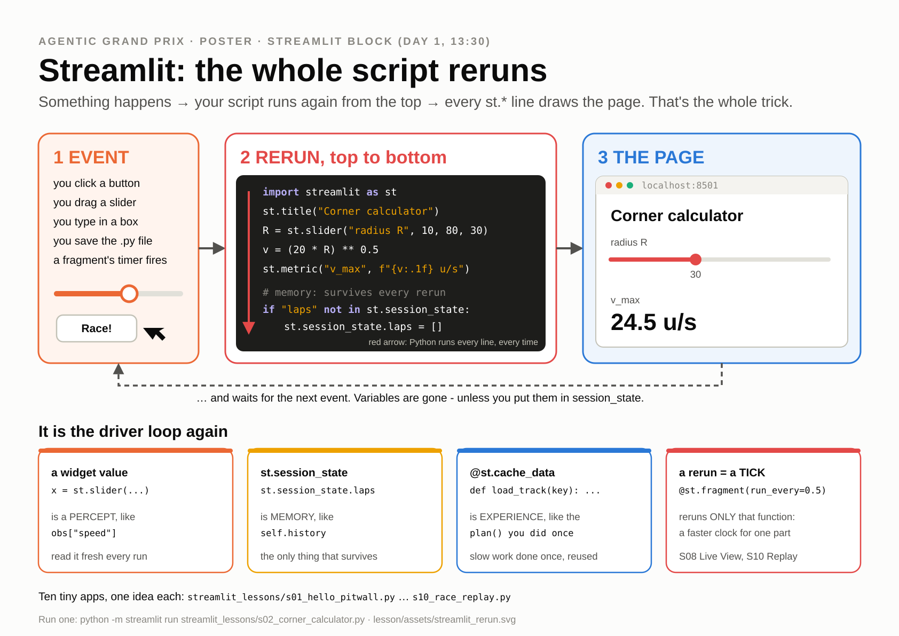

# The Streamlit block: build your own Race Control

**Day 1, 13:30-15:30 (120 min, with a 5-min stretch after S05).** Ten tiny apps, one new Streamlit idea
each. You start with a title and four numbers. Two hours later you **own a multi-car race replay
viewer** and a **"My learning curve" page**. You use the curve page in [Ch3](03_practice.md) at 16:00
and the viewer in the Day-1 Club Race at 16:35.

| | |
|---|---|
| **Where the files are** | [`streamlit_lessons/`](../streamlit_lessons/): `s01_hello_pitwall.py` ... `s10_race_replay.py`, solutions in [`streamlit_lessons/solutions/`](../streamlit_lessons/solutions/) |
| **Full step-by-step guide** | [`streamlit_lessons/README.md`](../streamlit_lessons/README.md), Part B (what to type, what you should see, hints, common errors) |
| **You leave with** | S10 running, with your own **"My learning curve"** page in its menu |
| **Your driver file** | not needed: every lesson reads demo data from `races/demo/` through `streamlit_lessons/_data.py`, so nothing here depends on your driver working |
| **LLM budget** | none: the lessons use the offline mock LLM and list code drivers only |

---

## 1. Why Streamlit?

You have used **Race Control** (`app/race_control.py`) since 09:20: the Replay page, the Physics Lab, the
Sensor X-ray, Live. Every page of it is a plain Python script. No HTML, no JavaScript, no web
framework, no callbacks to wire up: you write top-to-bottom Python with pandas and Plotly, and
Streamlit turns it into a web page.

That is why data scientists like it. The step from "a notebook cell that makes a chart" to "a page my
team can click through" is one command: `python -m streamlit run my_page.py`. This afternoon you take
that step ten times, and you finish with a tool you need tonight: something that shows a race, and
something that shows whether your driver is learning.

## 2. The one idea behind everything: the rerun loop

[](assets/streamlit_rerun.svg)

**Every time anything happens** (you move a slider, click a button, save the file), Streamlit runs your
**whole script again, from the top**. Each `st.*` call on the way draws a piece of the page. Then it
waits for the next event.

It is the same loop as the driver you wrote this morning:

| Streamlit | Your driver |
|---|---|
| a rerun | a **tick** |
| a widget value (`st.slider(...)` returns a number) | a **percept**: `obs["speed"]` |
| `st.session_state` (survives reruns) | **memory**: `self.history` |
| `@st.cache_data` (do the slow work once) | **experience**: the plan you computed in `plan()` |
| `@st.fragment(run_every=...)` (reruns only itself) | **a faster clock** inside the page |

Keep this table in mind: every lesson below is one row of it.

## 3. How every step works

1. Open a terminal in the repo root and activate the venv (`.venv\Scripts\activate` on Windows,
   `source .venv/bin/activate` on macOS). Check the version once:

   ```
   python -m streamlit version
   ```

   You should now see `Streamlit, version 1.66` or newer. (uv users without an active venv:
   `uv run streamlit run ...` as in the main README, or `uv run --no-sync streamlit run ...`, which
   skips the lock-file check and never touches the class Wi-Fi.)

2. Open the lesson file in your editor and read its docstring: **Concept**, **Run**, **You should
   see**, **Exercise**. Every file is at most 40 lines (S10: 90) and has exactly one
   `# TODO(exercise)`.
3. Start it from the repo root, for example:

   ```
   python -m streamlit run streamlit_lessons/s01_hello_pitwall.py
   ```

   The browser opens at http://localhost:8501 (open it yourself if it doesn't).
4. Do the exercise. **Save the file and watch the browser**: the page updates by itself, because the
   repo's `.streamlit/config.toml` sets `runOnSave = true`.
5. **Ctrl+C** in the terminal before you start the next lesson (one app, one port).
6. Stuck for 2 minutes? Open `streamlit_lessons/solutions/<same file name>`, or see only the exercise
   lines with
   `git diff --no-index streamlit_lessons/s04_telemetry.py streamlit_lessons/solutions/s04_telemetry.py`
   (use your lesson's name). Then red sticky note.

To start a lesson file over: `git checkout -- streamlit_lessons/s04_telemetry.py`.

## 4. The ten steps

Times are the run sheet's. Each row links the lesson file and its solution; the README's Part B has the
full "you should see" and a hint for every exercise.

| Clock | # | File (solution) | Min | Streamlit idea | Racing content | Exercise |
|---|---|---|---|---|---|---|
| 13:30 | – | opener | 5 | the rerun loop | the poster above; live-code `st.write("hi")` and save | – |
| 13:35 | S01 | [`s01_hello_pitwall.py`](../streamlit_lessons/s01_hello_pitwall.py) ([sol.](../streamlit_lessons/solutions/s01_hello_pitwall.py)) | 6 | `streamlit run`, rerun, `st.title` / `st.markdown` / `st.metric`, magic | lap tiles for L0, L1, L2, Max; the real `obs` dict your driver gets | your best lap as a 5th tile, with the gap to Max as `delta` (`delta_color="inverse"`) |
| 13:41 | S02 | [`s02_corner_calculator.py`](../streamlit_lessons/s02_corner_calculator.py) ([sol.](../streamlit_lessons/solutions/s02_corner_calculator.py)) | 9 | `slider`, `number_input`, `radio`: every change reruns | R → `√(20R)`; speed → braking `v²/50` + blind `0.5 v`; steering → your turning circle | "Can I make it?" from speed + front distance → `st.success` / `st.error` |
| 13:50 | S03 | [`s03_track_map.py`](../streamlit_lessons/s03_track_map.py) ([sol.](../streamlit_lessons/solutions/s03_track_map.py)) | 12 | `st.plotly_chart`, `@st.cache_data`, `selectbox` | walls, gates, T1 ... T10, centreline coloured by v_max | layer checkboxes; why the layers must be arguments of the cached function |
| 14:02 | S04 | [`s04_telemetry.py`](../streamlit_lessons/s04_telemetry.py) ([sol.](../streamlit_lessons/solutions/s04_telemetry.py)) | 12 | pandas, `st.dataframe`, `line_chart`, `bar_chart`, `download_button` | a practice day: speed / throttle / steering vs time; time per segment | the crash ticks of a run; a "time lost vs best run" column |
| 14:14 | S05 | [`s05_driver_card.py`](../streamlit_lessons/s05_driver_card.py) ([sol.](../streamlit_lessons/solutions/s05_driver_card.py)) | 10 | `sidebar`, `columns`, `tabs`, `expander` | a driver card: the lap coloured by speed; Speed / Controls / Radio tabs; the raw report `reflect()` gets | a Crashes tab (table + red markers on the map) |
| 14:24 | – | stretch | 5 | | stand up, water, Ctrl+C old apps | |
| 14:29 | S06 | [`s06_run_my_driver.py`](../streamlit_lessons/s06_run_my_driver.py) ([sol.](../streamlit_lessons/solutions/s06_run_my_driver.py)) | 12 | `button` (True for ONE rerun), `st.status`, cache keyed on (file time, track, params), `st.toast` | pick **your** `drivers/submissions/*.py`; **one slider per `PARAMS` knob**; 2 attempts as ghost cars | compare mode: keep the previous run, show both, metric with Δ time |
| 14:41 | S07 | [`s07_be_the_driver.py`](../streamlit_lessons/s07_be_the_driver.py) ([sol.](../streamlit_lessons/solutions/s07_be_the_driver.py)) | 12 | `st.session_state` holds a live `RaceEnv`; `on_click` callbacks; `st.rerun` | **hand-drive**: one click = one 0.5 s tick, rays and HUD (the Physics Lab's Hand-Drive is built the same way) | an Autopilot toggle that asks a driver file; an Undo stack |
| 14:53 | S08 | [`s08_live_view.py`](../streamlit_lessons/s08_live_view.py) ([sol.](../streamlit_lessons/solutions/s08_live_view.py)) | 14 | `@st.fragment(run_every=0.15)`, `st.progress`; compute first, animate second | **live view**: rays coloured by distance, the pink `debug` target point, gauges, radio, single-step | playback speed; a realtime toggle with a command-age gauge (a preview of Ch4) |
| 15:07 | S09 | [`s09_track_lab.py`](../streamlit_lessons/s09_track_lab.py) ([sol.](../streamlit_lessons/solutions/s09_track_lab.py)) | 5 (demo) | `st.data_editor`, `st.form`, `plotly on_select="rerun"` | edit control points → validity checks → v_max map → "race here" | homework: design a track that breaks your neighbour's driver |
| 15:12 | S10 | [`s10_race_replay.py`](../streamlit_lessons/s10_race_replay.py) ([sol.](../streamlit_lessons/solutions/s10_race_replay.py)) | 18 | multipage `st.navigation` / `st.Page`; a big JSON loaded once with `cache_data`; a time-scrubber; interpolation | **the multi-car replay** of `races/demo/class_demo.json`: cars on the map, timing tower, radio, follow-car zoom; the shared "Pro player" canvas | **the "My learning curve" page** (section 5) |
| 15:30 | | end | | | everyone has S10 open | |

S09 is the first thing to cut when the room is behind: the instructor demos it in 5 minutes and you do
it as homework. S07, S08 and S10 are never cut: they pay off in the afternoon.

**What you should see in the big three:**

- **S07:** five buttons (Left, Gas, Coast, Brake, Right), your red car on `sprint` in a chase camera.
  Brake into T1 from 30 u/s and count the clicks. That is why your driver must look ahead.
- **S08:** the planner lapping `sprint`; 7 rays (red closer than 10, amber closer than 25, green beyond);
  a progress bar "tick n of 82". Untick **Play** and press **Step one tick**. Pick your own driver in
  the box: you are watching *your* `drive()` think.
- **S10:** a sidebar menu: "Race replay", then S01 to S09, now pages of **one** app. "Race replay" loads
  the class demo race (8 cars, 2 laps of the Grand Prix circuit). **My viewer** is the part you own: a
  race-clock slider, the cars on the map, a timing tower and a radio feed; tick **Play**, pick a car in
  **Follow**. **Pro player** is the shared 60 fps canvas (Space = play/pause, 1-9 = follow a position).
  If the demo race was made with the offline mock LLM, the LLM cars drive exactly like Racing Line and
  show +0.00 in the tower: that is expected.

How your viewer works: a replay stores every car's position every 0.5 s. `car_state_at(car, t)`
interpolates any car at any time `t`, and `standings_at(replay, t)` sorts the cars by race progress.
That is the whole multi-car viewer, in about 30 lines. The Race Control Replay page, the HTML player and
the Unity 3D viewer all read the same replay JSON.

## 5. The goal: your "My learning curve" page

The S10 exercise, and the page you use in Ch3. Above the `pages = ...` line of
`streamlit_lessons/s10_race_replay.py`, write a function `my_learning_curve()`:

1. `st.title("My learning curve")`.
2. `files = _data.result_files()`: the `results/*.json` files written by
   `python race.py drive drivers/submissions/ada.py --track sprint --attempts 6 --save` (Ch3, step 3).
   Until you have your own, it lists the reference results already in `results/` (the example
   drivers on `grand_prix`; on a clone without any, the demo learner session), so the page works
   right now.
3. An `st.multiselect` of the files, then load them with `_data.load_json(...)`.
4. `st.plotly_chart(pf.learning_curve_figure(results), theme=None)`.
5. A metric "gain vs attempt 1 in %". **CP3 asks for at least 3 % and no DNF**: show an `st.success`
   when a curve makes it. The lap times are in each result's `attempts` list, one dict per attempt:

   ```python
   times = [a["race_time"] if a["completed"] else None for a in res["attempts"]]   # None = DNF
   ```

Then add `st.Page(my_learning_curve, title="My learning curve")` to the `"My app"` list (the
`# TODO(exercise)` line shows where).

```
python -m streamlit run streamlit_lessons/s10_race_replay.py
```

You should now see **My learning curve** in the sidebar menu, under "Race replay", showing the curve of
one of the reference result files. At 16:00, after Ch3 step 3, refresh it, pick
`results/ada_sprint.json` (newest files come first; the name comes from your car's `NAME`, so look for
the file the `Result saved:` line printed), and it shows your own curve: a gain of about 4.8 %
on `sprint` (the Ch3 handrail's number) and the green CP3 box.

The complete page is in [`solutions/s10_race_replay.py`](../streamlit_lessons/solutions/s10_race_replay.py)
(`my_learning_curve()`), if you need it.

## 6. How it plugs into the rest of the day

| When | What | Your page |
|---|---|---|
| **Ch3** (15:45-16:35) | you practise 6 attempts with `--save` | **My learning curve**: the CP3 evidence (≥ 3 %, no DNF) |
| **Day-1 Club Race** (16:35) | the instructor races every CP3 file plus the house cars (1 practice lap, qualifying, a 2-lap race) and shares `races/club/club_race.json` | save it anywhere under your own `races/` folder, refresh S10, and pick it in **Replay file**: the Club Race in **your** viewer. Follow your car; find where you lost time to Max |
| **Day 2** | LLM pilots, strategists, crew chiefs | S08's realtime gauge is Ch4's latency wall; S06 runs any driver file with sliders for its `PARAMS` |
| **Grading** | "one screenshot race-engineer report from your own viewer" | a screenshot of S10 or of your curve page |

Race Control (`python -m streamlit run app/race_control.py`) is built from the same parts you used
today: the canvases and Plotly figures are shared (`app/components/`, `agentic_gp.viz.plotly_figs`),
so any page there is now readable for you. The component API is in
[`app/components/README.md`](../app/components/README.md).

## 7. Stuck?

> **Stuck for 2 minutes? Red sticky note up.** Every lesson has a runnable solution with the same name in
> [`streamlit_lessons/solutions/`](../streamlit_lessons/solutions/); a solution is the lesson plus only
> the exercise lines (marked `# SOLUTION`):
>
> ```
> python -m streamlit run streamlit_lessons/solutions/s10_race_replay.py
> ```

The five errors you are most likely to meet (the full table is in the
[README's "Common errors and fixes"](../streamlit_lessons/README.md#common-errors-and-fixes)):

| You see | Fix |
|---|---|
| `No module named streamlit` / `'streamlit' is not recognized` | Activate the venv, then `python -m streamlit run ...` |
| `Port 8501 is already in use` | Ctrl+C the old app in its terminal, or add `--server.port 8502` |
| Saving the file does not update the page | You did not start from the repo root: Ctrl+C, `cd` to the repo root, run again (or press **R** in the page) |
| `ModuleNotFoundError: No module named 'agentic_gp'` | Keep `import _data` above the `agentic_gp` / `app` imports |
| My button's result disappears on the next click | A button is True for one rerun only: store the result in `st.session_state` (S06) |

## 8. Logbook

*"Streamlit reruns my whole script on every event, just like my driver gets `drive()` on every tick.
The idea I will reuse most is ___, because ___."*

Next: [Ch3 Practice Makes Perfect](03_practice.md).
